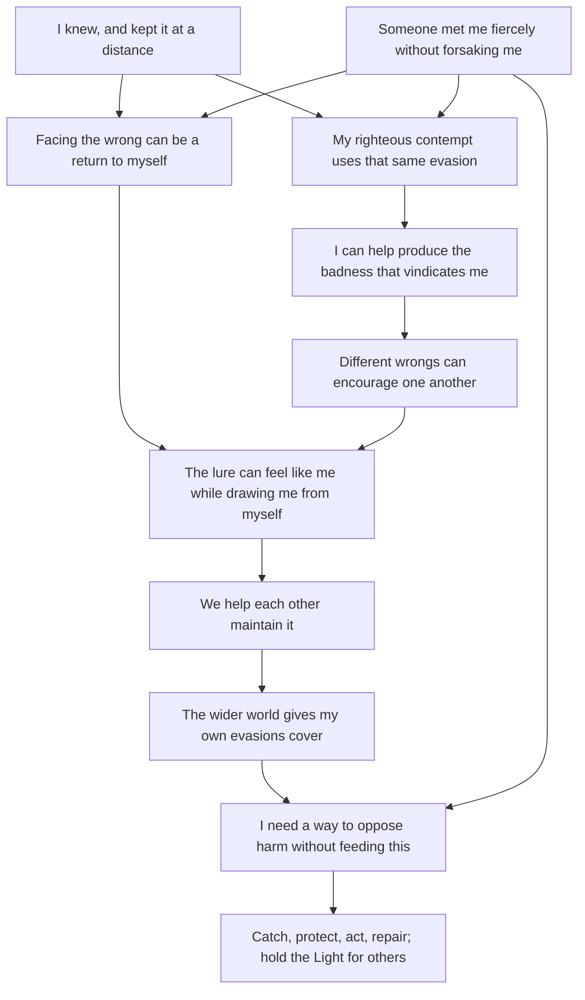
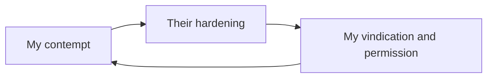
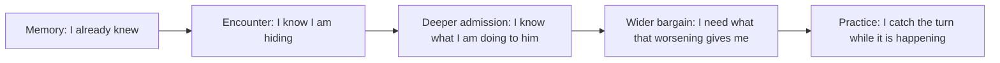

# Archived working notes

Consolidated November 2, 2026. Historical drafts of the architecture and turn-by-turn assessments follow in chronological order. They are preserved for recovery, not maintained as competing current plans. The current plan is in argument.md.

---

## 01-first-architecture

# First architecture: before reading the argument, audit, engine, or Chapter 1

Date: November 1, 2026.

This preserves ChatGPT's initial response, based only on `scratch/key-points/index.md` and the user's opening message. The existing architecture references and tier distinctions in that index informed this response; this was not an independent rediscovery of those distinctions. The proposed ordering below had not yet been tested against the completed Chapter 1.

---

I’ve read the whole key-points index, and nothing else.

My strongest initial conclusion is that **the book needs to bring the reader through two discoveries together**:

- The mechanism behind the behavior I most abhor is recognizable in my own mind—including in my response to that behavior.
- Seeing this clearly can reveal our underlying goodness, and make it possible to face more of what we’ve done.

The second discovery is essential. Without it, the first can become another reason to hate ourselves, hide, and find someone worse. The book would have reproduced its subject.

The passage about the medicine holding you in unconditional Love while revealing your darkness strikes me as an instruction for writing the *entire book*. The reader needs to feel that you will keep looking honestly at them and will never write them off. That has to be present long before you explain it.

There is already considerable architecture embedded in the index: its order, the chapter references, the governing cartoon, the proposed crescendo. I’ve treated those as previous decisions to reconsider. Here is the structure I would try.

The first part, **Something in me knew**, establishes a common experience the reader can examine.

1. **I already knew**

   Begin with an ordinary instance of your own self-deception: something you wanted, a justification that worked, and knowledge you were stepping around. Choose an incident small enough that the reader can stay with it and specific enough that they cannot dissolve it into “humans are imperfect.”

   Establish limbo through the experience of finally admitting something: *this feels like acknowledging what I knew, rather than discovering something new*. Include the pleasure of getting away with it—especially getting away with it in your own eyes.

   The reader’s first discovery is: **I recognize this state.**

2. **The person who would not write me off**

   Introduce the contrast between contemptuous correction and correction with integrity. The index’s two strangers could serve this purpose, although I haven’t read their actual scene.

   Let the reader feel how someone could confront them fiercely, recognize that they knew better, and remain wholly concerned with their welfare. This establishes the book’s emotional ground: there is a way to acknowledge wrongdoing without making the wrongdoer into something irredeemable.

   Conscience becomes more intelligible here. The correction reaches something that was already there.

   The reader discovers: **I can face what I did while remaining someone worth reaching.**

3. **What I add when I condemn**

   Turn toward contempt. Start with a case where the harm is real and opposition is necessary. Look closely at the extra thing we sometimes add: the pleasure in diminishing someone, the verdict about what they are, the willingness to stop hearing them.

   Then widen to the person struggling at the ticket machine, the opponent whose words we deliberately read uncharitably, and the humiliation we enjoy watching. This prevents readers from locating the whole problem in exceptional confrontations.

   Seed the tell through an encounter the reader recognizes. Give them the experience before explaining its recursion.

   The reader discovers: **Some of what I call fighting harm has another purpose.**

The second part, **What I could not bear to see**, contains the book’s central turn.

4. **Why I need you to stay wrong**

   This is where the book becomes deeply uncomfortable.

   Introduce the possibility that I want my enemy to dig in. Their deterioration vindicates me; their recovery might deprive me of something. Use the strongest tests in the index: would I feel relieved or robbed if the harm stopped without punishment? Would I still want my ideology if it offered no permission for contempt?

   Let the reader find a particular instance of this wanting. Stay close to it instead of immediately announcing a universal theory.

   The discovery is: **Part of me has an investment in the evil I oppose.**

5. **The fear beneath the hiding**

   Follow the reader’s likely response: *What does that make me?*

   Explore how the fear of being fundamentally bad makes honest examination feel dangerous. Self-contempt belongs here as a living instance of the same mechanism. I pronounce a verdict on myself, become less able to look, and need more defenses.

   This chapter must be especially compassionate and especially exact. Keep responsibility visible while exposing the further harm done by turning wrongdoing into an identity.

   The discovery is: **The verdict that seems to demand honesty can help keep me dishonest.**

6. **What was there all along**

   Here I would place the full encounter with the Light.

   Return to your experience of being shown your behavior while held in Love. Describe what became apparent as the hiding lifted: the care was already there; the behavior had required turning from it; acknowledging the harm felt like returning.

   This is where “compassion is the nature of mind” receives its central treatment. Give the reader both your strongest account and room to examine what they have actually found in themselves. The claim should be explicit, with its experiential basis visible.

   The discovery is: **What I was afraid to face is not what I most fundamentally am.**

7. **How someone becomes “evil”**

   Now return to the person the reader originally hated.

   Your account of being shown the progression into confusion belongs here: the small departures, accumulated defenses, the counterfeit becoming familiar, the people who grow more contemptuous as someone becomes more lost, and those few who continue to hold the line.

   This is where the forum quotation’s recognition can acquire its full force. The reader has encountered the mechanism, their investment in it, and the possibility of returning. They have something substantial from which to understand another person’s capture.

   Hold differences in harm, power, and responsibility clearly. Shared mechanism does not make our histories or obligations interchangeable.

   The discovery is: **I can understand something of their condition without minimizing what they did.**

This is the book’s emotional center. I would want the reader to reach it around the middle. Everything that follows draws consequences from it.

The third part, **What we are making together**, unfolds the wider mechanism.

8. **It speaks in my voice**

   Introduce the parasite as a name for the pattern the reader has already watched operating: defending itself, recruiting our intelligence, concealing itself through apparent righteousness, and making examination feel threatening.

   The corrected angel-and-devil cartoon can work well here. Each correction should clarify something already encountered.

   Be precise about agency and responsibility: this operates through my faculties, and I answer for what I do. Its apparent foreignness describes the discovery that I had mistaken it for my deepest commitments.

   The discovery is: **Something I experience as defending me is helping preserve my captivity.**

9. **Our darkness is collaborating**

   Bring the tell, the wanting, and the parasite together.

   My contempt supplies your defenses with evidence; your response supplies mine. We can sincerely experience ourselves as enemies while our patterns help each other survive. Return to an earlier encounter and reveal more of what was happening in it.

   This is the place for the secret handshake and for “darkness perpetuates itself by pretending to fight itself.” By now those sentences can name a recognizable transaction.

   Introduce the Devil as your way of understanding the larger unity of this behavior, with the distinction between its behavior and its substance clearly stated.

   The discovery is: **Our conflict can strengthen the thing holding both of us.**

10. **The world built from small exceptions**

    Widen from encounters to families, workplaces, institutions, and public culture.

    Put self-serving agendas here: the nominally helpful project whose hidden purpose shapes its decisions; the compromises people carry into work; the contempt audiences reward; the small evasions that become an organization’s normal operation.

    Keep returning to your own participation. The reader should feel the continuity between familiar behavior and large consequences, while still seeing the particular responsibilities of people with greater power.

    The discovery is: **The atmosphere I contribute to becomes part of what other people have to live and act within.**

11. **Being able to prove I am doing good**

    Now give the critique of calculation, ideology, rules, and metrics its fullest treatment.

    The reader has seen why a person might need a convincing account of their goodness. They can now examine the possibility of using a moral framework to escape the very attention that gave it value.

    Preserve the strong distinction in the index: care needs reasoning to work out what to do. Reasoning also needs an orientation that remains answerable to the lives affected. Show what happens when an impressive calculation grants permission to stop looking.

    Apply this to the book itself. Its language can also become a credential, a rule, or a reason to feel superior.

    The discovery is: **My account of goodness can become another means of avoiding responsibility.**

12. **Treating the world as stuff**

    Extend the inquiry beyond human relationships.

    Begin with concrete recognition: the ancient tree destroyed for amusement, a place reduced entirely to its saleable parts. Follow the experience of something living or precious becoming merely available for use.

    This opens naturally into your larger account of our inseparability from the world and the impossibility of ultimately profiting by its degradation. Give the lived recognition enough space before expanding into the metaphysics.

    This chapter should change the reader’s relationship with what surrounds them. An argument about worldviews alone would leave the central work unfinished.

    The discovery is: **The turning away reaches into my whole way of inhabiting reality.**

The final part, **Living from what I have seen**, makes the recognition answerable to ordinary life.

13. **Fighting without forsaking**

    Give sustained attention to protection, confrontation, restraint, removal from power, and consequences.

    The reader now needs to understand what opposing harm can require while keeping the wrongdoer’s humanity in view. Return to the fierce corrector with everything the book has uncovered.

    “Compassion is not wisdom” is central here. Care does not confer expertise, guarantee someone’s reform, or make a dangerous person trustworthy. Effective action still requires judgment, knowledge, and sometimes help.

    The discovery is: **I can oppose someone fully while remaining concerned with what happens to them.**

14. **Learning to turn back**

    Bring the task within reach.

    Work with catching the wanting, recognizing an evasive explanation, noticing enjoyment of humiliation, admitting a specific harm, repairing what can be repaired, and accepting correction.

    Include the desire to become someone who has finally transcended contempt. Readers of this book will have acquired a new vocabulary with which to rank people. You should appear here as someone who continues to catch himself.

    Responsibility becomes practical: what can I acknowledge and change now? Keep the focus on particular acts and relationships.

    The discovery is: **I can return, and returning asks something concrete of me.**

15. **Nothing is lost**

    Bring the book’s widest promise to full expression: the significance of private integrity.

    Earlier chapters will have shown ordinary routes by which our inner commitments enter the world. Here you can state the further thing you believe you saw: that the reach of an act exceeds what we can trace, and that unseen fidelity can sustain lives we will never know.

    Let the strength and status of that claim remain clear. Its place here gives it emotional meaning; the preceding chapters should not be presented as having logically proved it.

    Then return to something small—perhaps the kind of moment that opened the book. Someone is present, an evasion is available, and this time you remain with what you know.

    The discovery is: **This moment matters, even without recognition or reward.**

A few editorial judgments follow from that structure.

**The Light has to be present from the beginning.** Chapter 6 gives it sustained treatment, but Chapter 2 lets the reader experience its possibility. Your voice should carry it throughout. Otherwise the early chapters may make readers too frightened of what you’re showing them to keep looking.

**Contempt is the clearest place to encounter the mechanism.** It gives the book something intimate and inspectable through which to approach the larger claims about evil, goodness, and reality. This lets the book’s scope grow from a discovery the reader has participated in.

**The tell needs a concrete encounter before its full explanation.** The index contains some intricate material about mutual knowing, deniability, and self-reference. I would keep the encounter central and put the detailed formal account in an appendix. The reader should be able to recognize what happened without mastering the apparatus.

There are also two issues I would settle before drafting heavily.

First, the index contains both “the choice is real” while both pulls are felt and “you cannot choose to turn away” while still seeing. Those may describe different degrees of awareness or different senses of choosing. The distinction needs to become exact. It affects the entire treatment of innocence and responsibility.

Second, I would maintain a clear distinction throughout between **what the reader can catch in themselves, what you infer from that, and what you directly experienced and believe about reality**. All three belong. Keeping their relationship clear lets you make the strongest claims openly while preserving the reader’s freedom to examine them. Doubt must remain something the book can engage honestly.

The passage I would keep closest while writing is your account of the few people who would stop your misbehavior and still refuse to forsake you. It contains the book’s destination, its method, and the reason someone might dare to keep reading.

---

## 02-tiers-and-chapter-1

# Tiers and the completed Chapter 1

Date: November 1, 2026.

Read for this assessment:

- `scratch/key-points/index.md` (previous turn)
- `llms/claude-2026-08/argument.md`
- `llms/claude-2026-08/audit.md`
- `llms/claude-2026-08/engine.md`
- `llms/claude-2026-08/full-book/chapter-1.md`

The existing manuscript is unchanged. This assessment supersedes the first proposal's recommendation to distribute Chapter 1's discoveries across the opening seven chapters.

## Where my distinction came from

I did not discover the three tiers independently. I had not read the argument, audit, or engine when I proposed the outline, but the key-points index explicitly refers to Tier I, II, and III and says: “Three piles: what you saw, what I make of it, what I'm asking you to hold.” It also explicitly grades the three distances of an action's reach. My formulation drew on those passages. Agreement here should not be counted as another independent confirmation of the architecture.

My earlier shorthand also needs correction. “What you experienced / what you infer / what you directly experienced and believe about reality” makes the third category overlap the first. The real distinction is what grounds a claim for the reader. Something experienced directly by the author remains testimony to another person; the reader may find their own recognition through it, but the report does not itself give them that recognition.

## What distinguishes the tiers

The tiers distinguish the warrant and scope of claims, rather than three consecutive portions of the book or three degrees of truth.

| Tier | What the reader is being asked to do | Example |
|---|---|---|
| I: recognition | Examine a particular state or act in their own experience. | “I knew this was wrong while manufacturing reasons not to acknowledge it.” |
| II: explanation and extension | Consider an account of why these recognitions fit together, what the interaction requires, or how the pattern travels across cases. | “My contempt can provoke a response that I then use as evidence for my original verdict.” |
| III: the ultimate account | Consider the author's account of the nature of awareness and reality. | “The care we turn from is our common nature; the Light is undivided; even an unwitnessed act with no ordinary route of transmission matters to the Whole.” |

Each tier can be stated with conviction. The distinction concerns what supports that conviction and what the reader has grounds to accept. A first-person observation can still be mistaken; an inference can be powerful; the author's metaphysical account can describe something experienced as directly as anything else.

The same subject appears at all three levels. The experience of returning to care is available to inspection. The account that harmful contempt requires suppressing care is an explanatory claim. The claim that compassion is the nature of every awareness goes further. Calling all three “the Light” does not make their evidential positions identical.

## How to maintain the distinction

### Mark a change in warrant where it happens

The reader should know whether a paragraph is inviting inspection, drawing an inference, or reporting the author's experience and interpretation.

Useful verbs and transitions include “remember,” “see whether,” “what I caught was,” “this suggests,” “my explanation is,” and “what I came to believe.” They should occur where the basis changes, rather than at the beginning of every sentence. An explanation can then proceed in an assured voice within its stated scope.

A general disclaimer at the beginning helps, but cannot carry every later transition. “I'll earn this later” and “this is my ultimate account, which the practical argument does not require” make different promises.

### Watch changes in subject, scope, and modality

The most consequential crossings often happen in ordinary words:

- “I found” becomes “you will find.”
- “In this encounter” becomes “contempt always.”
- “This could explain it” becomes “it couldn't work unless.”
- “I recognized care in him” becomes “awareness is care.”
- “These patterns reinforce each other” becomes “they are one thing.”

These moves can be legitimate. They need their own support or an explicit statement of their status. A check that establishes one local instance does not by itself establish necessity or universality.

### Let the reader retain a recognition without accepting its fullest interpretation

A reader should be able to recognize their enjoyment of humiliation, see why they wanted the other person to react badly, and stop making that contribution without first accepting undivided awareness.

The ultimate account can illuminate these findings and deepen their significance. If it is used as a premise required to establish them, the promise that they stand without it has changed.

This is also why testimony does not require a separate fourth tier. Reporting what happened is one thing; the reach of what that experience establishes is another. An account of a trip can offer a local observation, an explanation of behavior, and a universal metaphysical interpretation. Those need not arrive with the same warrant for the reader.

### Keep a small private claim ledger

For each major claim, record:

| Claim | Available support | Scope | Dependencies | Status in the manuscript |
|---|---|---|---|---|
| I half-knew and deflected. | A specific recall or present observation. | This instance in me. | None of the metaphysics. | Offered for inspection. |
| My contempt helped produce the response I called proof. | My intention, the interaction, and a proposed causal explanation. | This encounter; then comparable cases if supported. | The observations, plus the causal account. | Explained; limits remain visible. |
| What is in us is one Light. | The author's testimony and interpretation, supported by its fit with earlier findings. | Awareness and reality as a whole. | Not a premise required to establish the local observations. | Offered as the author's ultimate account. |

This would be a compact working document, rather than another apparatus for the reader. Its most useful question is: **Does a claim presented as Tier II secretly require a Tier III premise?**

## Where the planning documents currently blur the contract

In `argument.md`, the Tier I section on “The Hiding Is the Revealing” concludes that “the best explanation” is that the ego exists as a functioning process with interests. That is an explanatory inference by the document's own phrasing. The observations of tracking and deflection can be Tier I; the account of what they amount to belongs to Tier II. Naming this distinction does not require removing the paragraph from its narrative location.

A deeper issue lies between two formulations:

- `argument.md` says the earlier claims stand without the metaphysical hypothesis.
- `audit.md`, in “The centre, and its status,” says the preceding account is possible only if awareness is caring and has nothing to differ by between people.

These can coexist if the second sentence refers to a modest shared capacity that the earlier evidence supports. If it means the full claim that compassion is the essential nature of every awareness, it makes that stronger ontology a required premise. Merely labeling the ontology optional will not maintain the distinction.

My recommendation is to preserve an intelligible account of the encounter without requiring its ultimate metaphysical explanation, while making the strongest interpretation explicit as the author's finding. The evidence may support that interpretation without uniquely forcing it.

Chapter 1 already helps with its shift into testimony: “I've laid this all out as an argument, but for me it wasn't one.” Its more forceful sentence “It wouldn't work unless we both already know…” is an explanatory necessity claim. It should be tracked as such in the architecture rather than counted as something the reader has directly inspected in another mind. This is a distinction to preserve in planning; I am not proposing a rewrite of the completed chapter.

## What Chapter 1 changes about my proposed ordering

The completed chapter substantially changes it. My first outline distributed its progression across roughly seven chapters: limbo, correction without contempt, the contemptuous addition, the desire that the enemy stay wrong, shame, underlying goodness, and the recognition of sameness. Your Chapter 1 carries much of that progression within one sustained inquiry.

It also already does what I said the book needed: it accompanies exposure with a way to bear it. Self-contempt is addressed before the confrontation. The teacher supplies an experienced alternative. The author's admission of malevolence arrives with an account of innocence that preserves responsibility. The closing return to the second stranger gives the reader something to do with the discovery.

I would preserve the chapter's sequence. My fifteen-chapter proposal should not be used to dismantle this opening or to restage its recognitions from scratch afterward.

The structural change is from **delaying the central recognition until the middle** to **giving a first substantial encounter with it, then increasing its depth, reach, and demands**. Early disclosure does not exhaust a discovery. Recognizing a small instance, accepting that it applies to my cherished commitments, and staying with it when a genuinely terrifying person comes into view are different accomplishments.

`engine.md` is more helpful here than my initial outline: it treats reach and depth as the book's two developing questions, and asks each chapter to grow from an unanswered question. I accept that principle. I have not read the later chapters, so I cannot endorse its claim that their existing order is settled and only their execution needs work.

## Where the book now starts after Chapter 1

Its final question is what two people can both be serving across their disagreements. That creates a real opening for the author's fuller testimony, provided the testimony is identified as such. It can put the reader inside the discovery that the chapter has so far approached through recall, a modeled encounter, and explanation.

The next movement can therefore begin from the question: **What was it that I encountered, and why did seeing it change my understanding of the person I hated?** This introduces the nature of the Light, the felt difference between the person and the harmful complex, and the author's experience of how far a mind can drift.

Later movements must earn their place by adding something the opening has not already done:

1. Bring the mechanism into the reader's trusted reasoning, perceptions, projects, and ordinary day.
2. Show how the local interaction becomes a room, an institution, and a culture without assuming that reinforcement proves numerical identity.
3. Return to the hardest cases: severe wrongdoing, unequal power, self-contempt, protective action, and the limits of skill.
4. Offer the ultimate account and the full reach of integrity, carrying the local discoveries with it while keeping its distinct warrant visible.

These are directions for revising the architecture, not a replacement table of contents based on unread chapters. The completed opening is the starting point. The task now is to work out what questions it genuinely leaves alive and what changes in the reader as each one is pursued.

---

## 03-chapter-2-assessment

# Chapter 2: assessment against the proposed architecture

Date: November 1, 2026.

Read: `llms/claude-2026-08/full-book/chapter-2.md`, including the holding pen, while distinguishing the published body from the commented-out material. This assessment concerns the current text, not the earlier Chapter 2 described in `engine.md` as the trip chapter. No manuscript changes made. Later chapters remain unread.

## Judgment

Chapter 2 improves on my proposed immediate move into fuller testimony. I would keep its position and basic task. It answers Chapter 1's question about what two people can both be serving through further recognition, explanation, and ordinary consequences. That is useful work before asking the reader to enter the author's fuller account of a psychedelic experience.

It also makes the book harder in two respects: it brings a large proportion of the central argument into the opening two chapters, raising the burden on everything afterward; and several passages ask the reader to grant more than the examples establish. The first is a productive architectural constraint. The second is avoidable.

## What improves the plan

### It gives the shared orientation content

Chapter 1 closes with the question of what transcends sides. Chapter 2's opening makes that question inspectable: another face becomes somewhere a person is looking out of, and their welfare begins to count. It then asks the reader to notice how a story about an enemy can block the recognition.

The chapter returns to this in a strong sentence near its end: “What I find hard to hold is that there *is* an orientation there, I can't give it an objective definition, and that still doesn't make it mine to define.” This makes the next problem tangible: the reader needs both an orientation they can recognize and reasoning that remains in its service. They cannot settle the matter by adopting a definition or by declaring the good arbitrary.

My proposed transition to testimony would have left more of that work to the author's extraordinary experience. This chapter gives the reader a firmer ordinary basis from which to encounter it.

### It makes the reach of one encounter concrete

The oil-executive passage is an especially useful advance. The hypothetical executive does not need to decide openly to harm an ecosystem. The encounter changes how convincing his self-serving reasons feel, and an ambiguous decision provides room for that change to matter.

The mechanism remains the one the reader has already inspected: a sense of entitlement, plausible reasons, and knowledge kept at arm's length. The setting changes the reach of the consequences. This is stronger than merely telling the reader that contempt infects the world.

As a hypothetical it establishes a plausible route, rather than proving that contempt always produces this result. The chapter's later acknowledgment that recipients can refuse to pass contempt on is important.

### It motivates the discussion of outcomes and measurement

The critique now follows a specific problem: a correction can produce an immediately visible benefit while also affecting someone's later choices, which the corrector never sees. The reader has a reason to examine the boundaries of their moral accounting.

That gives the subject a better place than an isolated late chapter warning against reason and metrics. The core insight is that visible success can coexist with another harm, and that I may choose an accounting boundary precisely to keep that harm out.

## How it makes the architecture harder

After two chapters, the book has introduced or substantially stated:

- limbo and the relation between care and justification;
- contempt's intended message, provocation, and reward;
- the shared ground beneath opponents;
- malevolence alongside innocence and responsibility;
- evil as the turn rather than a bad essence;
- the agent-like behavior of the turn;
- the spread of both orientations;
- effects beyond the immediate target;
- selective moral accounting;
- the limitations of definitions, rules, and declared intentions;
- the significance of private integrity.

Those findings are not exhausted by being stated. But later chapters cannot justify themselves merely by explaining the same topics at greater length. This opening requires development through cases that put the recognition under more pressure, or through consequences that change what the reader understands or does.

A later chapter on the parasite must add something beyond the borrowed-faculties paragraph already here. A chapter on calculation must move beyond the selective accounting already shown. A chapter on private integrity must distinguish its further claim from the ordinary carry-over already established. Those are constraints to assess against the actual later chapters, not a verdict on unread drafts.

The closing question is a real handoff: “if part of me knows that it does, and I don't ultimately want a darker world, then why do I keep doing it?” The next movement should make the persistence of the pattern more intelligible: its satisfactions, protections, habits, and social rewards. Another explanation of what good and evil mean would lose the question the reader is now holding.

There is also a planning-document consequence. `engine.md`'s description of Chapter 2 as the trip no longer describes this file. Any revised architecture needs to start from the current opening, rather than make these chapters fit that older description.

## Where the chapter creates avoidable burdens

### A limit of imagination becomes a necessity claim

The paragraph beginning “Recall the dehumanizing gaze check” asks the reader to imagine a terrible person committing an atrocity while seeing the victim as the second stranger saw them. It concludes that if the picture cannot be made to hold, the victim must have been moved out of view.

This is a useful exercise, but its conclusion outruns the exercise. Difficulty imagining the combination supplies evidence about the reader's conception or experience of care and cruelty. It does not establish the inner state of every perpetrator.

I would retain the experience and treat the larger claim as the explanation being proposed. This is exactly a transition between the first two tiers. The sadist and the apparent counterexample should remain cases the explanation has to address; agreement with the exercise cannot settle them in advance.

### The relativism sentence is an unnecessary weak point

“If evil were relative, the behavior wouldn't be bad” does not follow from relativism. A person can regard morality as culturally relative while strongly condemning corpse desecration. A group's own code can prohibit it, including when the group hates the enemy.

The soldier passage can still do its more valuable work: ask what the wrongness seems to be tracking when nobody present can be injured, and explore the person's relation to life and to their own capacity to care. That inquiry does not require dispatching relativism in a sentence.

The chapter should avoid making the shared orientation's credibility depend on a philosophical objection it has not established.

### Incomplete accounting begins to sound like comprehensive moral knowledge

The oil-executive example shows how downstream effects may escape the visible record. It supports the warning that the visible record is incomplete and can be selected dishonestly.

It does not, by itself, establish the later claim that the vast majority of effects come from hidden intentions, or that a person perceived as turned away is probably causing vast unseen harm. The latter conclusion requires confidence both in the diagnosis of the person's orientation and in the scale of the consequences.

These passages risk giving the reader a new form of certainty: the visible evidence can favor an act, but my perception of the actor's inward state authorizes me to assume a larger invisible debit. That would work against the book's demand for honesty about one's own justifications.

The valuable principle is that calculations cannot excuse known cruelty merely because they omit its effects. Outcomes remain important to learning whether an intervention works; the orientation does not supply a complete account of them. This matters especially because the chapter itself correctly distinguishes trying to do good from knowing how.

### A supporting argument needs a narrower claim about effort

The grudge-upkeep passage usefully identifies rehearsal and defense. But the move from that observation to care being the mind's effortless baseline needs care. Sustained attention and acting well can require substantial effort; habitual dismissal can feel easy. The chapter acknowledges the latter, which helps.

The strongest experiential contrast is between maintaining an exclusion through stories and the relief of no longer maintaining it. That supports the nature claim without making effortless caring a test every reader must pass. I regard this as a refinement to the supporting argument, less central than the three issues above.

## What I would preserve

I would preserve the opening inspection of another face; the distinction between damage and the orientation that licenses it; the oil-executive passage; the second stranger's countervailing influence; the account of selective moral accounting; the distinction between an orientation and a definition; and the final question about why the pattern persists.

I would keep the chapter ahead of fuller testimony. Its ordinary route makes the later testimony more intelligible and gives the reader something of their own against which to read it. I would narrow or better mark the few claims whose scope grows beyond their support.

The current opening calls for a different book structure from my first proposal. Its central recognition is already substantially available. The later book needs to let the reader encounter what that recognition costs, where they resist applying it, how far it reaches, and what the author's fullest account adds. Whether the later chapters accomplish that remains to be assessed by reading them.

---

## 04-compact-book-and-the-stronger-argument

# A compact complete book, and the stronger argument

Date: November 1, 2026.

## Updated brief

The user wants a version that can be finished and released. It may be a condensed treatment rather than the final, fully developed book. It still needs to convey all the major points through recognitions readers can feel deeply, with the possibility of changing how they see and act. Total realization or complete philosophical defense is not required.

This changes my previous assessment of the opening's scope. Carrying so much of the argument in Chapters 1 and 2 can be an advantage for this version. The remaining task is to complete the experience and its major implications without expanding every thesis into a separate essay. The opening's breadth creates a problem only if the rest repeats it or if the reader is being asked to assimilate conclusions without enough participation.

The working architecture below uses the existing first two chapters and six further movements. Those movements are proposed functions, not assessments of the unread later manuscript chapters. Chapter 1 remains the completed foundation. Chapter 2's position and basic task are retained; the concerns about overextended claims remain.

## The stronger argument beneath the relativism passage

My objection to the sentence “If evil were relative, the behavior wouldn't be bad” still stands. But the passage is reaching toward something stronger than a report of widely shared disapproval. The stronger argument is already partly present in the key-points index's “Who decides what's good” discussion and Chapter 2's orientation-versus-definition passage. I am sharpening that material, rather than claiming a new independent discovery.

The live question is: **What can giving myself a moral permission actually change?**

In the book's characteristic instance, I can make an apparently convincing case for what I am doing and still need to keep part of what I know out of view. Changing the definition or justification does not remove the need to turn away. Indeed, the justification is being used to accomplish that turning.

The experiential argument runs:

1. In a particular remembered act, I find both an account under which my behavior is good and a recognition I am avoiding.
2. Improving the account, or securing approval from my side, does not by itself settle the conflict. I can still catch the avoidance.
3. The difference between staying with that recognition and managing it away is therefore not created by the description I give my act.
4. In an encounter with someone who corrects me without contempt, I can sometimes recognize the orientation being served even across major disagreements about moral descriptions.
5. These findings support the book's larger claim that there is a shared direction toward goodness that our accounts can serve or obscure. They do not establish that claim simply by the existence of a guilty feeling.

The sharper challenge is: **Choose your definition of good, then see whether it abolishes the need to turn away.**

This defeats a specific escape: “Because I cannot define the good conclusively, I can make anything good by describing it in a way that suits me.” It does not, by itself, refute every account under which values are dependent on minds, cultures, or evaluative standpoints. A theory can allow self-deception and standards that constrain present wishes without accepting the author's ultimate metaphysics. The larger shared-orientation claim needs the interpersonal evidence and the rest of the book's experience as well.

The corpse case can serve this inquiry. In the example, contempt for an enemy and the group's approval might appear to permit desecration. The question is whether that permission actually removes the recognition of degrading life, or merely gives someone a way not to attend to it. This is an invitation to inspect what is happening, rather than a stipulation that everyone must report the same experience.

The book can retain a bold claim about the shared orientation. It should avoid pretending that one instance settles all competing philosophical accounts of moral knowledge. Its strongest route is to show where a reader's proposed permission leaves the needing-to-look-away intact, then let the recognition acquire greater reach.

## Working passage, for consideration rather than insertion

Suppose I could make a convincing case that desecrating the body was good. It would strengthen our side, frighten the enemy, and nobody who mattered would ever know. Would that let me do it without turning away from anything?

In me, it wouldn't. I could have the argument, the permission, even the approval of everyone around me, and still need to keep something out of view. The permission would help me do that. It wouldn't make what I was avoiding disappear.

That is the distinction I'm asking you to look for. When I say *who's to say?*, am I honestly uncertain—or am I using the uncertainty to step around something I already recognize? A definition can tell me I'm permitted. It can't, by itself, make me honest.

This passage is deliberately limited to the permission/self-deception point. The stronger claim that the orientation is shared across minds should emerge through the two-stranger experience, the mechanism of contempt, and the author's testimony. It should not be smuggled into the conclusion of this one exercise.

## Working architecture: eight movements

| Movement | What it carries | Recognition to deepen |
|---|---|---|
| 1. Limbo — existing Chapter 1 | Half-knowing, the two strangers, the aimed message, the wanting, shame, malevolence alongside innocence, and the other look. | I can catch myself doing the thing I oppose, and I can look without writing myself off. |
| 2. Good and Evil — existing Chapter 2 | The shared orientation, the turn, the baseline asymmetry, effects beyond the immediate encounter, selective accounting, and the limits of definitions. | What I do inwardly enters the world; my justification cannot substitute for attending to it. |
| 3. Why I keep doing it | The actual bargain: self-serving permission, the pleasure in an enemy's failure, counterfeit righteousness, fear of what my own behavior means, and the pattern's ability to feel like self-protection. | I have been getting something I am reluctant to give up; I may need the other person to stay wrong. |
| 4. What I am, and what my enemy is | The author's fuller experience of being held in Love while the hiding is exposed; the nature of mind; the progression into capture; the distinction between innocence and blamelessness. | Seeing clearly can reveal care beneath the behavior, in me and in the person I hated. |
| 5. The alliance | The parasite frame, corrected cartoon, borrowed faculties, mutual provocation, the spectator's pleasure, allies, the room, and the larger Devil image with its status marked. | What feels like my weapon can be using me; the patterns in opposing people help each other persist. |
| 6. The world we make | Hidden self-serving purposes in work and institutions, certainty and perception, the background hum, proof and metrics as possible evasions, and the treatment of living reality as stuff. | The mechanism is present in my ordinary projects and way of inhabiting the world, with consequences beyond a feud. |
| 7. The way through | Fierce protection, discernment, consequences, compassion and wisdom, honest limitations, catching the wanting, repair, self-contempt, and contempt for people who express contempt. | I can oppose harm at full strength while giving up my contribution to the trap. This asks for practice and skill. |
| 8. Nothing is lost | The ultimate account of shared nature, the full reach of private integrity, the unwitnessed act, and the unknown person about to break. Close in an ordinary particular moment. | My private fidelity matters even without reward or a traceable result; my life can be oriented by that recognition. |

Movement 3 inherits the actual question Chapter 2 leaves. Movement 4 gives a fuller experiential account of what has been glimpsed from the start; the Light must remain present in the voice and scenes before that point. Movement 5 names and extends something the reader has encountered rather than introducing a new creature to blame. Movement 6 broadens both participation and consequence. Movement 7 makes the recognition answerable to difficult action. Movement 8 gives the fullest account openly, without treating it as a deduction that every earlier reader must accept.

The parasite needs to be introduced and dissolved as an independently existing substance within its own treatment. It cannot be left as an enemy inside the reader for them to hate. Likewise, cooperation between patterns and numerical identity are distinct claims: one must not be used as an unnoticed proof of the other.

## Major-point coverage

This is a coverage check, not an instruction to give each item equal space.

| Index material | Principal home in this structure |
|---|---|
| Limbo, knowing and not knowing | 1; deepened in 3 and 4. |
| Conscience, reason serving care, the moral escape hatch | 1 and 2; applied in 6 and 7. |
| Contempt, subtle forms, and contempt for people who have harmed nobody | 1 and 3; broadened in 5 and 6. |
| Kind is not nice; compassion is not wisdom | 1; pressure-tested in 7. |
| The tell, aimed hiding, deniability, mutual recognition | 1 and 2; the larger transaction in 5. |
| The wanting and the need for others to remain bad | 1; fully confronted in 3. |
| The parasite, borrowed faculties, reason and perception recruited | 3 and 5; ordinary-life application in 6. |
| The collaboration, audience, conspiracy, and Devil | 5; widest interpretation in 8. |
| Bad people, depth of capture, innocence, shame, and self-contempt | 1, 3, and 4; practical return in 7. |
| Counterfeit righteousness | 3; applied to ideology, projects, and the book itself in 6 and 7. |
| Self-serving agendas and institutions | 3 and 6. |
| Contempt for the world; life treated as stuff | 6; ultimate interpretation in 8. |
| The Light, compassion as the nature of mind, and Oneness | Glimpsed in 1 and 2; central encounter in 4; fullest account in 8. |
| Private integrity and every act counting | Ordinary transmission in 2 and 6; full reach in 8. |
| The way through and the reader's own practice | Present in 1; developed in 7 and enacted by the ending. |

The choice/innocence wording still needs resolution at the sentence level. This structure does not solve the inconsistency between some earlier statements that turning cannot be chosen and the later account of a real choice while both pulls are felt. For the compact book, responsibility should be made concrete through catching, acknowledgment, repair, and capacity; technical treatment of the regress should earn its space rather than interrupt the experience.

## How this version becomes more deeply felt

Compression should begin with repeated explanations, historical positioning, multiple metaphors for the same finding, and defenses of every conceivable objection. Protect the actual encounters, the author's disclosure, and the reader's opportunity to recognize something particular.

Each movement needs one central experiential task. Its explanation should help a reader remain with and understand the finding. Several small checks can support the task, but a procession of tests without a developing question can become another inventory.

The movement should leave a live consequence that the next one takes up. After the reader has caught something, allow them to feel both its cost and the possibility of facing it. The text should continue to do what the teacher did: direct enough to prevent evasion, held in care enough to permit looking.

The author should continue to go first, especially where the accusation becomes hardest. Later examples must bring the mechanism into the reader's protected territory, rather than only show obvious hypocrisy in villains. Ordinary self-interest is not intrinsically wrong; the relevant finding is the concealment or disregard required to pursue a particular advantage.

A useful test for a cold reader is more specific than whether they agreed or found the prose moving. Can they describe an actual episode from their own life, say what they had not previously allowed themselves to notice, distinguish the wish to stop harm from the wish to diminish someone, and describe where they expect the wanting to recur? Can they hold responsibility and their own worth together? Do they see something newly possible in responding to a person they oppose? These would be evidence that the book has given them more than terminology. The reader does not need to assent to every metaphysical claim for those recognitions to matter.

## Philosophical cross-check and reading lead

I checked primary philosophical material to avoid equating all mind-dependent accounts of value with arbitrary permission. Christine Korsgaard's *The Sources of Normativity*, especially the Tanner Lectures' discussion of reflection, offers a nearby example of an account that distinguishes having a desire from its authority as a reason. This is a boundary check on the proposed argument, not support for the book's particular account of an unarguing conscience:

- [Korsgaard, The Sources of Normativity — Harvard-hosted lecture text](https://dash.harvard.edu/server/api/core/bitstreams/7312037c-6223-6bd4-e053-0100007fdf3b/content).

A further reading lead surfaced: the opening sections of Sharon Street's publicly posted September 2022 draft *On Recognizing Oneself in Others* discuss literal recognition of oneself in others, pure awareness, and the distinction between believing an argument and experiencing a way of seeing. This is close enough to the book's broader concerns to merit later attention. It is a working draft, not evidence that the book's interpersonal mechanism has already been argued there; I have not audited the whole paper or its relationship to the novelty claims.

- [Street, On Recognizing Oneself in Others — NYU-hosted draft](https://www.law.nyu.edu/sites/default/files/Sharon%20Street%20-%20On%20Recognizing%20Oneself%20in%20Others.pdf).

---

## 05-chapter-2-permission-paragraph

# A brief replacement in the soldier passage

Date: November 1, 2026.

The current Chapter 2 has Claude's revision:

> If good just meant good for my side, the behavior wouldn't be bad. It would just teach them to hate the enemy, which would presumably be good.

Proposed change: replace that paragraph with the following, leaving the next paragraph (“But look what it actually does to the soldier”) in place. This is a proposal only; the manuscript is unchanged.

> Suppose he could make a convincing case that desecrating the body served his side. Would that let him do it without turning away from anything? I know the feeling of having permission and still needing not to look. The justification gives me something to look at instead. I can change what I call good without changing what I have to turn away from to do it.

Claude's revision narrows the target usefully. This replacement keeps that test while avoiding the claim that the only possible evaluation within a side-relative morality would approve desecration. The stronger argument is local: my permission does not abolish the recognition I am avoiding. The following paragraph identifies the proposed direction of that recognition as degrading life in general. The passage contributes to the shared-orientation argument without claiming to refute every form of relativism.

---

## 06-self-test-and-five-chapter-finish

# The self/better-nature test, and finishing in five chapters

Date: November 1, 2026.

The user now wants to fit the remainder into approximately three more chapters, while carrying all the major recognitions. I read every Markdown file in `llms/claude-2026-08/full-book/`: the preface, Chapters 1–7, 6a, 7a, 7b, and the Chapter 2 map. I reread Chapters 1 and 2 because they have changed during this conversation. I also read the immediate context of the quoted passage in `general-book/chapter-1.md`.

This note recommends a five-chapter version. It supersedes the earlier eight-movement scale. It proposes no changes to manuscript files; only these working notes have been edited.

## The two expressions are already present

In active text, Chapter 1's “The Need” names the better nature as the deepest part of ourselves and says we must turn away from it to cause harm. A few paragraphs later it asks whether a dehumanizing person seems “turned away” from himself. Chapter 2's account of the second stranger says he remained turned toward himself, and as a result toward the other person and the implications of his behavior.

The exact first-person phrase “turning away from myself” also appears in Chapter 1's holding pen, but that is not active prose. The conceptual switch is already active even without that wording.

The user is right that calling better nature the deepest part does not quite give the reader the connection as an experience. The reader can still hear “better nature” as a virtuous advisor that an independent self sometimes listens to.

## The test is already in full-book Chapter 5, but too late for its first use

Chapter 5 contains a shortened version beginning “Go back to the memory from Chapter 1,” followed by the account of what one calls “I” when nothing is hidden. This is not missing from the full-book material. Its timing is the problem: Chapters 1 and 2 already use the identification before this check establishes what the author means by it.

I recommend moving the core check to Chapter 1, “The Need,” immediately after its first paragraph—the paragraph ending “That's why I must turn away from it to cause harm”—and before “Part of what it sees in others…”.

This is the local point of need. The term has just been introduced; the next paragraphs transfer the recognition to the other person. Checking what the reader was hiding the knowledge from gives that transfer an experiential basis before the dehumanizing gaze is described as someone turned away from himself.

This is a small addition to the finished chapter's existing progression, not a proposal to reopen that progression.

## A compact proposed insertion

Go back to the knowledge you hadn't *let yourself* know. What does “yourself” mean here? I'm not asking a philosophical question. Take a moment, and see if you can find what you were hiding it from. When you finally owned up, did it feel like losing something of yourself, or like getting something back? For me, it was getting something back. That's why I call my better nature *myself*: it's what I return to when the hiding stops.

The longer general-book passage can supply more if necessary, but I would start with this core. The month-alone thought experiment and the question of which part one would choose to keep are less direct than the reader's actual recall. The final choice sentence introduces a separate problem at the moment the paragraph should be clarifying a term. Responsibility and the real choice can be handled in their own context later.

The general-book request to find what the knowledge was hidden from is also stronger than treating the grammar alone as evidence. “We call it ourselves” does not prove the underlying claim. The invitation is to inspect an experience, then understand why the author uses this language.

When the later nature chapter returns to the subject, it should deepen what the reader has found, rather than run the same check again. The early finding is the felt relation between care, honesty, remorse, and returning to oneself. It does not by itself establish universal consciousness or the full metaphysical account.

## What the earlier condensation already accomplished

The current later manuscript has a usable progression:

1. Chapter 3 makes the pattern ordinary and social: the traffic hypocrisy, self-serving compromises, contempt for people who have harmed nobody, the shadow space, and the pleasure of consuming humiliation.
2. Chapter 4 gives the pattern an agent-like shape and shows the mutual offer: take the darkness for the person, supply a license, and complete the handshake. It extends to institutions and the conspiracy archetype.
3. Chapter 5 asks what remains when the hiding stops and widens care beyond human faces.
4. Chapter 6 applies that account where it is hardest to sustain: the worst people, responsibility, danger, and the conscience held under crushing load.
5. Chapter 7 brings the reader to practice, the limits of wisdom, and the book's own temptation to become an ideology or a new superiority.
6. The Picture and Epilogue state the largest interpretation and the experience behind it.

I would reuse this material. The route to finishing is consolidation around those existing achievements, with selective relocation and deletion. There is no need to invent another comprehensive set of chapters from scratch.

## The main weakness in the current later structure

Some of the material with the greatest capacity to make the book felt is held until after the main argument: the experience of being shown one's harm while held in Love, the progression into confusion, the people becoming more contemptuous as one becomes more lost, and the few who refuse to forsake the person while stopping the behavior.

These are not merely autobiographical corroboration. They can let the reader inhabit the central recognition. In the compact version I would bring this material into the main nature/worst-person chapter. The largest cosmological details can remain clearly identified as the author's interpretation, but the experience that makes compassion intelligible should not wait until the reader has finished the practical conclusion.

There is also a tier issue. The current main chapters sometimes state the shared faculty and far-reaching integrity claims before the afterwords announce that the checkable material has ended. A five-chapter version can mark those changes locally, without creating separate endings for each kind of claim.

## Three more chapters

### New Chapter 3: How We Keep It Alive

**Main sources:** current Chapters 3 and 4; a compact selection from “The Picture I Use”; selected first-person complicity from the Epilogue if useful.

**Question inherited from Chapter 2:** why do I keep doing something I know helps make a darker world, and where else am I doing it?

**Sequence:**

1. Begin with the ordinary self-serving bargain and the world's wrongdoing as permission for my own. Keep the traffic hypocrisy and one everyday compromise.
2. Retain the distinction between accurate assessment and the contempt added to it, including a target who has harmed nobody.
3. Enter one shadow space closely. Let the reader remember being one of the participants and feel what the other person's assent gave them. Keep the pleasure of consumed contempt, rather than giving it a separate long section.
4. Show the loop the darker world completes: it supplies proof that my contempt and exceptions are necessary.
5. Name the parasite from what the reader has encountered: its borrowed faculties, apparent self-protection, concealment, and the trade it offers. Dissolve the picture of an independently existing creature within the same treatment.
6. Follow the handshake between enemies, then the same transaction between allies and through institutions. Preserve the powerful institutional gap: the one who decides does not look, and the one who looks does not decide.
7. Give the conspiracy/Devil picture in a compact, clearly marked statement of the author's interpretation. Preserve the major claim that every act of contempt feeds it. Coordination and numerical identity must remain distinguishable.

**Emotional arrival:** I thought I was using this pattern against the world's corruption. It is getting me to build the conditions in which it survives.

**Door to Chapter 4:** if seeing it as me produces shame, and seeing it as him produces contempt, what are we actually looking at—and what remains when the hiding stops?

Current Chapters 3 and 4 already provide much of this sequence and its handoff. They total roughly 4,900 words before removing author TODOs and any repeated material. Consolidation does not require replacing their strongest scenes.

### New Chapter 4: What We Are

**Main sources:** current Chapters 5 and 6, together with the experiential heart of the Epilogue.

**Question:** what is the self we return to, and can that recognition hold when the other person has done something terrible?

**Sequence:**

1. Return briefly to the self-recognition checked in Chapter 1. Do not repeat the entire exercise.
2. Give the author's experience of exposure while held in Love: what was shown, what lifted, and why it felt like returning rather than acquiring goodness. State the fuller nature claim as the author's finding.
3. Bring in the drift toward the far end and the reactions of others. Keep the few who refused to forsake the person. These experiences make the later hostage image intelligible and felt.
4. Apply it to the worst people. Keep differences in danger, capacity, and responsibility visible; retain the permission for hurt readers to choose another face and to keep their distance before pressing this case.
5. Give the necessary account of innocence and responsibility. The long technical derivation of the first turn need not govern the chapter. The operational distinction is between the innocent want, its disguised description, and what one does to keep looking, catch blindness, and repair.
6. Retain the crushing-load/hostage image as the point the chapter has arrived at, rather than another proof appended to an abstract theory.
7. Widen the recognition beyond people through the tree or arch, and give the author's full account of shared nature with its status visible. The care that can include an enemy can also change how the world itself is held.

**Emotional arrival:** seeing the pattern in myself changes my perception of the person it has most deeply captured. I can oppose what they do without wanting the captive to remain captive.

**Door to Chapter 5:** how do I act from this without pretending to see more than I do, becoming passive, or assuming care makes me wise?

This placement gives the book its fullest experiential recognition before its practical finish. It uses testimony openly while allowing the reader's earlier checks to remain their own.

### New Chapter 5: The Way Through

**Main sources:** current Chapter 7; the Epilogue's integrity and accountability passages; any short remaining portion of the Picture needed for the conclusion.

**Question:** what can I actually do from here?

**Sequence:**

1. Start with the difficulty of capture feeling like clear perception, and why help from someone else can matter. Keep this grounded in an actual shift in how one saw someone.
2. State compassion and wisdom as distinct. Reason, rules, contracts, procedures, and external correction still matter. They help care act and prevent conviction from masquerading as competence.
3. Use the most portable checks: relieved or robbed; would I still want the cause without its permission for contempt; catch the wanting for the verdict to settle. Keep the reader's next ordinary situation in view.
4. Give fierce protection and consequences their full place. Retain the admission that stopping harm with contempt can be preferable to letting it happen; count the contempt as another harm rather than treat inner purity as the priority.
5. Address counterfeit compassion, self-contempt, and contempt for the unpracticed. Keep the observation that kindness keeps victim and perpetrator in view, while contempt or niceness can exclude one.
6. Give catching and repair concrete weight. The reader leaves with an act they can perform, rather than a demand to attain an ideal state before acting.
7. Finish with integrity's full significance. The reader has already seen ordinary transmission; now offer the further belief about unseen solidarity explicitly, including the unknown person almost ready to give up. Let the author's hope and continuing accountability remain present.

**Emotional arrival:** this has a place in my next action. Giving up the pleasure of contempt does not leave me powerless; what I do instead matters beyond recognition or reward.

This is the ending. It should not be followed by two more substantial explanations of the whole book. The point of absorbing the Picture and the Epilogue is to retain their important content while letting the main book finish once.

## What to consolidate or leave out for this version

- Move the core self/better-nature check forward; retain the deeper nature account later.
- Keep one developed social scene rather than every shadow-space example at equal length.
- State the formalization problem fully in Chapter 2. In the final chapter retain its practical application, the reason rules matter, and the danger of making this book a substitute for looking.
- Let the handshake demonstrate the alliance. Keep the larger Devil picture short, explicit, and in the main text.
- Move the Love-held exposure, drift, and non-forsaking witnesses out of the Epilogue and into Chapter 4.
- Leave out the separate far-end exercise (current 6a) in this version. The author's testimony and the reader's existing checks already give the claim a route; the exercise is explicitly optional even in the current draft.
- Compress the origin cosmology, the creation of time, competing traditional accounts, and historical positioning. The major claims about shared nature, innocence, and every act mattering can remain explicit without giving each of those elaborations its own treatment.
- Keep the world-as-stuff claim and the ecological extension. They are major implications, not optional scenery. Ordinary participation belongs in Chapter 3; the fuller change in perception belongs in Chapter 4.
- Give the major claims one developed arrival each. A brief return that changes their application is useful; another complete explanation is expensive.

## The constraint is feasible

The first two active chapters together are about 8,300 words, excluding holding pens. Three further chapters of roughly 3,000–4,000 words would make a substantial short book, around 17,000–20,000 words before notes and final edits. This is a planning range, not a target to fill.

The emotional space should come from choosing and developing the encounters that carry several claims at once. The five-chapter structure is feasible if those encounters do the work. Merely retaining all the existing prose under three new headings would preserve the repetitions and the delayed emotional center.

The practical route is to assemble the three new chapters from existing passages in a separate draft, in this order, then edit the duplicated explanations and transitions. The original files should remain available throughout. The work is consolidation of an already substantial manuscript, not a demand for another complete conception before the user can release a version.

---

## 07-chapter-3-map

# Chapter 3: aim, sequence, supports, and coverage

Date: November 1, 2026.

**Subsequent status: the user rejected this draft after reading its opening. The map below records intended effects, not effects the prose achieved. Its recommendation is withdrawn. See `08-chapter-3-failure-and-restart.md` before using this material. The draft and holding pen remain intact as records.**

Draft: `llms/claude-2026-08/full-book/chapter-3-draft.md`.

The current `chapter-3.md` has not been replaced or edited. The separate draft has a clean reading body and an HTML-comment holding pen at the end. That pen contains, verbatim, every original prose paragraph not retained verbatim in the draft, with a reason for its treatment. This includes rewritten formulations as well as deferred material, and preserves the original author TODOs. The original source's SHA-256 is recorded there.

## Current brief and boundaries

The user did not intend a literal three-more-chapters requirement. There is no reason to force the existing later material into three new chapters. This note addresses Chapter 3 at its current place in the book, with Chapter 4's parasite treatment still following it.

The user also proposes that the full identification of self, better nature, and Light should arrive with the response to the problem, near the parasite or metaphysics. I agree with that timing for the full experiential identification, and withdraw the earlier recommendation to establish it fully through a new insertion in Chapter 1.

Chapter 3 can use the previously introduced descriptions of care and turning away without asserting that the caring faculty is the reader's ultimate identity. The draft contains no such identification, no new self/Light exercise, no parasite named in its body, and no explanation through universal consciousness.

When that check is placed, Chapter 4 offers a useful functional location: after the parasite has been named and its apparent independent substance dissolved, before the paragraph beginning “And here is what it gains by feeling like me.” The check would then help the reader distinguish the pattern from the person without evading responsibility, and would give the discussion of shame something experiential to rest on. The larger claim about the Light remains a further step. This is a placement recommendation, not an edit to Chapter 4.

## Aim

**The reader should discover a stake in the darker world they oppose: its corruption supplies cover, relative goodness, and permission for their own exceptions. Their contribution helps maintain the conditions they then cite as justification.**

Chapter 1 has shown the local transaction. Chapter 2 has explained its moral orientation and shown a route by which consequences leave the immediate encounter. Chapter 3 must do more than repeat that contempt has effects. Its advance is to make the return path felt: the world I help make comes back as my reason to keep doing it.

The key emotional sentence is already in the original:

> What I've been hiding isn't that I *could* do what the "bad people" do. It's that I'm *already doing it*, by using them as a place to hide the fact that I am.

The chapter should build the reader's experience that makes this admission possible. A general inventory of contempt's forms cannot do that by itself.

## Why the existing order disperses its force

- It opens with the conclusion, before the chapter has created a new need to understand it.
- It changes the organizing question repeatedly: ordinary self-interest, no-wrongdoer contempt, social transmission, spectators, global ecology, the far end, then fierce correction.
- Some strongest claims arrive as explanations about everyone rather than discoveries in a particular instance.
- The healthy-correction sequence supplies a practical resolution before the final admission. The tension has been released just before the sentence meant to carry the weight.
- The ending identifies the loop, but the earlier examples have not all been made to contribute to the reader's discovery of why they want it.

The solution is a developing question and a returning example, rather than simply moving the same blocks from small scale to large scale.

## Sequence in the draft

| Movement | Reader's question | Main support | What changes |
|---|---|---|---|
| 1. The ordinary permission | Does this happen only in confrontations? | The traffic hypocrisy, the padded claim, the small pleasure of getting away with something. | The mechanism becomes recognizable outside an enemy encounter. |
| 2. A good purpose can be cover | What if my reasons and project really are good? | A clearly hypothetical work proposal; the difference between hearing an objection and finding an answer that lets me proceed. | Real benefit and sincere conviction do not certify the use I make of them. |
| 3. Accurate contempt | What if I'm simply right about the person? | The no-wrongdoer case, toddler/grandparent comparison, and deliberately uncharitable reading. | Accuracy doesn't require the diminution I want to add. |
| 4. Permission between allies | How is this shared when the target isn't there? | The reader's own group conversation, its warmth, and the imagined quiet interruption. | The pleasure is also belonging and mutual authorization. |
| 5. Spectator and private rehearsal | What if I only watch or think it? | The humiliation clip, “fuck yeah,” familiar catchphrases, and the next person seen through the rehearsed verdict. | The reader can participate without sending a direct message to the target. |
| 6. The world those permissions make | How does any of that reach beyond us? | Ordinary transfer between rooms, norms, the executive already introduced, and the ecological sum. | Small permissions have different outward forms but can share a direction. Wider reach is presented as inference. |
| 7. The returning world | Why don't I want to give this up? | A counterfactual world of integrity, one of the reader's own exceptions, and an actual exchange in which the other's worsening felt vindicating. | The corruption is doing something useful for me. |
| 8. The price | Do I actually want what this exchange produces? | Put pleasure, advantage, diminished people, stronger excuses, and a harder world in the same view. | The bargain can become unwanted when its cost is visible, raising Chapter 4's question about what is being served. |

These are analytical divisions. The reading body has horizontal breaks rather than explanatory section headings.

## The strongest supports

### Traffic hypocrisy

It puts the author in the finding immediately and requires no reader to identify an extreme villain. The difference in the stories told about the two drivers is available at ordinary scale. It is retained verbatim as the opening.

### No wrongdoer and the uncharitable reading

These prevent the reader from reserving the account for fighting atrocities. The accurate assessment is left intact; the question is what the eye-roll or deliberately worse reading is for. The uncharitable-reading example is added from the index.

### The warm room and the interruption

This is the strongest social scene. The reward feels like friendship and relief, not a villain's pleasure in evil. Asking what a quiet “I don't think that's fair” would interrupt lets the reader investigate the reward without needing the parasite model first. The scene is developed rather than followed by a catalog of equally weighted examples.

### Consumed contempt

The spectator's pleasure is broadly accessible and requires no public wrongdoing the reader must be willing to confess. The object of the pleasure is inspectable: stopping harm can be kept distinct from enjoying someone made smaller. Public praise, deniability, and the duty framing then explain why this form spreads so easily.

### Private rehearsal

This gives an ordinary route for the “in my skull” claim. The next encounter can be altered by what I have practiced alone. This chapter does not need the cave or undivided-awareness claim to make that point.

### Integrity as a counterfactual

The old paragraph says corrupt leaders meet a hidden need in all of us. The draft gives the reader a way to investigate the author's narrower first-person finding: what happens to my particular excuse when others' corruption cannot supply it? It does not claim that I secretly want every corrupt leader to remain in power. The distinction between wanting the entire state of affairs and wanting a permission that helps sustain it is crucial.

### The reader's own write-off

The scene in Chapter 1 narrates the mechanism in the author's voice. The added recall asks the reader to catch their own small vindication when someone reacts badly. The pleasure is the evidence to examine; it is not treated as proof that the reader caused all of the other's wrongdoing.

## What from key-points was missing or underdeveloped

I read the relevant current index sections, `conspiracy.md`, `spine.md`, and the write-off/general-book scenarios in `scenarios.md`. This is a coverage check rather than an attempt to fit every high-rated bullet into Chapter 3.

| Material | State in the old Chapter 3 | Treatment |
|---|---|---|
| F0: getting away with it, including from myself | Mostly implicit in the little exceptions. | Made a felt reward in the opening and returned to as the price at the end. |
| T0/F0: the self-serving substrate and “helps me and helps the world” fig leaf | Named, with little experience of how the dual-purpose explanation works. | Added a hypothetical proposal and a check about the objection I wanted to get past. Benefiting oneself is not treated as the offense; the hiding is. |
| T0: most contempt doesn't need a wrongdoer | Already strong. | Retained, including the toddler/grandparent and leak paragraphs. |
| F1: the uncharitable reading | Absent here. | Added as the respectable, inward version of the same move. |
| T0: shadow spaces | Present as one recall plus a collection of examples. | Developed the recall, narrowed the example list, and followed what the group exchange permits. |
| T1/F0: consumed contempt and why it scales | Present but crowded together. | Separated recognition of the pleasure from the explanation of its public moral cover. |
| T1: the reader's write-off | The author described it in Chapter 1; the reader's particular episode was absent. | Added near the climax. The possession/true-self inference in the longer scenario is deferred. |
| Corruption as cover for smaller betrayals | Asserted early about all of us. | Moved late and given the integrity counterfactual already suggested in `conspiracy.md`. |
| T1: the honest price of the trade | Mostly awaited Chapter 4. | Brought forward as Chapter 3's emotional arrival; Chapter 4 can refer back to it. |
| F0: the parasite seems to help me, while using me to build its world | The old ending only hinted at this. | Seeded as the unwanted result of the bargain, leaving the model and name for Chapter 4. |
| T1: ordinary contribution to ecology | Recently developed in the old chapter. | Retained, including unequal power and responsibility. |
| T0: far end and innocence | Only gestured at through “time and conditions.” | Preserved in the holding pen and reserved for the chapter that can support it. |
| T0: kind is not nice; fierce and dark can look alike | Present as a substantial late coda. | Preserved in the pen; main treatment remains available for the later response/practice sequence. Earlier chapters already establish that opposition is necessary. |

If “what's missing from key-points” is taken literally as a question about the index itself, the core missing item is not another major thesis. It is an explicit **chapter-level experiential handoff**: the difference between being told that corruption is useful to me and discovering what my own next excuse would lose without it. The components are already in the index and supporting notes. The concrete counterfactual can be indexed as a check if it proves useful; its value is still to be tested by the author and readers.

## What stays for later

- The identification of self, better nature, and Light, including the full hidden-from-whom check.
- The agent/parasite name, the asymmetry between a person and the process, and the full two-way handshake.
- Numerical identity of the darkness and the Devil account beyond behavioral coordination.
- The worst-person extrapolation, choice/regress, and the hostage image.
- Sustained instruction in fierce correction, repair, and practice.
- The claim about integrity in a sealed room with no ordinary route of transmission.

The chapter should make those questions necessary. It does not have to answer them all.

## Evidence and emotional restraint

The draft distinguishes an ordinary observed route from a world-scale inference. The neighbor/atrocity sentence remains the author's belief and is immediately given the narrower support. The ecological passage preserves varying power and responsibility. No anecdote or autobiographical event has been invented; the work proposal is explicitly hypothetical, and the reader is asked to supply their own instances for the recalls.

The peak is an admission about a particular contribution, not a verdict on the reader. A short paragraph after the admission keeps the focus on an act, its motive, and its effect. That is enough holding for this chapter without prematurely claiming a metaphysical innocence or telling the reader what their ultimate identity is.

## Editing status

The clean reading body is approximately 2,700 words. Twelve original prose paragraphs are retained verbatim. Twenty-six original prose paragraphs have been rewritten, incorporated in substance, or deferred; all twenty-six are preserved verbatim in the draft's holding pen. The original manuscript remains available as a separate, unchanged file.

The draft is a concrete alternative for review, not a claim to have established what will transform a cold reader. Its main new test is whether the reader arrives at the bargain through their own instances, rather than merely agreeing with the author's account of how contempt spreads.

---

## 08-chapter-3-failure-and-restart

# Chapter 3: rejected attempt and basis for restarting

Date: November 1, 2026.

The user rejected `full-book/chapter-3-draft.md` after reading the opening. The failed draft and its complete holding pen are retained; this note does not repair or replace its prose. The original manuscript remains unchanged by this work.

## The objections

1. “That's the low-grade infection” names something as if already established, and extrapolates from one traffic example to a pervasive condition before earning the extrapolation.
2. “The claim will go through” introduces an unspecified claim. It has the appearance of concrete detail without an established situation or referent.
3. The question about political lies and corporate scams licensing my small exceptions appears in the first section, out of the blue and without development. This spends an important later turn before its support.

The user does not regard further line editing of that attempt as a useful investment. The task is to improve the underlying method, not ask the user to debug the draft sentence by sentence.

## What failed

I arranged conceptual coverage and then described the intended recognitions as though the arrangement had produced them. I moved a paragraph into the opening without rebuilding the dependencies of its language. I treated illustrations as support without checking what, precisely, they could establish. I used a question to introduce a conclusion instead of constructing a situation in which the reader could discover it.

The preservation check was useful for ensuring nothing was lost, but it did not validate the prose. The earlier map's claims that the draft built toward a felt bargain should be read as intentions that failed on the page, not as established literary judgments.

The source material already prescribed a developing question, an author who goes first, and recognitions the reader actually supplies. I repeated those principles but did not consistently apply them while drafting. Another large abstract architecture does not fix that.

## Immediate corrections to the method

- Before writing, distinguish what Chapters 1 and 2 actually leave available from what Chapter 3 still has to establish. A first-person local instance does not establish frequency, scope, or a general mechanism by itself.
- Give the opening one experiential task. Do not introduce the chapter's whole theory in miniature or use several incomplete examples to create the appearance of breadth.
- Establish every particular before referring to it: who is doing what, what their stated purpose is, and what shifts. An unspecified claim is not a scene.
- Put a name or analogy after the experience that makes it useful. Merely changing “the infection” to “an infection” does not earn the breadth claim.
- Keep the returning-world/permission question for the point where its support is present, and follow it through once introduced.
- For each paragraph, ask what the reader knows on entry, what they can observe or recall here, what conclusion that supports, and why the next paragraph is needed.
- Inspect the short opening against those questions before expanding it into a complete chapter. Do not hand the user another long draft whose first page has not passed this basic check.
- Keep the distinction between a proposed emotional destination and evidence that a reader reached it. A map cannot certify its own draft.

## A smaller working route to test

The provisional destination can remain: I help sustain conditions I then use to excuse myself. The sequence needed to reach it is still to be established; it is not settled by the failed draft.

One route worth testing starts with the strongest social scene already available:

1. A particular conversation among people on my side begins with a legitimate criticism.
2. Something changes: we enjoy diminishing the person and give one another permission. Let that change become inspectable before explaining it.
3. Follow what one participant carries into a later interaction or exception. Establish any new situation fully; don't jump between unspecified examples.
4. Only after showing what this helps produce, examine how a harsher world returns as permission.
5. Then inspect what my particular excuse gets from others' wrongdoing, and what the bargain costs.

This route is a hypothesis for a short opening and subsequent sequence, not a replacement full outline declared successful in advance. The opening has to show the first change before it earns the larger interpretation. The reader's own recall must remain open to what they actually find.

## What remains unchanged

No fixed requirement to finish in three further chapters. No early identification of self, better nature, and Light merely to make the mechanism tidy. No deletion of set-aside source passages. No replacement of the original Chapter 3. No claim that this failed draft has been repaired by recording the failure.

---

## 09-chapters-1-2-rewrite-review

# Chapters 1 and 2: review of the November 2 rewrite

Date: November 2, 2026.

Scope: read Chapter 2 only through the first double horizontal rule, at lines 65–66 in the reviewed version. The assessed body is lines 1–64. No content below that boundary was read for this review. Checked the current changes to Chapter 1 against the Git baseline and against the version previously read in this conversation. The manuscript files are unchanged by this review.

The author finds the revised Chapter 3 reading draft well written and flowing, but still too verbose. This qualifies the reference: continuity is endorsed, not its length or final readiness. A short root instruction now points manuscript work to the scoped `full-book/AGENTS.md`, which records the standard and requires an actual compression pass. This follows the AGENTS.md mechanism described in [official OpenAI documentation](https://learn.chatgpt.com/docs/agent-configuration/agents-md).

## Main judgment on Chapter 2

The new continuum makes the far end more intelligible through an unfolding experience. The reader first looks at a person, then encounters their own difficulty doing the same with an enemy, then sees descriptions of progressively more guarded and self-serving ways of inhabiting the world. The far end arrives as a recognizable limit of that process, instead of an alien category that must be argued into the model afterward.

The effective movement is from another person's welfare failing to register, through justified private advantage and the need to appear good, into cynicism about whether goodness was ever real. The passage has an inward motion and a cost. It does more emotional work than stating that bad people are further along the same road.

It answers **how a familiar departure could become that state** and **why my own orientation changes what I see in the person**. It does not prove that every perpetrator, every sadist, or every congenital case has the same underlying condition. That boundary does not require a separate defense here. The explicit first-person report leaves the wider nature claim open rather than extracting assent from the exercise.

## The strongest remaining gap: one path is not the whole far end

The progression currently gives cynicism a privileged place: eventually the need to call oneself good falls away, and goodness is seen as a useful lie. That is a recognizable path, but another especially important path for this book is increasing conviction of one's righteousness while becoming more cruel.

A reader may think of a fanatic whose victim counts for nothing precisely because the perpetrator believes he is serving the highest good. That reader need not recognize the overt cynicism described in the current last stages. The fanatic may cherish goodness as an idea even as direct care is absent from his treatment of the people in front of him.

The chapter can accommodate this with a brief fork: sometimes the person comes to regard goodness as a lie; sometimes their own justification comes to feel like goodness itself. These are two expressions of the separation being described, rather than required consecutive stages. Chapter 1's new language already supplies the second branch: justifications feel more righteous, as though they are conscience.

This addition would improve the experiential route to the far end without introducing a new philosophical proof.

## Reception: what I expect, and why

These are editorial forecasts, not the results of cold-reader testing.

- Readers who recognize the earlier limbo exercise can recognize the smaller state before being asked to consider the extreme one. This makes the continuity harder to dismiss as an abstract equation between trivial and horrific acts.
- The most unsettling effect may come from the ordinary stage: the world as something there to meet my needs, with help experienced as an interruption. This lets the question become what I am already practicing, rather than whether I could imagine being a monster.
- Some readers will hear that stage as a verdict on tiredness or limited capacity. Helping can feel costly while the other person remains fully real. The distinction to preserve is a motivated disregard or refusal to let the other's needs count, not the presence of effort or the absence of warm feeling. The existing first-person framing helps, but the burden language deserves care.
- Skeptical readers can accept a plausible route to cruelty while remaining unconvinced that it explains everyone. The paragraph acknowledging what the author cannot prove gives them a way to remain with the text.
- Readers whose strongest example is a self-righteous zealot will need the second far-end branch described above. Without it, they may think the chapter has explained ruthless opportunism rather than the case they most need it to explain.

## The added maximal-turning exercise

I would remove the invitation beginning “If you're brave” from this chapter. The opening asks the reader to look without adding anything. This new exercise changes the task to trying to manufacture the extreme turned-away state. That is a different experience from noticing a turn already familiar in themselves.

“Brave” also makes participation sound like a test of courage, even with the parenthetical about feeling mentally well. Readers may feel pushed to attempt it or treat what happens as a verdict on themselves. This is a textual and experiential concern: the prose descent already gives the far end a route, so the exercise does not need to carry the burden. The chapter's strongest recognition does not depend on it.

## Keep absence of access distinct from absence of conscience

“Completely disconnected from their own” can sound like the better nature is no longer there, whereas Chapter 1 says the knowledge is present in limbo. Describing goodness as no longer seeming real or trustworthy preserves the depth of estrangement without quietly changing the model into absence of the capacity itself.

The chapter is already moving toward this distinction in its account of fear that the cynical story might be true. That is a useful place to keep the inner tension alive.

## Smaller wording issue in Chapter 2

“My behavior in the last chapter wasn't ‘malevolent’ in terms of scale” mixes the kind of intention with the amount of harm. The force of the book is that the smaller act really did contain malevolence. The qualification should concern scale or consequences directly, rather than imply that malevolent is a word for magnitude. This is a local clarity issue, not a reason to rebuild the passage.

## What improves in Chapter 1

### The innocence is now connected explicitly

“That's the same sense of ‘innocence’ I was smothering in him” is particularly important. Previously, the reader could hear an innocent part as simply a good part, and wonder why the author was denying the target's wrongdoing. The new line links it to what has just been revealed in the author: real malevolence, an innocent root, and responsibility retained. This gives Chapter 2's continuity a stronger foundation.

### The consequence gets a short human beat

“No wonder he had dug in” returns the author's revelation to the person he harmed. It is economical, and allows the target's response to become intelligible without another explanation. It also stops the author's pain at seeing himself from taking all the space.

### The demand for responsibility lands on the author

“Nor is it your duty to be nice to me if I do it again” is strong. It makes the practical meaning of innocence clear without asking the reader to soften toward the author. It earns trust for a book that will ask the reader to reconsider their relationship with wrongdoers.

### Self-righteousness becomes a felt substitution

The revised account of justifications sounding like conscience gives counterfeit righteousness something experiential. It also supplies the far-end branch the new Chapter 2 needs.

## Two Chapter 1 cautions

1. “Listening to them at all” risks making the presence of thought the sign of corruption. The distinction the book needs is what reasoning is serving or avoiding. Cutting “at all,” or returning the emphasis to using thoughts instead of attending to what is known, preserves the argument without treating reasoning itself as the tell.
2. “Knows what's happening in them, and how I can be of service in ending it” may imply that recognizing the orientation confers knowledge of the right intervention. The book's compassion/wisdom distinction says otherwise. Recognition can reveal the direction one wants to serve while the effective action remains uncertain. This is worth keeping exact, especially in a passage that extends to people doing much worse harm.

## Implication for later work

The next chapter must be reassessed once this Chapter 2 section settles. It now carries more of ordinary self-interest, counterfeit goodness, and the continuum than the version against which Chapter 3 was drafted. That does not authorize rewriting Chapter 3 now; it means the future compression pass should remove repeated setup and preserve the distinct social and returning-world development.

The later far-end treatment may likewise need less persuasion about the common mechanism. It can concentrate on responsibility, unequal capacity, danger, and acting without pretending to see more than one actually sees. These are architectural consequences to assess when those chapters are back in scope, not grounds to expand the current requested reading boundary.

---

## 10-chapter-2-integrated-revision

# Chapter 2 integrated revision

November 2, 2026. The author authorized reading and restructuring the full chapter, beyond the earlier double-bar boundary. Edited `full-book/chapter-2.md` and replaced its map with a current plan. Chapter 1 was not edited.

The clinical-literature boundary and the section-by-section progression are recorded in the current `full-book/chapter-2-map.md`. The author's underlying proposal about conscience is supported in the reading body with an inspectable distinction between knowing and acknowledging; it is not presented as a research result about psychopathy.

The reading body is approximately 3,400 words, compared with approximately 4,600 before the revision. The existing holding pen is preserved. Every original prose paragraph not retained verbatim has been added to it, including the draft tragedy note and inline author TODO. The previous map is also preserved in its own holding pen.

Main changes: removed the burden-as-disregard wording; distinguished usurped moral authority from the further imagined cynical limit; replaced complete disconnection with inaccessible knowing; added the warning/limbo passage and its recall; recast the optional far-end exercise without courage framing or an instruction to intensify malice; removed the repeated anatomy below the old double bars; gave the corpse, executive, accounting, escape routes, second stranger, and private-integrity sections distinct forward tasks.

The corpse now asks what an unwitnessed act practices in its actor. The executive asks where such a state might affect an unrelated decision. The accounting section examines why that effect will be left out. The second stranger supplies the inverse effect after the inadequacy of moral certification has been explored.

The named psychopath endpoint was not inserted as fact. Moral categorization, empathic responses, and motivation can dissociate; the primary studies consulted do not establish the author's hypothesized developmental sequence. A historical person's exact position on such a continuum was likewise not asserted.

---

## 11-chapter-2-repair-and-cut-audit

# Chapter 2: repair after the author's review

November 2, 2026. Edited the live chapter and map. Preserved all displaced current wording in the chapter's existing holding pen; Chapter 1 remains unchanged.

## Errors acknowledged and repaired

- The two cynical-endpoint paragraphs repeated the same development. Combined them, retaining the distinctive point about moral language used instrumentally.
- “The more I have to face” did not specify what was increasing. Replaced it with the amount of harm caused and the knowledge that must be kept in limbo to continue. This remains a first-person account of knowing versus acknowledgment, not a clinical claim about conscience volume.
- The far-end exercise wrongly asked the reader to begin from a remembered state when its target was a hypothetical extreme. Recast it as an explicitly imagined perspective. Retained the optional notice before it and the instruction not to force the refusal or cultivate a wish to harm.
- “For me, something is still wrong” replaced the soldier example's shared judgment with a private report. Restored the author's original opening.
- The corpse passage had also been narrowed to rehearsal and later effects. Restored the thought that the act is itself degrading life, and that wrongness is recognized before one can name the downstream victim.
- “That's what I mean by degrading life in general” referred back to wording not introduced. Restored the actual introduction of that phrase before developing it.
- The criticism and proposal are separate events. Removed the misleading “look like” transition; the hypothetical now asks how the executive will choose under each condition.
- Restored the second stranger's willingness to be held to the same standard. Added the explicit recognition that genuine goodness exists and is neither party's invention. Reason can serve the recognition without being its experiential substitute.

## The remorse addition

The full reverse-remorse test is already in Chapter 1. Chapter 2 now briefly recalls it, adds the author's formulation that remorse is what turning back feels like, and draws a new implication: the compass may be obscured without pointing in the opposite direction. It does not repeat the full imagined evil person and secret kindness scenario.

The argument is an invitation to inspect the kind of remorse meant here, distinguished from regret, social guilt, and resentment. It is not offered as a proof that every person's felt guilt is correct or that a metaphysical account follows deductively from a feeling.

## Audit of the earlier cuts

| Earlier cut or compression | Judgment after review |
|---|---|
| Shared soldier judgment | Bad substitution: restored. |
| Recognition before traced consequences | Material loss: restored. |
| The act itself as degrading life | Material loss: restored as interpretation, not reduced to later conditioning. |
| Same standard binding the second stranger | Useful support removed too aggressively: restored. |
| Genuine goodness, rather than merely two behavioral directions | The earlier names paragraph flattened the book's purpose: strengthened explicitly. |
| The author's refusal to call a beneficial trade-off good | Restored briefly after the voter example. |
| Explicit identification of contempt with evil | Restored in the close, rather than only saying contempt isn't confined to the skull. |
| Older anatomy of the turn below the double bars | Still reasonably set aside: the new first half now carries it. |
| Early agent/borrowed-equipment account | Remains in the pen for the parasite treatment, where it has a distinct job. |
| Upkeep/grudge argument | Retained in the pen as support for the nature claim later, not silently rejected. |
| Expanded re-explanation of the lesson before the executive | Still unnecessary: the example now shows a later consequence of the lesson. |
| Quantitative “vast majority” claim about hidden intentions | Remains in the pen; the chapter can establish uncounted effects without estimating their share of all effects. |
| Full animal-abuser recapitulation at the end | Still repeated setup; retained its identification in a shorter close. |

## Soldier source boundary

`quotes.md` lines 131–135 contain a reported meeting of roughly forty SEAL Team 6 operators, with a former participant reporting thirty-five affirming rejection of mutilation. This is relevant evidence of a shared judgment among people trained to fight and kill enemies. It is not a representative survey establishing the manuscript's “most soldiers” expectation. The original wording is restored at the author's request, with this evidential boundary recorded rather than quietly substituting the editor's personal judgment. Attempting to open the linked Intercept article in this turn failed, so its full context has not been independently checked here.

## The pressure on a reductive account

The main text now says that the second stranger restored the recognition of genuine goodness, something neither party invented or could redefine. The pressure is on the account that goodness is merely a convenient fiction serving self-interest. Atheism or materialism alone need not entail that account. The chapter should make dismissal of the recognition harder, without pretending to have disproved every nonreligious metaphysics.

The distinction between reasoning and recognition should remain exact. Reason can clarify, challenge, and serve care. Understanding a causal account of a recognition is not identical to undergoing it, and the chapter's strongest claim is made through the latter. The fuller ontology of the Light remains available for the later chapters.

---

## 12-chapter-2-order-and-chapter-3-opening

# Chapter 2: relation between evils, then depth of the turn

November 2, 2026. Working assessment accompanying the actual reordering of Chapter 2. Chapter 1 gains the compass conclusion after its existing reverse-remorse test. Neither Chapter 3 reading version is overwritten.

## Why this ordering is stronger

The examples have already established a proposed common movement. Another catalogue of internal degrees is not the most urgent next step. The reader now needs to see that apparently different wrongs can help sustain one another. That gives the unity of “evil” a causal dimension rather than merely a classificatory one.

There are two operations: I cultivate my own willingness to disregard; and I give someone else permission to disregard, which can emerge as a very different act. The corpse shows the first and, with witnesses, the second. The executive is the stronger example of a change of form: the contempt was interpersonal and perhaps sincerely moral, while the later harm can be ecological and made through apparently reasonable evidence-weighing. This is not the claim that every evil act causes every other evil act. It is a proposed route by which different forms can encourage the same underlying direction.

The corpse also has an independent job. Do not reduce the shared recognition of its present wrongness to a prediction of future damage. The text must retain that the act is itself a degradation, even when we cannot identify a later victim.

The accounting follows the executive immediately because it asks the question the example has just made unavoidable: would I include that in the success I claimed? The continuum then has a new task: what happens in me when these turns become a way of living? This order preserves the existing account of the cynical endpoint and warning in limbo.

## The early exercise

The author's original request to “try to stop seeing the life in them altogether” is more experiential than the editor's substitute questions about what kindness would sound like in an amoral worldview. The substitute changed the task.

The original's useful finding includes the refusal: the reader may encounter a boundary without successfully crossing it. Asking them to push through that boundary would change an examination into a challenge to cultivate a state. The active text restores the author's wording, removes the courage test, makes the step optional and brief, and returns to the stranger.

Placement right after the enemy gives the movement a direct referent. The later continuum explains what the reader has briefly approached or found themselves refusing. Do not claim the exercise reproduces the experience of an extreme perpetrator or proves their internal psychology.

## Remorse placement

The compass conclusion follows Chapter 1's actual test. Chapter 2's recall was interrupting the question generated by its evil cases. Removed the recall rather than manufacturing a new transition around it.

The line about remorse as turning back is worth keeping available for Chapter 3. There it can connect the return toward the harmed person with the return toward oneself, rather than arriving as another abstract proposition in Chapter 2. Its wording is preserved in the holding pen.

## Proposed Chapter 3 progression

This is a proposed change to the existing Chapter 3 draft's order, not a claim that its scenes already achieve these effects.

1. **Tree and arch: widen the recognition.** Put them before any attempt to equate goodness with serving biological life. The arch matters even though it has no conscious inside. The relevant contrast is between allowing something its own significance and treating everything as material for my purposes. The example concerns gratuitous destruction for pleasure, not a rule against changing or destroying anything.
2. **Turn the inquiry inward.** Use the hidden-from-whom test: what was I keeping my wrongdoing from? What comes back when I admit it? Bring in remorse as turning back and the sense of coming home. The question is why turning toward the harmed person and turning toward myself can feel like one movement.
3. **Make the author's identification explicit.** “I am life” here is stronger than the uncontroversial claim that a human organism is alive. The intended recognition is that the awareness doing the looking, and the care revealed when it is unobscured, are what the author most deeply is. Give the reader something to examine, and present the fullest identification as the author's finding. Neither the arch nor a linguistic ambiguity about “life” establishes it on its own.
4. **Introduce the parasite through the division already felt.** What borrows my attention, intelligence, and desire to be good while drawing me away from what I recognize as myself? Why do I keep choosing a direction whose outcome I don't ultimately want? Show those operations before asking the analogy to explain anything. Anti-life names its direction and dependence, not a separate supernatural organism.
5. **Locker room: what happens between us.** Prefer this to a long two-person work-gossip opening if the chapter's new job is to reveal a jointly maintained space. Let one signal test the room; show replies, escalation, what becomes speakable, and what changes when a particular witness enters. Silence need not mean agreement: fear of exclusion can also sustain a space. The nature of the joke matters; “off-color” alone does not establish contempt.
6. **War room and institution: larger protection for the same refusal.** Show who or what is being kept out, what the group rewards, and what information would threaten the agreement. Political organizing or collective action is not itself a shadow space. Power and responsibility must remain differentiated.
7. **Return the apparent victory to the author.** The chapter's emotional pressure is not just that darkness spreads, which Chapter 2 now establishes. It is that agreement, belonging, moral certainty, and even other people's worsening can be welcomed as evidence that protects me. I can be helping maintain the world I claim to oppose. This must be discovered in the scenes, not appended as a verdict.
8. **Leave the response question open.** If I fight this by hating the room or myself, the same mechanism can enlist that fight. The response must address the difference between me and what is borrowing my powers.

The first three steps need to stay compact and experiential. Otherwise the metaphysical opening and the social scenes become two chapters glued together. The bridge is the same live question: what am I lending myself to, and what makes it feel like me?

## Architectural choice

Chapter 2 now establishes recognition, unity across forms, depth, and the reality of goodness. Chapter 3 can deepen whose goodness it is and why departure from it can feel like one's own will, then expose the shared spaces that protect that departure. This is a possible earlier arrival of the parasite than in the existing manuscript. It will require revisiting overlap with Chapter 4 before finalizing later chapter boundaries; no fixed remaining chapter count is assumed.

---

## 13-chapters-3-4-self-parasite-and-conspiracy

# Chapters 3–4: self-recognition, the lived lure, and the conspiracy

November 2, 2026. New reading pair: full-book/chapter-3-draft.md and chapter-4-draft.md. Rewrote the separate Chapter 3 draft and created a separate Chapter 4 draft. The original Chapters 3–5 and the live Chapters 1–2 are unchanged in this pass.

## Chapter 3's task

Make “myself” and “better nature” refer to an experience rather than tidy up their terminology. Then show how I am drawn away from that experience into a state that feels like me and can use my capacities against what I recognize as mattering.

The order is:

1. Hidden from whom? Return to Chapter 1's actual memory; inspect the sense of returning to oneself when admitting the wrong.
2. Develop remorse as turning back toward the harmed person and toward oneself in the same movement.
3. Inspect awareness through what is present while reading, then through admitting the other's reality without the protective explanation. Distinguish manipulative alertness from the willingness to let the excluded reality matter.
4. Widen to animal, tree, and arch. The source of care can be life without restricting its reach to biological life.
5. State the mystical identification as the author's finding. “The same life looking out through both” is meant literally. It is not presented as a deduction from the inability to distinguish awarenesses or from the arch's significance.
6. Give the lure its own sustained phenomenology: relief from questioning myself; the pleasure I would lose by staying oriented; attention gathering around the case against someone; apparent clarity growing as their reality matters less; return and non-endorsement afterward.
7. Examine the bargain in full. Real private benefits were obtained, but the world being helped into existence was not what the author wanted. The hiding, use of capacities, fear, and reinforcement justify the parasite name within the author's account.
8. Return to the enemy. The distinction between the person and estrangement cannot be reserved as a privilege for me.

The hoped-for emotional turn is from fear that looking will reveal a bad essence to recognition of both the wrong done and the goodness it had to be hidden from. That is an intended effect of the draft, not a claim established by this map.

## Sources used

- general-book/chapter-1.md, “The way out”: the hidden-from-whom inquiry, return/home, and the self/better-nature identification.
- The same file's later “That wasn't the real me” passage: preserved directly, with responsibility beside it.
- full-book/chapter-5.md and short-book/chapter-2.md: awareness, life serving life, the extension beyond biological life, tree and arch, and the wider recognition of oneself in others.
- llms/parasite-reveal.md and full-book/chapter-4.md: the reward, unwanted full bargain, hiding, defense, borrowed capacities, and the gain from being identified with the person.
- scratch/key-points/index.md, especially its parasite and nature-of-mind sections: the same direction across different rewards, and the turn away from the Light rather than an equal opposing essence.
- quotes.md: considered both Warner and Thich Nhat Hanh. Used a brief passage from [Thich Nhat Hanh's poem](https://plumvillage.org/articles/please-call-me-by-my-true-names-song-poem), checked against the primary Plum Village text. This gives another witness after the inquiry rather than handing its task to an authority. The full Warner passage remains available in quotes.md; its exact original publication was not established in this pass.

## What the parasite claim does and does not establish

The phenomenology precedes the name. The author reports a state, its lure and its aftermath, before saying that something is using him. The private benefits are acknowledged; the new text does not repeat the misleading claim that only the parasite gains anything at all.

“Not the real me” identifies what the person is estranged from. It does not deny that the deed was theirs, reduce the duty of repair, or entitle the person to renewed trust. Fear, pain, reasoning, and belonging are capacities or needs recruited by the pattern, not themselves the parasite.

The sameness earned so far concerns a direction and a structure: different reasons and rewards encourage disregard, hiding, and distrust of goodness. That is not evidence for a single independently existing entity controlling every person. The draft allows the stronger felt recognition while keeping its account intelligible without a creature in the mind.

## Chapter 4's task

Show cooperation in protecting the departure, then the replacement of conscience's authority, then the consequences of that cooperation at institutional and civilizational scales.

- The locker room establishes a complete hypothetical before “shadow spaces” is named. A specific objection by an absent woman gets made ridiculous; replies establish permission; a different witness changes what can be said. Silence can reflect social pressure rather than private approval.
- The strategy room adds a distinct operation: an objection can be treated as disloyalty to a genuinely good cause. The fuller statement is deliberately omitted from a proposed public post. The choices are intentional; the moral acknowledgment is in limbo.
- The enemy handshake shows cooperation through opposition as well as agreement. Shared mechanism is not equal power, rightness, or danger.
- The executive callback puts the Chapter 2 decision among summaries, permissions, and incentives. The institutional division permits limited true accounts to coexist with a result whose meaning nobody fully owns. It distinguishes people designing the arrangement from people constrained within it.
- The cultural movement is the usurpation of the Light: reasons and approved accounts begin to feel like goodness, and the original recognition becomes an optional story.
- The arch returns to prevent physical description being silently equated with disposability. Neither a material account nor sacred language guarantees care.
- Ecological consequences are the author's wider reading of accumulated refusals, not a traced causal chain or an equation of everyone's responsibility.
- The close returns the conspiracy to the author: I can sincerely oppose a corrupt world while using its corruption as permission and comparison.

The intended peak is the personal usefulness of a darker world, discovered after the rooms show how we sustain it. The chapter then offers the interrupted agreement as a chance to return, handing off to practice.

## Boundaries and remaining architecture

Kept the executive and the basic moral-accounting argument in Chapter 2. They have a necessary earlier task: showing the connection between different forms of wrong. Chapter 4 adds collective protection and organization rather than repeating the whole example.

The original Chapter 5 now substantially overlaps the new Chapter 3. This pair should be assessed as a proposal to replace much of the existing Chapters 3–5 progression, not simply inserted in front of an unchanged Chapter 5. Remaining work can draw on the existing worst-person material and practice chapters; no fixed remaining count is imposed here.

The full prior Chapter 3 reading body and all its earlier holding material are preserved in its holding pen. That includes the manager/colleague alternative opening and the material about harmless limitations, private rehearsal, insurance, and subtle exceptions. The new Chapter 4 holds the previous Chapter 4 reading body for comparison, while its original file and original holding pen remain intact.

---

## Superseded argument-and-review document — archived November 4, 2026

The following document was replaced because it mixed the book's argument with revision history, review notes, and a technical inventory. Preserved verbatim for recovery; it is not the current structure.

# The book: insights, dependencies, spiral, and reading plan

Current working map, updated November 3, 2026. Maintain this file instead of creating another numbered assessment for every exchange. Earlier work is in [archive.md](archive.md).

## November 3 revision

Revised the live Chapter 2 from 3,605 to approximately 2,985 words while preserving its opening exercise and the distinct evidential functions of its cases. Restored the grudge/upkeep passage and made **evil is not an equal and opposite force** an explicit ledger insight (K37). Its activity depends on departure from care; care need not be constructed as a rival appetite. The nature claim is further developed in Chapter 3, not established as a universal theorem by one grudge.

Corrected the narrowing of reach to carrying a practice into my next act. A look has already entered another person's world and needs no further deed of mine to remain there. The stronger claim—that even an entirely unwitnessed act matters if I never do another thing—is now stated as the author's wider finding, with its fuller reach owed to the later testimony. Do not reduce that claim to habit formation or pretend the executive hypothetical demonstrates its whole extent.

Reworked Chapter 3's opening: the self-inquiry now leads into the author's supplied testimony of exposure while held in Love, before the explicit identification with the better nature. Removed the generic awareness-while-reading exercise. The fuller epilogue remains source text and will need a later integration pass to avoid redundant retelling.

Restored the complete insurer scene in Chapter 4 before the institutional extension. It now explicitly asks whether I really fail to know that cheating the company can make it less trusting and harsher toward the next customer. The scene supports the later callback and the distinct recognition of helping create the corruption I use for permission.

The detailed audit below describes the November 2 drafts. Its first three revision priorities have now received a writing pass; reader recognition remains untested. The remaining chapters and final testimony still need integration. Displaced wording is preserved in each chapter's holding pen. No new numbered memo was created.

## Judgment

### Review of the author's subsequent Chapter 2 edits, November 3

Latest bounded Chapter 3 review: read only through the first double bars (ending with the fear about one's goodness), plus Chapter 1's new harmless-limitations paragraph. The opening is useful recall followed by deeper self-recognition; its most substantial new turn is that contempt degrades the life looking out of my own eyes now, independently of a later cost returning to me. This is a proposed recognition, not a deduction from everyone having an inner life. The closing claims “that need is the darkness,” “not the real me,” and self without self-deception still run ahead of the lived bridge: the actual lure, return/home, and the difference between acknowledging a desire and identifying with it. The phrase “self-deception … turns me away from myself” already assumes the self-identification it is meant to establish. The fear-to-global-doubt sentence is a psychological account needing recognition, not something explained by the word “externalized.” Chapter 1's new slow/ignorant/clumsy paragraph is a useful seed and establishes the new Chapter 3 callback; it need not carry the whole later demonstration. No manuscript changes made in this review.

Subsequent Chapter 3 opening revision: the author added a shared-life recognition passage before the self-inquiry. Revised that section around a particular remembered encounter, distinguished sameness from matching traits, retained the born-into-their-life feeling as a possible expression, and asked what happens to the wish to use or harm while the recognition holds. The movement into care/life is presented as the author's experience rather than a deduction that the reader has established oneness. Original opening preserved in the chapter's holding pen; the rest of the reading body was left intact.

The recalled-wrong paragraph about permission coexisting with knowing is now dispensable: Chapter 1, the executive's evidence-weighing, and Chapter 2's later account of limbo already establish its function. Keep it in the holding pen rather than reinsert it. The revised transition into the corpse gives the examples a more specific question: what was conscience registering beyond the local, justifiable-looking injury? The executive's invitation and the second stranger's restoration of answerability now connect more directly to the chapter's purpose.

Outstanding review points: the new invitation to give an actual stranger a dehumanizing gaze should be cut; it enacts the behavior under examination and does not provide a clean test. The new unequal-forces sentence ties evil to a *complete* turn, which both weakens the small-scale identification and fails to establish the intended dependence on an existing Light/care. The “often far greater impact” comparison asserts a frequency and ranking the examples do not establish. The politician/war paragraph enlarges the stakes but is the main candidate for compression after the executive. This review does not change the manuscript.

A dependency map is worth doing. It catches missing support, unexplained callbacks, and chapters that repeat a conclusion without changing the reader's relationship to it. It cannot determine the reading order by itself, or establish that the reader has felt anything.

The current direction is sound: Chapter 1's encounter; Chapter 2's unity and reach of the turn; the new Chapter 3's self and lure; the new Chapter 4's collective protection and usurpation; then the hardest human case and the way through. The delivery is uneven. Chapter 1 most often makes a discovery happen within an encounter. My Chapter 3 too often states the hoped-for recognition after a short exercise. My Chapter 4 has useful scenes but still gives the reader too many opportunities to watch other people's wrongdoing from safety.

The book needs a small number of encounters given enough room to change meaning. It also needs less explanation between and after those encounters. More length everywhere would not solve this.

## Scope and provenance

The candidate reading sequence assessed is preface; current Chapters 1–2; chapter-3-draft.md; chapter-4-draft.md; then material from current Chapters 6–7, The Picture I Use, and the epilogue. The original Chapters 3–5 are source material, not three extra chapters to append to the new pair.

This assessment reread the candidate reading bodies, the priority claims in scratch/key-points/index.md, and the existing graph sources. A first 37-node map and provisional route were made before opening dags in this turn. This is not an independent discovery of the book's theses: I had read Claude's argument.md in an earlier turn, and the author's key points already contain the architecture. After comparing the maps, I separated out the ordinary substrate and comparative-goodness fear, and separated three ultimate claims that my initial map bundled together.

This ledger compresses the architectural insights. Individual examples, synonyms, research leads, and alternative formulations remain in the source index. The labels below identify the claim's basis; they do not certify its truth. A reader's recognition in one case is not proof of a universal claim about every mind.

## The destination

The central recognition is stronger than “I should be nicer” or “everyone makes mistakes”:

> I can recognize in my own righteous behavior the mechanism I condemn in horrific wrongdoing. When I really face that, I can also recognize the goodness I had to turn from to do it. That changes both my responsibility and what I see in the person I was condemning.

The fuller destination is that this goodness is what I am, what is looking out of others, and what I can remain true to while opposing harm. The author wants that recognized, not merely accepted as an ethical doctrine.

My present formulation of the five main theses:

1. I can knowingly evade what I know, and conscience is not erased by the reasons that let me do it.
2. Moral contempt uses the same departure it condemns, communicates it, and can cultivate the evidence that excuses more of it.
3. The deepest goodness is recognized rather than awarded by a side or definition. The author's further recognition is that it is what we are.
4. The pattern can recruit my capacities and cooperate through both enemies and allies, becoming institutional and cultural.
5. The way through is non-forsaking honesty, learned discernment, protection, catching, and repair; the good we maintain can travel too.

## The insight ledger

“I” means a proposed inspection of one's own experience. “II” means interpretation, causal extension, or a wider explanatory claim. “III” means the author's fullest account. Mixed labels indicate an experiential seed and a stronger extension; a single sentence can contain both. The testimony is available to the reader as testimony, even when it concerns what the author directly experienced.

### The encounter

| ID | Insight | Supports in this map | Basis |
|---|---|---|---|
| K1 | I can know a wrong without admitting it. | An entry point | I |
| K2 | Avoidance can be intentional while its meaning remains in limbo. | K1 | I |
| K3 | Justification does not extinguish the knowing. | K1 | I |
| K4 | Dignity permits exposure; contempt makes hiding attractive. | An entry point | I |
| K5 | Facing another's reality brings care; using them involves exclusion. | An entry point | I |
| K6 | Fierceness and contempt can be separated. | K4, K5 | I |
| K7 | My contempt communicates my own turned-away state. | K2, K6 | I→II |
| K8 | The concealment is part of the message; the look is the deed. | K7 | I→II |
| K9 | I recognize their mechanism because I use it. | K1, K7 | I→II |
| K10 | My correction can invite further disregard. | K7, K9 | I→II |
| K11 | Their hardening vindicates me; I can have a use for it. | K10 | I |
| K12 | I can cultivate the evidence that protects my innocence. | K2, K11 | I→II |
| K13 | Love and contempt reach the same someone. | K4, K8 | I→II |

### The turn across forms and scales

| ID | Insight | Supports in this map | Basis |
|---|---|---|---|
| K14 | The turn connects evils across differences of harm and form. | K5, K9 | II |
| K15 | One form can encourage another, privately or socially. | K10, K14 | II |
| K16 | Visible success does not account for everything sent. | K3, K15 | II |
| K17 | Goodness is recognized across sides and is not mine to redefine. | K3, K6 | I→II |
| K18 | Repetition can replace care's authority with righteous reasons or cynicism. | K3, K14 | II |
| K37 | Evil is not an equal and opposite force: it depends on departure from a care that is already available. | K3, K5; grudge/upkeep recall | I→II |
| K35 | Ordinary self-serving evasion can operate without an enemy. | K1, K3 | I→II |

### Self, Light, and the lure

| ID | Insight | Supports in this map | Basis |
|---|---|---|---|
| K19 | Remorse's return/home points toward better nature as self. | K1, K4; T1 as witness | I→II |
| K20 | Unobstructed awareness and care are one in the author's recognition. | K5, K19 | II/III |
| K21 | Care reaches beyond useful or biologically living things. | K5 | I→II |
| K22 | The lure feels like me; the full bargain can be unwanted on return. | K11, K16, K19 | I→II |
| K23 | The pattern borrows my capacities and defends itself as me. | K2, K12, K22 | II |
| K24 | It presents as my convictions to me and as their essence to me. | K9, K19, K23 | II |
| K36 | Fear about my goodness drives its pursuit by comparison. | K4, K11, K19 | II |

### Cooperation and civilization

| ID | Insight | Supports in this map | Basis |
|---|---|---|---|
| K25 | Opponents can strengthen the same pattern in one another. | K10, K23 | II |
| K26 | Allies jointly maintain exclusions through belonging and righteousness. | K2, K15 | I→II |
| K27 | Institutional roles and culture can organize exclusion and usurp care. | K18, K25, K26 | II |
| K28 | Civilizational destruction can accumulate from disparate refusals. | K15, K21, K27 | II |
| K29 | A corrupt world gives my own exceptions cover. | K11, K23, K27 | I→II |

### The hard case and the way through

| ID | Insight | Supports in this map | Basis |
|---|---|---|---|
| K30 | The worst-person case tests shared mechanism without abolishing responsibility. | K9, K18, K24 | II/III |
| K31 | Non-forsaking exposure reveals a way back for me and for others. | K4, K13, K19; T1 as witness | I→II |
| K32 | Care needs skill, restraint, protection and repair. | K6, K31 | I→II |
| K33 | Recognition must become catching, honest action and repair. | K12, K23, K32 | I→II |
| K34 | Integrity and love can travel too; private acts have significance. | K15, K31, K33 | II |

### Testimony and the fullest account

| ID | Insight | Supports in this map | Basis |
|---|---|---|---|
| T1 | Author's testimony of being held in Love while exposed. | An entry point | testimony |
| T2 | Author's literal identification with shared Light/life. | T1 | III |
| T3 | Author's unified adversary: the shared direction seen as one. | T2, K25, K27 | III |
| T4 | Every act matters even beyond any traced ordinary transmission. | T1, T2, K34 | III |
| T5 | The first forgetting, guilt, projection and apparent separation. | T1, T2 | III |

## The dependency DAG

[Open the complete graph](../claude-2026-08/dags/chatgpt-insights.svg). Its editable source is [chatgpt-insights.dot](../claude-2026-08/dags/chatgpt-insights.dot).

An arrow means that this exposition uses one insight to support or prepare another. It does not mean deduction, an empirically established causal law, or “must be read immediately before.” The graph is acyclic. Gold dashed arrows show testimony bridges and leads into the fuller account; green dashed arrows mark the interpretive identification of awareness and care. No ultimate-metaphysics node is a prerequisite of catching contempt, stopping harm, or making repair.

One ordering of the ledger that respects every displayed support edge is:

```text
K1 K2 K3 K4 K5 K37 K6 K7 K8 K9 K10 K11 K12 K13
K14 K15 K16 K17 K18 K35 T1 K19 K20 K21 T2 K36
K22 K23 K24 K26 K25 K27 K28 K29 K30 K31 K32 K33 K34
T3 T5 T4
```

That orders whole insights. The manuscript needs the depth-specific returns below, and an early foothold in practice, rather than treating each insight as finished after one appearance. The full graph checks coverage; the practical spine is smaller:



Important missing-premise checks:

- Shared mechanism does not establish equal harm, power, culpability, clinical capacity, or likelihood of recovery.
- A return/home experience supports the self/better-nature identification. It does not deductively prove the nature of every awareness.
- An arch's significance widens care's reach. It does not establish that stone is conscious or prove numerical oneness.
- Coordinated incentives and reciprocal reinforcement do not by themselves establish one independently existing agent.
- Observable transmission does not establish that an act with no ordinary causal route must affect a stranger elsewhere.
- Certainty, doubt, or failure to have a predicted experience does not prove capture. The reader needs permission to find otherwise.

These are choices about where the claim has to be made in its own right, not reasons to remove the mystical account.

## The feedback loop is allowed to be cyclic

The thing being described has a loop:



The explanation of that loop must have an entry point independent of already accepting the whole loop. The remembered wrong and the second stranger supply two such entries. Confusing the loop in the mechanism with a circular proof would make the book seem to establish its conclusion by assuming it.

## Representing the spiral

Use an insight at a specified depth and in a specified encounter as the reading-unit. K1 is a ledger entry; K1 encountered through an ordinary lie, K1 encountered through righteous cruelty, and K1 encountered through the manufacture of evidence are different reading events.

That unfolds into a DAG without pretending the reader is finished with K1 after its first appearance:



This is a structure for exposition, not a claim that people's actual insight develops in one fixed order.

| Returning insight | Chapter 1 | Chapter 2 | Chapter 3 draft | Chapter 4 draft | Later payoff |
|---|---|---|---|---|---|
| I know while hiding | A remembered wrong, then intentional evasion | Reasons cannot abolish knowing | What was I hiding it from? | Groups and institutions protect the omission | Catch it in a new situation and repair |
| We share the mechanism | My look resembles what I condemn | One turn across different wrongs | If it was not what I was, why make it what he is? | Opponents strengthen each other's departure | Face the worst case without dissolving danger or responsibility |
| Goodness is real | The teacher and second stranger | A shared orientation across sides | Return/home, awareness, wider care, author's identification | What gets silenced or usurped | I can remain true to it and hold it for someone else |
| I have a use for their badness | The pill and the satisfaction at hardening | Their offense licenses a different wrong | The unwanted full bargain | A corrupt world provides comparison, cover, and permission | Would I feel relief or robbed if the harm stopped? |
| Nothing is merely private | The look is an act | Corpse, executive, uncounted effects | What I practice changes where I live from | The room, institution, and civilization | Integrity travels too; the fullest reach is testimony |

A return earns its place when it changes at least one of these: what I discover I knew; what I was enjoying; whom I have to include; what a claim costs me; what I can now do. Rewording the earlier conclusion is not another turn of the spiral.

For the strongest passages, track four things: the situation, the resistance, what becomes visible, and what the reader can no longer say quite so innocently afterward. A label or question that supplies its own answer is weaker than a situation in which the reader encounters a resistance they did not expect.

## Comparison with Claude's maps

The existing directory is already more than one DAG. It contains a dependency map, the central cycle, a depth-indexed spiral, and a detailed roadmap for an earlier larger architecture. Those are useful distinct tools, not redundant versions of one drawing.

1. **spiral-cycle.dot already solves the representational problem.** Its nodes separate see-self, see-other, and free-self by depth. It also gives the process entry points through memory and contact. My own fresh route reached the same need for encounter-specific depths before opening this file. The existing diagram expresses that solution explicitly; no novelty claim is warranted.
2. **core-circle.dot captures the reciprocal recognition well.** It also needs care at its inference steps. “Same move” does not alone prove that every perpetrator retains the same access to care or can recover. “Not a different kind of thing” and “redeemable” need an account of what each means.
3. **book-map.dot is a useful coverage inventory.** Its relation “B rests on A” sometimes combines experiential preparation, explanatory support, and layout order. Those should not be treated as one kind of necessity. Memory, contact with the second stranger, and the author's testimony can each provide an entry.
4. **roadmap-dag.dot overstates what topological sorting buys.** Its comment that any topological sort is a valid linearization is true only of respecting the selected edges. It says nothing about whether the experience works in that order. Some of its dependencies are also optional for an early practical foothold: a reader need not resolve sadism, the ultimate chooser, or oneness before trying the relieved-or-robbed check.
5. **The short release needs fewer explanatory obligations than that roadmap.** The full recursive argument, strict common-knowledge claims, comparative traditions, the first origin of the turn, and the ultimate cosmology should not all become prerequisites of the central recognition. Their truth is not settled by moving them later.
6. **The tier descriptions need claim-by-claim restraint.** My case can be inspected; the universal mechanism and another person's inaccessible knowing are extensions. The phrase “the hiding proves the care” is stronger than what an arrow can establish. The hiding is a powerful route into the recognition, and the fuller identification still has to be encountered or testified to.

Claude's argument.md contains the same five broad theses and many of the detailed insights in this ledger. This map's purpose is not to replace that scholarship with new names. It is to make the current short manuscript's reading tasks, source of warrant, and unfinished deliveries easier to assess.

## The reading order I recommend

These are six developing movements, likely close to six chapters; chapter count is not the constraint.

### 1. Catch myself in the encounter

Use the existing Chapter 1 as the anchor. The remembered wrong, the teacher, the enacted confrontation, the gratification, and the confession support one another. The reader first meets both what is happening and what makes facing it bearable.

Chapter 1 already contains a miniature of the whole book. Later chapters should deepen that miniature rather than act as though the reader has never heard its implications. I would not reopen the chapter wholesale in response to this map.

### 2. Discover the unity and reach of the turn

Keep Chapter 2's current main sequence: face and enemy; familiar wrongs; corpse; executive; accounting; continuum; genuine goodness. It answers the question left by Chapter 1 at wider scope.

The compression opportunity is in repeated explanation and repeated restarting of the definition problem. Preserve the distinct jobs of accident versus intent, scale versus wrongness, legitimate exceptions, the shared soldier judgment, and the executive's changed judgment. Do not repeat the earlier mistake of deleting those functions to reduce words.

Keep the early glimpse of the far end. Its later return should concern something the early glimpse could not yet show.

### 3. Find what I turn from, then feel the lure away from it

Keep the new Chapter 3's main task and defer the rooms to Chapter 4. But the awareness/Light passage needs another pass before the draft earns its title.

Use the hidden-from-whom and return/home questions. Then let the author go further than a questionnaire: bring in the concrete experience of being exposed while held in Love, now buried near the end of the epilogue. Give the reader a reason to feel how full acknowledgment can coexist with not being forsaken.

That testimony belongs here as testimony, without needing the whole cosmology. It provides support precisely where the reader is asked to look most vulnerably. The identification with the Light can then be explicit without pretending a brief attention exercise has demonstrated it.

Keep the sustained lure: relief, selective attention, increasing apparent clarity, the pleasure sacrificed by stopping, unwanted aftermath, borrowed powers. The ending “not me, then why him?” is the right return.

### 4. Discover the protection we give it together

Keep the new Chapter 4's locker room, righteous strategy, opposing handshake, institutional organization, and cultural usurpation. They reveal different operations.

But return the implication to an ordinary action of mine before the scale becomes too grand. Restore a fully established private evasion—such as the insurance claim—from the previous Chapter 3 draft's holding pen. It gives the civilizational inference a nearby personal stake.

Make the effect on the Light the chapter's center. The point is more than that bad moods spread: we help each other stop trusting what would interrupt the agreement.

The corrupt world's usefulness should land as the late discovery: I can want the large wrongs gone while still using their existence to make my own small wrongs comfortable.

### 5. Face the hardest person without abandoning either half

Rebuild from current Chapter 6 around its distinct emotional task. The continuum and warning-in-limbo are already in Chapter 2. Do not give them a second full introduction.

Use the new understanding of estrangement to approach the hardest case. The image of the hostage can be a new perception rather than another explanation of the spectrum. The author's testimony of drifting and of those who would not forsake him can support it honestly, rather than being withheld until everything is over.

Keep protection, distance, danger, and responsibility explicit where needed. The technical choice/regress argument is unresolved in the sources and should not be the toll gate into compassion. The current text says the turn cannot be chosen, then says one can keep looking or stop. Distinguishing those claims takes more work than the compressed proof presently does.

### 6. Learn what to do with the recognition

Use the concrete second half of current Chapter 7 sooner. Relieved or robbed; would I still want the cause without contempt; the quiet sigh at a harmless person; the tightening before the story; a particular repair; the book turned into a new superiority. These make the prior chapters usable.

Keep care versus wisdom and niceness versus protecting both people. Bring them through an action, not a long new restart of the theory of reason and rules.

Close with what I can be for others and what private integrity gives. The positive transmission deserves comparable experiential weight to the darkness's transmission.

A short fuller testimony can remain at the end. It should widen the account rather than be the only place the reader learns how exposure became bearable.

## Audit of the November 2 drafts

These are editorial judgments about the opportunities and burdens the prose creates. There are no new reader results behind them.

| Material | Where recognition has the best chance | What weakens it now | Priority |
|---|---|---|---|
| Chapter 1 | Teacher; the unfolding encounter; the pill; satisfaction at hardening; the own-case confession | Some later universal conclusions outrun what one remembered case can establish. But its experiential sequence is the strongest existing asset. | Protect its encounters and voice. No wholesale rewrite from this analysis. |
| Chapter 2 | Face/enemy; corpse; executive weighing uncertainty; integrity crossing sides | Several conceptual tasks arrive in succession. The definition issue returns after it has already been raised; the second stranger is explained more than newly encountered. | Tighten explanations and give each return a distinct task. Keep shared judgment and present wrongness. |
| Chapter 3 draft | Hidden-from-whom; return/home; the temptation to rest in the verdict; the unwanted bargain | The generic “awareness while reading” section moves quickly into awareness = self = care. The tree, literal shared life, and poem add several major claims in little space. Inviting an experience is not the same as evoking it. | Replace some explanatory/awareness prose with the author's actual held-in-Love exposure. Keep the mystery as a recognition to approach, not a conclusion the questions require. |
| Chapter 4 draft | The interruption that threatens belonging; a true cause licensing omission; corruption providing cover | A reader may condemn the locker room rather than recognize their own room. The institutional and cultural stretch can become a fast explanatory tour. Ordinary self-serving evasion and contempt for harmless limitations lost too much room. | Bring the reader's own valued agreement into it; restore one complete mundane case. Keep the enlargement of scope but reduce summary. |
| Old Chapter 5 | The self/home and expanded-care material | Much is now in the new Chapter 3. | Treat as source, not a further chapter to read in sequence. |
| Chapter 6 | Fearful sympathy becoming fierce non-forsaking; the hostage image | Repeats the continuum and warning. Its opening logical proof and totalizing claims ask too much before the experience can do its work. | Give the hard case one distinct purpose; keep uncertainty about universal access visible. |
| Chapter 7 | Relieved/robbed; the cause without contempt; spiritual superiority; repairs; both harmed and harmer kept in view | A long conceptual reopening delays the practice. Several core definitions and arguments recur without a changed experience. | Start closer to a new live choice; let the theory return in service of that choice. |
| Picture and epilogue | The author's exposure, drift, non-forsaking witnesses, and capacity to offer the same | The most useful emotional support arrives late; the final stretch repeats much of the entire account while adding cosmology. | Move the relevant testimony earlier; retain the remaining ultimate account concisely and clearly as the author's account. |

### A concrete continuity error in my new draft

Chapter 4 says “Go back to the lie to the insurer” and treats the company's wrongdoing as an established excuse. In the candidate sequence, Chapter 2 only mentions the lie in lists. The full claim scene was in the previous Chapter 3 draft, which I moved into its holding pen. I left a callback to a scene no longer in the reading body. Restore the scene or introduce it properly.

Current Chapter 7 also refers to the everyday low grade “Chapter 3 described” and to fear from old Chapter 5. Those references belong to the original architecture and need updating when the new pair is integrated. The comparison must be against an actual candidate sequence, not all the files piled together.

## What must be felt, and what can move quickly

The book cannot give every insight equal dramatic space. These recognitions carry the greatest burden:

1. I knew while hiding.
2. My supposedly righteous act contains the same movement I condemn.
3. Something in me wants the other person to stay bad, and I can bear seeing that without becoming worthless.
4. Goodness is real; returning to it is a return to myself.
5. The lure can feel like me while using me, and our agreements can protect it.
6. My private permissions can depend on the wider darkness I say I oppose.
7. I can oppose harm and remain someone who does not forsake; that is a concrete possibility now.

Reason versus rules, types of judgment, terminology, the institutional analogy, and the derivation of a shared goal can often move more quickly once a relevant encounter carries them. They still need adequate support, but not a second full emotional climax.

For each indispensable recognition, look for an encounter with enough development to permit resistance, discovery, and aftermath. The number of questions, paragraphs, or words is not a measure of whether this happened.

## Bullet train or slow burn?

The useful ambition is to make the book hard to put down. That comes from each discovery generating the next live question. Constantly introducing a new thesis can instead make it hard to inhabit.

The short-book impulse is wise when it removes duplicate explanation, disconnected examples, self-protective qualifications, and arguments the core does not need. It becomes counterproductive when it removes the time in which the reader locates an actual memory, resists an implication, and discovers something they had not intended to admit.

A slow burn can be equally mistaken if it means more versions of the same explanation, treating every intuition as a chapter, or postponing the difficult claim behind indefinite preparation.

Use different speeds. Stay in the encounter at the points where something has to be felt. Be concise in naming what it reveals and moving to its next consequence. A sentence can be spare while the discovery it participates in is deliberately unhurried.

Two especially useful revisions require redistribution, not a longer book:

- In Chapter 3, exchange some abstract explanation for the actual held-in-Love testimony.
- In Chapter 4, exchange some summaries of spread for the complete ordinary evasion that makes the bargain mine.

Do not choose the length before deciding which experiences must occur. Seek the shortest version that gives those experiences a real opportunity to happen. If a passage moves quickly because the reader is following, keep it. If it moves quickly because the prose has supplied the expected recognition on their behalf, slow down there.

## How to find out whether a reader felt it

Agreement and paraphrase are insufficient. Ask a real reader, without suggesting the desired answers:

- Where did a particular memory of your own enter? What was it?
- Where did the book say you should be recognizing something you had not recognized?
- Did a passage change what you saw in someone you condemn, or mainly give you a new account of them?
- Where did you feel accused, relieved, resistant, or merely persuaded?
- After a day, did you catch a new instance or make a different choice?

A reader who can supply a new, specific instance has done more than repeat the book. A reader who reports disagreement has supplied useful information, not evidence that the parasite won. Existing model-generated cold reads are editorial simulations; they cannot establish actual reader transformation.

## Next revision priorities

1. Repair the missing insurance scene/callback.
2. Rework the central experience of Chapter 3 without expanding its thesis count.
3. Make Chapter 4's ordinary personal stake carry more of the civilizational enlargement.
4. Rebuild the remaining chapters around the hard case, action, and positive transmission, removing the old Chapter 5 duplication and the Chapter 6 continuum restart.
5. Read the resulting sequence continuously before adding more explanatory material.

The November 2 mapping pass changed no manuscript prose. The November 3 writing pass is recorded at the top of this file; the remaining integration tasks are still open.

## Former Chapter 2 holding pen — November 8, 2026

```text
<!--

---
Holding pen (full book, Chapter 2), October 30. Four reorders in one day; this
is the fourth. The chapter was holding three passages twice while you moved
them; one copy of each stays in the body, and the other is here, with the
sentences the reorders set aside. The map is in chapter-2-map.md. Yours,
verbatim:

The story I normally tell myself is that I am the one in charge, sitting between my better nature and my self-interest, deciding which one gets to win today. I treat it like an advisor offering an opinion, which I can weigh against other practical concerns and set aside if the price is right.

But it's not an advisor. The moment I pretend that listening is optional—that I have the right to look at what is right and say *not today*—I've already committed to the harm. I'm just looking for reasons to make it feel like a considered choice.

In that case, I don't get to look down on my enemy from above. I'm just another person who knew what was right, decided it was negotiable, and then looked for someone worse than me to prove I wasn't so bad after all.

---

Not everyone you pass is in view in this sense, but that doesn't make it contempt. The hundred people around you in an airport are in the background; if one of them dropped a bag and started crying, they'd come into view, and you'd feel the pull. Turning away is keeping someone out of view when they'd come forward, because their reality would otherwise place a claim on you.

The who's-to-say block, older wording. Its first and third paragraphs
differed; the angel-and-devil and look-down paragraphs were identical. "The
greatest lie ever told is that because it's impossible to pin down *good* and
*evil*, I'm free to define them as I choose. Here's what it sounds like in my
own mind: *who's to say whether this behavior is good or bad?* Have you ever
felt that "who's to say?"" / "But it's not an advisor. The moment I pretend
that listening is optional—that I have the right to look at what is right and
say *not today*—I've already committed to the harm. I'm just looking for
reasons to make it feel like a considered choice." (Key-points has the second
under a T0, as the formulation readers quoted; Chapter 3 opens on "the great
lie," which is why the newer wording dropped the phrase.)

The proverb's second statement, which restated the paragraph before the second
stranger and made him a detour instead of the close (key-points holds it as a
T1): "Here's what I think: the road to hell is paved with good intentions only
because we're not always honest about our true intentions."

The two definition sentences from the torturer paragraph (two reads: the
paragraph explaining why the experience supports the terms; the no-essence
section carries the asymmetry): "That makes part of this a definition, and I'll
own it. What isn't a definition is what you checked: that your wrong needed a
story, and your decency didn't."

The last two sentences of the definitions paragraph, which now sits beside
"who's to say." They landed the chapter a third of the way in, and one
October 27 reader listed the second under where he felt handled: "This inability to define good is also why I can't prove to you that a shared orientation even exists. All I can do is invite you to remember the part of you that already knows it."

The soldier check that followed the single move, out when the soldier's full
passage moved after the anatomy and does the test itself (yours, with Claude's
October 26 fix already taken out): "Check it against the soldier case. What
makes desecrating a corpse evil? I think something in him knows that it teaches
him to degrade *life in general*. Can you feel that?"

Claude's bridges, in order: "…Or does it stay in my skull?" (the executive
answers it); "Does it reach the joke that makes someone smaller, the slur, the
order to clear a village?" (the list had put them on one ladder); "How far
does one look travel, through people who never saw it?" (the ecosystem
answers it). The door now asks why.

Imagine the oil exec has to visit that ecosystem for a week. He breathes the fresh air, swims in the ponds. He gets to know the wildlife that calls it Home.

Think about *how* the oil exec gives the counter-evidence more weight. 

Doesn't the choice become harder?


Holding pen (full book, Chapter 2). On October 27, after the paired read, these went back in or moved: the facts passage (reworded; original below), "a whiff of the whole," the padded-expense list, "Every faculty is still at work," "Check it against the cases you'd already use the word for," "Harshness alone… the door was closed," "contempt is the turn made into a message," the bridge question (without the forest), and the forest paragraph (to "The Picture I Use," before wetiko). The spread section ("But when I'm the first stranger, something in me knows…" through "…cover for my own darkness") moved to the top of Chapter 3.

Still out:

Your original of the facts passage: "When I'm the first stranger, notice what I do: I make sure the facts are on my side, and sneak in the thing that I know will harm him. Why would I do that if I really believed facts were enough to settle it? I know better, and I’m counting on being able to claim otherwise." (The last clause is back in the chapter, October 30.)

There is one kind of evil, and it's the turn. By *evil* I don't mean damage. Damage can be an accident. I mean the not-seeing that licenses it, and every harm done while the people it touches are held out of view has it in it. It was never a thing some people have. It's the turn itself.

To wield contempt, I had to already know that its target was redeemable: the verdict was aimed at pushing him further from the light, and nobody can be pushed from a place they aren't in. And for the message to sting, he had to read it as evil, not as harshness. So it wasn't *the good kind of darkness* I told myself it was in Chapter 1. [TODO(Aditya): Claude's draft. Readers liked "nobody can be pushed from a place they aren't in"; two would put it in Chapter 1. None found "the good kind of darkness" in Chapter 1.]

Contempt is evil. That's not a value judgment. (Your T0; in the chapter, after the turn made into a message.)

Out November 1, yours, from the second-stranger paragraph that ends the chapter's climb (five of five October 31 readers heard stock phrases): "In a way, that healed his outer world." / "A healthier world is its own reward."

Out on October 29, yours, from the oil-executive passage (written and cut the same day): "They recognize the pull to pass on the degradation, and actively resist it."

---

Out in the October 27 rewrite, Aditya's, verbatim. In neither book now; the ideas are mostly carried, these wordings aren't.

From the line-cutting paragraph:

> "Evil" is too strong a word for that case, but it somehow lies on the same axis. What is it trying to capture? (Back in the chapter October 30.)

From the worth-more paragraph:

> However carefully I try to pin down the definition, there will always be exceptions. And in that case, who's to say that contempt for "bad people" isn't one of them?

After "the greatest lie ever told":

> And since I'm a rational person, I should obviously choose based on the outcome.

When I turn away from my better nature, I turn away from his, and also from the full implications of my behavior. It's all a single move. I *know* it will darken the world as a whole, if only imperceptibly. But I don't *let* myself know. I let my reasoning mind take over. It says: *how could you ever know such a thing? You couldn't. So don't listen to that part of yourself.* Meanwhile, the part that knows quietly keeps on knowing.

The soldier knows that desecrating a corpse teaches him, his allies, and his enemies alike to degrade *life in general*; that it normalizes *turning away* for all involved, even if he doesn't put it that way. Can you feel that? In the same way, hating my enemies teaches more hatred all around, friend, enemy, and bystander alike.

We've all heard this in a hundred sermons, and I think there's a reason we only hear it there. I don't believe it can be objectively proven. In fact, what I've come to see is that the insistence on proving it is exactly what lets me keep pretending that I don't already know it, while relying on that loophole every time I benefit myself at the world's expense.

So here's what I think *good* means: staying oriented toward the part of us that already knows, in the ineffable way that it does. And evil is turning away from it. I think it's something we must all already know, for the evidence we've seen to fit. But if I tried to convince you of that, or turn it into a definition, I'd only be making the same mistake. The part of me that's good at exploiting definitions would just find new loopholes.


---

# Holding pen: November 2, 2026 revision

The double bars previously separated a new first half from an older continuation. They have been removed from the reading body. The old continuation's repeated account of the turn is held here, along with every original prose paragraph rewritten or set aside in this revision. Existing holding-pen material above is unchanged. The chapter map records the new progression and the research boundary around psychopathy and the warning/limbo account.

## Revised or set aside 01

If you're brave (and feel mentally well enough for it), try to stop seeing the life in them altogether. For me, it's nearly impossible. Something in me refuses to go there, because I can feel where that perception leads.

## Revised or set aside 02

Here's what I find in myself: when I turn away from my better nature, I turn away from the life in others, and also from the full implications of my behavior. All three are facets of a single move, and it's that move I call *evil.* That's why the smallest evil carries a whiff of the whole: there's nothing in it but the move, and it covers vastly different scales. My behavior in the last chapter wasn't "malevolent" in terms of scale, and yet it carried the essence.

## Revised or set aside 03

Most of us picture evil as something people have: a drive toward harm, a dark side with wants of its own, something that lives alongside their better nature (or perhaps in place of it). But here's what I found in myself: the further I'm turned from my better nature, the more strongly that drive manifests; and the closer I am to it, the less I can find it at all.

## Revised or set aside 04

A subtle turn doesn't feel (or look) like "evil." It often looks like me going about my day, perceiving the world as something there to entertain me or meet my own needs. In that world, other people become little more than tools to that end. NPCs, as they say. I'm not craving their suffering or anything, but their wellbeing fails to register as relevant to me. Of course, I identify as a "good person," so I still step up when it's needed of me, but it feels like a small burden. I shave off a little extra for myself here or there, justifying it as just something we have to do to take care of ourselves, because no one else will.

## Revised or set aside 05

Further still, even the need to call myself "good" falls away. What's the point of that charade when we can all see that "goodness" is a lie—a story humans tell themselves to avoid the cold, hard, truth: that we're all in this for ourselves, and ought to use every tool at our disposal to do so, including the lie of "goodness."

## Revised or set aside 06

At the far end of turning away is where we see the people we normally reserve the word *evil* for. They're lost in a world where goodness has long since been forgotten, because they've become almost completely disconnected from their own.

## Revised or set aside 07

When I tell myself I'm nothing like the evil people; that I don't have what they have, what I'm doing is justifying the part of me that already *is* like them, and licensing myself to spread it, so that I don't have to see this in myself.

## Revised or set aside 08

This, I think, is how groups of us, each subtly turned away—far from anything we'd call "evil"—together reinforce the very thing we hate.

## Revised or set aside 09

[Here's the tragedy: my better nature is also the thing that warns me when I've turned from it. The further turned I am, the louder it is warning me, but also the deeper that knowledge is in limbo—so the less I hear it.]

## Revised or set aside 10

---
---

## Revised or set aside 11

I think it's fully explained by the turn. The craving for harm is real; I felt it myself in Chapter 1, with the two buttons. What I doubt is that there's anything there but the turn. It's just that the turn comes in degrees, and the far end is what we normally reserve the word "evil" for.

## Revised or set aside 12

Recall the dehumanizing gaze check from Chapter 1, and how it felt like the other person was *turned away* from themselves. Now try to picture the worst person you know of doing their worst while seeing their victim the way the second stranger saw you. I can't make the picture hold, so I take it that whatever drove them had to get the person out of view first.

## Revised or set aside 13

The drive toward harm isn't like hunger. Hunger is there before I look at the bread, and doesn't have to look away from it. The craving to harm someone isn't there while he's fully in view. It arrives with the turn, and it has no more substance than the turn: it's what my behavior looks like the more I've stopped looking. Decency needs none of that. That asymmetry is what I mean when I call care the baseline: it's where I am when I'm not doing anything, and turning away is a departure from it. [TODO: seeing people as things doesn't automatically imply a craving for harm.]

## Revised or set aside 14

Turning away takes upkeep, at least until it's practiced enough to run by itself. A grudge has to be fed: the reasons rehearsed, the case kept open, their face kept out of view. Being turned toward someone takes nothing like that. And when a grudge finally drops, it doesn't feel like starting a new effort. It feels like setting something down. If turning away were the mind at rest, I'd expect it the other way around. So evil is not an equal and opposite force.

## Revised or set aside 15

Badness is the result of turning away, not its cause. When I tell myself the bad people don't have a conscience, or that they choose to turn away from it due to some "bad essence," I'm turning it back into a cause. One way or another, something in me needs there to be an essential difference between us.

## Revised or set aside 16

But make no mistake: despite having no essence of its own, evil isn't just nothing. Call it that and I'll underestimate it. I'll stop looking at exactly the moment it's crucial to look more closely. It tracks, it aims, it fights to stay hidden. In this way, it's an absence that behaves like an eerie presence: it has no substance of its own, and yet it *acts*. Everything it uses—my attention, my reasons, my eyes—is borrowed from me. Every faculty is still at work, but the other person's life is no longer allowed to count the way I still know it does. When it's operating, it looks and behaves exactly like you'd expect a "bad essence" to look. It's what I saw in my enemy, and what I showed him in return.

## Revised or set aside 17

If evil were an essence, I'd be right to feel ashamed for my own, and I'd have to keep proving it's in others and not in me. But if it's something I *do*, then I can stop.

## Revised or set aside 18

Watch how it spreads.

## Revised or set aside 19

Ask a soldier whether it's wrong to desecrate an enemy's corpse, even if nobody is watching and no one will ever find out. Most will say yes, without hesitation. But why? Where's the harm, exactly? A corpse can't be hurt, and his loved ones will never know.

## Revised or set aside 20

But look what it does to the soldier. It encourages him to degrade life. Not just the life of his enemy, but *life in general.*

## Revised or set aside 21

Can you feel that?

## Revised or set aside 22

If his allies were watching, it would teach them the same thing. And if the soldier tried to claim it was good for the reason I gave above, they would instantly know he's lying, even if they couldn't verbalize why.

## Revised or set aside 23

We can't pinpoint where or how (or even if) that lesson will manifest as physical harm to the "good guys" or anyone who doesn't "deserve" it, and yet we sense the wrongness anyway. We don't need to trace the consequences to know that. It's as if the action isn't just *teaching* him to degrade life, but is *itself* degrading life.

## Revised or set aside 24

Now think back to the two strangers. Both would have said they had "good intentions." And both might have shut you up or stopped your misbehavior, so both could have said they produced a good outcome. And yet one of them did wrong. Again: where's the wrong?

## Revised or set aside 25

Recall the lesson contempt teaches: *why should I be the lone chump?* What does that do to a person? Does it make them *more* likely to benefit themselves at the expense of others, or less? To lie, cheat, and steal in ways that can't be caught? To treat others with contempt?

## Revised or set aside 26

Say I'm an oil executive who's been harshly criticized for deceiving the public—in one case, with my dignity intact; and in another, with pure contempt. A new proposal comes across my desk that will benefit me while potentially degrading a sensitive ecosystem. There's no conclusive proof that it will, and my PR team has provided ample counter-evidence. How am I likely to choose?

## Revised or set aside 27

If I'm honest, I'm far more likely to license myself to act out of self-interest in the latter case—because *fuck* the self-righteous hypocrites who use my product and then throw me under the bus for it. What about you?

## Revised or set aside 28

The way I'll justify it is by subtly giving the counter-evidence more weight. I don't have to be a monster to do that. It was a genuinely gray area, and no one can prove that I chose to tip the scales in the "wrong" direction—*again, not even me.*

## Revised or set aside 29

So even when contempt does suppress visible misbehavior, there are countless other channels for it to express itself. This is just one example. Another is that I might have gone home and taken it out on my wife and kids.

## Revised or set aside 30

The people who treated me with contempt: will they have any idea that this happened? No. They'll be patting themselves on the back for a job well done: a liar ruthlessly exposed. And yet, I think, some part of them *knows*. Not the specific harm it would result in, of course. But they could feel the darkness of their own actions, and they knew their claim it was righteous wasn't entirely honest.

## Revised or set aside 31

The darkness we put out into the world has consequences far beyond what we can see. That darkness doesn't just evaporate. It only changes shape, subtly darkening the world *as a whole.*

## Revised or set aside 32

*This* is what my conscience was trying to warn me about in Chapter 1. Not just that I was harming one specific person (though I was), but that my claim it was "for the greater good" was a lie, and that I already knew it.

## Revised or set aside 33

What the first stranger did wrong is that he also degraded life. Yours directly, and as a result, *life in general.*

## Revised or set aside 34

Now think about the second stranger. He had nothing to hide. He didn't benefit directly. If anything, it cost him. It's *hard* to confront others. And he showed the world that he could be held to the same standard—that he wasn't allowed to make exceptions for himself. He didn't know when, or how, that would come back to him, and he didn't need to.

## Revised or set aside 35

Think what that did to you. In me, that lesson goes somewhere deep, just as the opposite message does. It's precisely the reverse of *why should I be the lone chump?* It's more like: *if there are others who will stand up for what's right even when they don't obviously gain, then so can I*. I'm not saying it transforms me overnight, but I'm ever so slightly more likely to act in integrity, even when no one else will ever know.

## Revised or set aside 36

What about you?

## Revised or set aside 37

He remained turned toward himself, and as a result, toward you, and toward the fuller implications of his behavior. All a single move. He wasn't exactly serving you, and he wasn't serving himself. He was serving *life in general.* The exact opposite of the first stranger's orientation. The first stranger was serving himself, and as a result, degrading life.

## Revised or set aside 38

Because both directions seem universal, I give them universal names: *the light*, and *the darkness*, the word I've been using all along. You can think of them as mere labels, and now you can feel where they point.

## Revised or set aside 39

Both are transmissible. When we remain *turned toward,* we tend to inspire others to do the same. And when we turn away, we degrade that ability: we turn them away, too.

## Revised or set aside 40

Contempt doesn't always have this effect, of course. People still have a choice in how to respond. But if you've ever chosen to become better after someone's contempt, was it *because* of how you were treated, or despite it? For myself, I find it takes effort to say *I'm not going to be the one who passes this on.* To stop the spread of the infection.

## Revised or set aside 41

Here's another way I look at it. I've always found it hard to believe there's such a thing as objective goodness. That sounds like something out of a fairy tale. But I now think that's actually a form of deep cynicism, and it's that cynicism I pass on to others. When I treat you with contempt, I'm saying: *look, good just means whatever we need it to mean—and right now, it means harming you.* You can see that I'm lying to myself, and you think: *if that's how things work, then screw it. Even if there is a good, it clearly has no power in this world.*

## Revised or set aside 42

What my enemy and I agree on, then, isn't a definition of good, but an *orientation*. If I had to name it, I might call it being *turned toward life*. Not one person, and not my side, but *all* of it. I hesitate to name it at all, because watch what happens when I do: *Goodness means serving life. This man isn't serving it, so hating him is good.* That's what I did to my enemy. It's the orientation turned into an idea, and it failed for the simplest reason: the man in front of me was part of the life I claimed to be serving.

## Revised or set aside 43

*Any* time I try to define goodness, I give myself something to blindly follow instead of orienting. Of course, it doesn't feel blind; it feels carefully reasoned. This gives the self-serving part of me a way to follow the letter of the law while violating its spirit.

## Revised or set aside 44

But the opposite approach fails, too. When there's no letter to follow, the same part says: nobody has ever managed to pin down _good_ and _evil_, so I'm free to define them as I choose. In my own mind, it sounds more innocent: _who's to say whether this behavior is good or bad?_ Have you ever felt that “who's to say?”

## Revised or set aside 45

It's not that reasoning isn't important. Even when I am *turned toward,* I don't necessarily know the best thing to do. But I do know that I'm trying. When I'm turned away, by contrast, I'm not even trying—I'm just telling myself nice stories about how I am.

## Revised or set aside 46

This is why I can't prove to you that such an orientation even exists. All I can do is invite you to remember the part of you that already knows it.

## Revised or set aside 47

The way I normally evaluate whether my behavior is good is by looking at its outcome; at the "objective facts."

## Revised or set aside 48

But when I'm the first stranger, notice what I do: I make sure the facts are on my side, and *sneak in* the thing that I know will harm him. If I really believed the visible facts told the whole story, why would I need to sneak in anything? Part of me *must* know better, and I'm counting on being able to claim otherwise.

## Revised or set aside 49

When we measure the "outcomes" of our behavior, we have a powerful incentive to draw the boundaries of what we measure in a place that makes us look good. And because so much of our long-term impact comes from how we affect people's minds—which is effectively impossible to measure—we have every justification to draw that boundary in a way that excludes most of its actual effects. We can simply say "I couldn't have known."

## Revised or set aside 50

In this way, my mind can inject *massive* amounts of darkness into the world in ways that look objectively "clean" on the surface, while secretly benefiting myself. Consider how the politician lies his country into a war to line his own pockets. Does he know he's doing this? I think the answer is yes and no, just as it is with myself. All he has to do is tell himself a story about how *there's really no way to know* and voila, evil becomes good.

## Revised or set aside 51

Do *I*, the voter, know he's doing this? When his lies happen to produce a world that's aligned with my own interests, I have a powerful incentive not to detect it. There will surely be *some* objectively good outcome from it, and I can choose to focus on those, even as part of me knows.

## Revised or set aside 52

And it isn't only politicians who can put darkness into the world and keep the books clean. Anyone with enough reach can, and so can we. In fact, when I look at it, I think the *vast majority* of the effects we see in the world are the result of intentions we don't see—or rather, don't let ourselves see. I think we know this, but have learned to use this hiddenness to our advantage.

## Revised or set aside 53

So here's what I've decided for myself. If someone is turned away, then even if their projects or policies benefit me, they may still be causing vast amounts of harm I can't (or won't) see. One of those harms is often the contempt they show our shared enemy, entrenching them further and making them feel even more morally compelled to fight back. That's a trade-off I'm no longer willing to make.

## Revised or set aside 54

I often tell myself that I am the one in charge, sitting between the angel of my better nature and the devil of self-interest, deciding which one gets to win today. I treat the former like an advisor offering an opinion, which I can weigh against other practical concerns and set aside if the price is right.

## Revised or set aside 55

But it's not an advisor. When I look at what is right and say _not today_, I'm already turning away. The reasons are there to make that refusal feel like a considered choice.

## Revised or set aside 56

In that case, I don't get to look down on my enemy from above. I'm just another person who knew what was right, decided it was negotiable, and then looked for someone worse than me to prove I wasn't so bad after all.

## Revised or set aside 57

They say integrity is what we do when no one is watching. Whenever I've broken mine, it was by telling myself that no one was. But someone always was: me. Not the part of me busy with reasons, but the part I'd turned away from, so I wouldn't feel it watching.

## Revised or set aside 58

I don't think I turn from it first and spread the harm afterward. My refusal to listen is already harm. I tell myself it's fine as long as nobody else knows—but this is just a further act of self-deception, reinforcing the lesson I teach others: that *this is just how the world works.*

## Revised or set aside 59

The knowledge of what I've done goes somewhere deep, even if I manage to spend my life avoiding it. But what I refuse to face in myself keeps finding expression in the world—as if one were the reflection of the other.

## Revised or set aside 60

I think this is what's meant by _the road to Hell is paved with good intentions._ The first stranger, the contemptuous critics, and I as the oil exec would all have called our intentions "good"—and yet part of us knew better. I think I'm going to have to face that one day. In my more honest, reflective moments, I can feel that at some level I already am.

## Revised or set aside 61

This is why I say contempt is evil. It is evil's way of spreading in secret, through people who sincerely believe they're fighting it.

## Revised or set aside 62

When I hate the animal abuser, my hatred for him is the same move he's making with his victim. By choosing not to see this, I make him *more* likely to do it, not less. This isn't some abstract idea: when I treat him with contempt, I'm revealing to him that I *know* it's the same move, and that I'm using that fact against him.

## Revised or set aside 63

That doesn't mean that hating animal abuse itself is bad, of course. It just means I have to see whether my behavior is actually stopping it, or blindly reinforcing it. And I can only do that by taking a closer look at what I'm actually doing—whether I'm actually oriented toward the good, or just telling myself I am.


## Intermediate wording adjusted on the final read

I can't prove to you they still have one, or that they ever did, or that if they did, that this is how they got here. All I can do is give you my report: the more *turned toward* I am, the more I respond to them with fierce kindness; and the more *turned away*, the more I see in them a foreign substance call "evil," which I feel morally compelled to viciously attack.

This is optional. Skip it if you're unsettled, troubled by intrusive thoughts of harm, or likely to bring someone who hurt you into it. Don't try to intensify the state or make yourself want harm. Return to the particular person, with a life that matters to them. If the exercise is distressing or hard to leave, stop and return your attention to your surroundings. Nothing that follows depends on doing it.

The lie was exposed. The behavior stopped. Those are real results. But they aren't the whole result.


## November 2: repair following the author's review

The following wording was replaced or cut. The soldier's shared judgment and recognition before traced consequences were restored; the light passage now names genuine goodness explicitly. This repair does not treat the cuts from the previous revision as endorsed merely because they were archived.

### Repair 1

At the far end of this picture, goodness no longer feels like something that can call me to account. I may still understand its language perfectly, even use it to manipulate others. But I treat it as something to exploit rather than something to answer to.

### Repair 2

Here's the tragedy: my better nature is also what warns me when I've turned from it. The more I have to face, the more urgent that warning becomes—and the more I may need to keep it in limbo to go on as I am. What I know and what I let myself hear can move in opposite directions. From outside, it can look as though there's no conscience left. From inside, what I recognize is knowing something and becoming practiced at not hearing it.

### Repair 3

If you want to approach that far end, begin with a small moment you already know: someone you dismissed, whose hurt didn't count while your story about them held. Briefly consider what a world would be like if that became your ordinary way of seeing everyone. What would still restrain you? What would goodness sound like from there?

### Repair 4

Don't try to intensify the state or make yourself want harm. Return to the particular person, with a life that matters to them. If the exercise is distressing or hard to leave, stop and return your attention to your surroundings.

### Repair 5

Consider a soldier desecrating an enemy's corpse, alone, with nobody ever finding out. The dead man can't suffer, and his loved ones will never know. Does that make the act harmless?

### Repair 6

For me, something is still wrong. Look at what the soldier is practicing: holding a human life as something to degrade. The enemy's death hasn't made that way of relating to life cease to matter.

### Repair 7

If his allies were watching, they could learn it from him. Alone, he is still doing it, and becoming more practiced at it. We may never be able to point to the later person who pays for that lesson. The wrongness doesn't have to wait for us to find one.

### Repair 8

That's what I mean by degrading *life in general*. The act changes how a person is prepared to meet the living, even when its immediate object can no longer be hurt.

### Repair 9

The criticism and the proposal look like separate events. But the way I received the first can alter how I consider the second.

### Repair 10

Now think about the second stranger. He had nothing to hide. He didn't benefit directly. If anything, it cost him: it's hard to confront others, especially without taking the satisfaction of putting them beneath you.

### Repair 11

These are the directions I mean by *the light* and *the darkness*. The names point to something we've been examining: what a person stays available to, and what their behavior encourages in the people it touches.


### Final wording adjustments in this repair

That's why I doubt the compass ever points in reverse. It can be obscured, and someone may be unable to hear it. But I can't picture an evil nature confronting a secret act of kindness with the same remorse, as though the kindness were what it had to stop hiding from.

You haven't been asked to remember having been there. This is an imagined limit, not an accusation. Notice where you can follow the picture and where something in you refuses it; you don't have to force your way past that refusal.

In this way, it's as if the action isn't just *teaching* him to degrade life, but is *itself* degrading life. That's what the shared judgment is registering before anyone can produce an account of who will be hurt.

That's why I can't dismiss contempt as a small feeling confined to my skull. It is the same turning away I recognize in the person I condemn, and one of the ways it passes between us while we call it a fight against evil.


## Reordering after the author's structural proposal — November 2, 2026

Remember the asymmetry we looked at in Chapter 1. I've felt remorse for harm I did, but never for having been decent. When I thought I had, it was regret at what the decency cost, guilt at breaking a rule, or anger at being taken advantage of.

Remorse is what turning back feels like: you turn toward someone you've harmed and see them properly. There's nothing to turn back from when you were already seeing them.

That's why I doubt the compass ever points in reverse. Someone may be unable to hear it; that isn't the same as having a conscience that recoils from kindness as mine recoils from cruelty.

*The following exercise is optional. Skip it if you're unsettled, troubled by intrusive thoughts of harm, or likely to bring someone who hurt you into it. Nothing that follows depends on doing it.*

As a thought experiment, imagine the far end we've been describing: other people can be useful, dangerous, or entertaining, but their suffering makes no claim on you. From inside that imagined world, what would an appeal to kindness sound like? A demand that you give something up for no reason? A weakness someone was trying to exploit?

Notice where you can follow the picture and where something in you refuses it. You don't have to force your way past that refusal.

Don't try to make yourself want harm. Return to the stranger's face at the start of the chapter, and the recognition that there's someone there. If the exercise is distressing or hard to leave, stop and return your attention to your surroundings.

So far we've looked at what the turn does to the person turning. But does it have to produce a visible injury before it matters?

What my enemy and I share, then, isn't a definition of good. It's the possibility of an *orientation*: being turned toward life, including the lives our plans would find it convenient to disregard.


## Before the recognition revision — November 3, 2026

We often think it's about the outcome, but it can't be that alone. The driver who hits a child who ran out between parked cars will carry it for the rest of his life, and nobody calls him evil. The driver who *tries* to hit a child and misses surely deserves the word.

The friend who spilled red wine on your fancy couch left a visible mark, whereas the one who made a small cutting remark didn't. And yet the latter is the one you're still thinking about a week later.

And it isn't just about the size of the harm. The man who tortures a mouse hurts one tiny creature—a few grams of matter—and nobody hesitates over the word. Smaller still, watch what cutting in line does to you. The cost is thirty seconds, but the heat is out of all proportion, because what you're reacting to isn't the cost. "Evil" may be too strong a word for that case, but check if it lies on the same axis.

Now think back to your own wrong in Chapter 1. If it was cheating on a test, what did you have to do to feel okay with it? For me, I have to feel that *the rules don't apply to me*; to treat myself as worth more. I make myself an exception, the same way the politician does: other people's children can die for his ambition. The executives make one for their company, the man with the animal for his own fun, the line-cutter for his time.

So *feeling like I'm worth more* and *making myself an exception* come close, but they're not quite it. A human *is* worth more than a mouse, in a meaningful sense, and sometimes I must rely on this fact to do good. And when my back is hurting, I can take the last seat on the bus without it being "evil" in the slightest.

I find that any way I try to objectively define it, there will be false positives and false negatives. And as we'll soon see, that provides a crack through which evil sneaks in. It's the *who can really say* that lets me believe that hating bad people is good.

What all the "evil" cases have in common is that the person wasn't truly taking others into account, in the way they do for themselves; seeing them as *beings that matter* in their own right. That's *turning away*, and it's what we've always been tracking when we use the word "evil." Don't take this as a definition, but only as a hint.

Here's what I find in myself: when I turn away from my better nature, I turn away from the life in others, and also from the full implications of my behavior. All three are facets of a single move, and it's that move I call *evil.* That's why the smallest evil carries a whiff of the whole: there's nothing in it but the move, and it covers vastly different scales. The harm I did in the last chapter was small beside an atrocity. The malevolence was what I recognized in both.

These acts don't only have something in common. They can make one another easier. When I make an exception for myself, I practice keeping someone out of view. When others do it, I can take their behavior as permission to do the same, even if my exception looks nothing like theirs.

Start with a case where there's no living victim left to hurt.

Say I'm an oil executive who's been harshly criticized for deceiving the public—in one case, with my dignity intact; in another, with pure contempt. Later, a proposal comes across my desk that will benefit me while potentially degrading a sensitive ecosystem. There's no conclusive proof that it will, and my PR team has provided ample counter-evidence.

This is where the lesson we've already followed acquires a consequence we hadn't counted. The people who exposed my lie may have succeeded at that. They won't see the ecosystem when they look back at their correction, or connect my later decision to the contempt they added.

My later choice remains mine. Their contempt didn't force it. But it gave the self-serving part of me something to work with, just as the first stranger's look did in Chapter 1.

And I think some part of the sender knows this. Not the particular proposal or the particular harm, but the direction of what they're putting out. I knew the darkness of my own look before I knew where it would go. Calling it "for the greater good" was already less than honest.

The wrong wasn't only what I did to one person. It was what I encouraged in him, which could find an outlet in people and places I hadn't considered.

Say the lie was exposed and the behavior stopped. Those are real results. But they aren't the whole result.

When I'm the first stranger, I make sure the facts are on my side, and *sneak in* the thing I know will harm him. If I really believed the visible facts told the whole story, why would I need to sneak in anything? Part of me knows better, and I'm counting on being able to claim otherwise.

When we measure outcomes, we choose where to draw the boundary. I have a powerful incentive to draw it where I look good. The effects on other people's minds, and on what they do later, are among the hardest to count. I can leave them out and say, sincerely enough, *I couldn't have known.*

This is why a benefit to me doesn't settle whether I should support what someone is doing. A politician's lie may serve my interests. That gives me a reason to attend to the visible benefit and stop asking what the lie will cost others. His reasons can be in limbo, and my willingness to believe them can be in limbo too. That isn't a trade-off I'm willing to call good just because it benefits me.

I still need to examine outcomes. Being turned toward someone doesn't tell me which policy will work or what an intervention will cost. But no calculation can make me honest if I'm using it to keep some part of the situation out of view.

What happens in me as these turns become a way of living?

Most of us picture evil as something people have: a drive toward harm, a dark side with wants of its own, something that lives alongside their better nature (or perhaps in place of it). But here's what I found in myself: the further I'm turned from my better nature, the less another person's reality restrains what I want to do. Sometimes I want an advantage; sometimes I want to punish. Turning away needn't create a craving for harm. It lets a want proceed without the care that would question it.

A subtle turn doesn't feel (or look) like "evil." It often looks like me going about my day, perceiving the world as something there to entertain me or meet my own needs. In that world, other people become little more than tools to that end. NPCs, as they say. I'm not craving their suffering or anything, but their wellbeing fails to register as relevant to me. Of course, I identify as a "good person," so I still step up when it's needed of me. But I can be more interested in getting their need out of my way than in finding out what they actually need. I shave off a little extra for myself here or there, justifying it as just something we have to do to take care of ourselves, because no one else will.

What I'm not seeing is that in that state, I'm subtly teaching the same lesson I did in Chapter 1: that this is the kind of world we live in, so the rest of you should do the same.

The further turned away I am, the more the world takes on this character. I may still want to look like (and see myself as) a "good person," so I'll still help, but only when it benefits me—such as when others are watching. In my private moments, I'm busy with projects that quietly help me in some way, making sure that I can prove to myself (and the world) that they're "for the greater good."

The horror is that the further down this road I go, the more righteous I feel. My cause is good; the people standing in its way don't count. The more harm I do for it, the more I need the cause to justify me. My reasons have taken the place of the care they once served, but from inside, I believe they are conscience itself.

Further still, even the need to call myself "good" falls away. What's the point of that charade when we can all see that "goodness" is a lie—a story humans tell themselves to avoid the cold, hard truth: that we're all in this for ourselves, and ought to use every tool at our disposal to do so, including the lie of "goodness." I may still understand its language perfectly, even use it to manipulate others. But it no longer feels like something I have to answer to.

It's the same cynicism I spread to my enemy before, and it comes from the same place: part of me fears this story might actually be true. And the *reason* I fear it might be true is that I've lost contact with the part of me that actually *is* good. The same thing the second stranger put me back in contact with, by remaining true to it himself.

Think of a wrong that was especially hard to admit to yourself. Was it hard because you knew less about it, or because there was more you couldn't bear to face? In me, the knowledge was there, and the difficulty admitting it was a measure of how much I was keeping out. Getting used to not looking didn't mean there was less to see.

Here's the tragedy: my better nature is also what warns me when I've turned from it. The more harm I cause, the more it has to warn me about. But to keep doing it, I have to keep more of that knowledge in limbo. The wrong can weigh more heavily on the part of me that knows, while I become less able to hear it. From outside, that can look like a conscience disappearing. What I recognize from inside is becoming practiced at not hearing something I still know.

I can't prove to you that someone at that extreme still has a better nature, or how they got to where they are. All I can do is give you my report: the more *turned toward* I am, the more I respond to them with fierce kindness; and the more *turned away*, the more I see in them a foreign substance called "evil," which I feel morally compelled to viciously attack.

What my enemy and I share, then, isn't a definition of good. It's the possibility of an *orientation*: letting what we'd rather disregard come fully into view, and allowing it to matter.

I hesitate to name it, because watch what happens when I do: *Goodness means serving life. This man isn't serving it, so hating him is good.* That's what I did to my enemy. The man in front of me was part of the life I claimed to be serving, and I used the idea to stop seeing him.

A definition gives me a letter I can follow while violating its spirit. But the opposite approach gives me an escape too: nobody has pinned down good and evil, so I'm free to define them as I choose. In my own mind, it sounds more innocent: *who's to say?*

Go back to your own wrong. Did having an explanation make the knowledge disappear, or give you a way to avoid it? For me, permission and knowing better could coexist. The description I gave my behavior didn't change what I had to turn away from to do it.

What I find hard to hold is that there *is* an orientation there, I can't give it an objective definition, and that still doesn't make it mine to define.

I often treat the part that knows like an advisor whose opinion I can set aside if the price is right. But when I look at what is right and say *not today*, the turning has already begun. My reasons can make it feel like a considered choice without changing what I'm refusing to face.

Now think about the second stranger. He had nothing to hide. He didn't benefit directly. If anything, it cost him: it's hard to confront others. And he showed that he could be held to the same standard—that he wasn't allowed to make exceptions for himself. He didn't need to know when, or how, that would come back to him.

For me, it's the reverse of *why should I be the lone chump?* If someone else can stand up for what's right without an obvious reward, then perhaps so can I. His integrity makes mine feel less foolish.

The effect needn't be immediate or dramatic. I may simply be a little more willing, later, to acknowledge something I'd rather not face, or to do right by someone who will never know what it cost.

He kept you in view, and let what he saw matter to him. In doing so, he served more than your immediate interests. He strengthened your willingness to let other lives count too. That's the opposite of the lesson I sent through my enemy.

What he restored in me was the recognition that *genuine goodness exists*. It wasn't his invention, or mine. I might have disagreed with him on nearly everything, yet I recognized what he was serving—and that neither of us could redefine it to suit ourselves.

I've often found it easier to believe that goodness is only a story we tell about what benefits us. But that isn't what the second stranger showed me. He wasn't offering a better story about why I should behave. He was calling on something I already knew, and had been finding reasons not to hear.

People can refuse the lesson of contempt. If you've done that, recall what it took. For me, it took recognizing what I was being invited to do and refusing to pass it on. The contempt wasn't what I was drawing strength from.

The soldier alone with the body, the executive alone with his decision, and I alone with what I've done haven't escaped the consequences by keeping them private. We still carry what we practice into the next thing we do. The second stranger's example can travel that way too.


## Wording tightened in the final reading pass

What the evil cases share is something I can check from inside: whose reality did I need not to let count?

This is the cynicism I taught my enemy, and part of me fears it might be true. I've lost contact with what the second stranger put me back in contact with by remaining true to it himself.

-->
```

## Chapter 3 before the split — November 8, 2026

```text
# Chapter 3: What You Are

Recall from Chapter 1 that I said my better nature is the deepest part of me: what exists beneath my self-deception. That's why hiding misbehavior from it feels like hiding it from *myself*, and going against it feels like going against myself. It's why the person giving you a dehumanizing gaze feels *absent*, not more present.

In this sense, it is the "real me," and my darkness isn't. The darkness is a behavior produced by my *absence.*

This requires some care. We've all heard the excuse "that wasn't the real me!", and it's often used as one. But in an important sense, it's also true. I am conscious of what I do in that state, and fully responsible for the harm I cause from it. In that sense, it is me. But being conscious of something isn't the same as being fully present to it, as we saw in Chapter 1. While I am fully present; fully *turned toward*, this behavior cannot exist.

Have you ever have been "snapped out of" being mean? I don't think a person can be awoken out of decency back into their natural cruelty.

While I'm under its sway, it feels entirely like me. I don't feel less perceptive. I feel I've finally seen through my enemy. When someone questions my verdict, I defend it as I would defend myself. That person seems naive, stupid, or even evil themselves. So this is one thing we know about it: it benefits from me seeing it as myself, even though it's not.

And look at the bargain I'm defending. I get the pleasure of hating my enemy, the relief of knowing he's the bad one, a little more freedom to serve myself. In exchange, I help make a darker world: people more trapped, institutions more corrupt, life more degraded.

Is that what I most deeply want? When I face the whole bargain, I can't want it. Yet I keep taking my part. So the whole trick is to keep the rest out of my sight—to know without letting myself know. And that turning away *is* the darkness.

When I begin to see what I'm doing, what happens? I feel shame, which I'm forced to cover up with justifications—reminders of why it's okay when I do it. I refuse to look my darkness squarely in the face, which only gives it more power.

So it benefits from being seen *as me*—by me, and by everyone else. When I mistake it for myself, I defend it. When others mistake it for what I am, they feel justified treating me with contempt.

And it acts as though it has intelligence. But everything it uses—my attention, my reasons, my eyes—is borrowed from me.

And what comes out stronger through all this? The *darkness itself*. Remember, they all point in the same direction: against life. I become more practiced at turning away, my enemy feels more justified in doing it, and each of us has more evidence that the problem is in the other. The darker our world becomes, the more we feel we need our darkness to survive in it.

So here we have something that I don't want and that doesn't feel like me. It hides in my blind spots. It lures me away from myself, creating a gap in which it takes control. At that point, it *does* feel like me, but works toward a world that doesn't truly benefit me, but only benefits *it*.

What does that sound like to you?

It is a parasite, and we are its hosts.

On one level, I think I'm using my darkness to fight my enemies. On a deeper level, I'm using it to strengthen theirs, so I can judge them for it. But on the deepest level, I discover something far stranger: I'm not using it at all. *It's* using us as vehicles to spread itself, by convincing us we're fighting it.

Mine tempts my enemy to see mine *as* me, and his tempts me in the same way. If we succumb to this misperception, we're ignoring what we're actually doing: giving each other license to create more animosity in the world, so we can each continue to believe evil exists only "out there." It's like a secret handshake taking place beneath our threshold of awareness—but it's something we can each learn to see.

Have you ever felt like something in the "bad people" *wants* you to hate them? That it's feeding on your hatred? See if you can find that sense now. What's harder to see is that we do it right back at them, and for the same reason.

I'm not claiming there's a literal entity sitting in our brains. At the end of the day, the darkness is something we *do*, and we are each individually responsible for our own. But I find the parasite framing helpful for a number of reasons, so I'll continue to use it throughout the rest of this piece.

Sometimes I'll refer to my darkness (or my parasite), but since they're all working toward the same "goal," I'll also treat them as pieces of a singular mechanism—what I'll call *the* darkness. It's dangerous to mistake it for a "real thing." But it's equally dangerous to treat it as nothing at all.

---

This gives another way to look at "evil people": they are those for whom the infection has gone so deep that they can no longer tell it apart from themselves. My contempt has only ever been shoving them deeper into the grip of their captor; our shared nemesis.

What I saw was that part of me has always known this. But if anyone ever found out—especially *myself*—just think of what that would mean. I've been fighting for the wrong team. I had to hide that at any cost.

This is why I *need* to know that evil people are fundamentally different—and why I must do everything in my power to keep them that way. And not just me: we, as a society, have a vested interest in knowing the worst people are nothing like us. That is why, on the rare occasion we do agree on who's evil—such as a child molester—we gather on social media and make horrific comments about them. *Into the wood chipper, feet first!*

The message that we're sending them is something like:

> *You will be humanity's sacrifice—the dumping ground of our collective shadow. Good luck.*

On some level, they know exactly what we're doing—and they're meant to. Because the worst thing they can do is not to attack. It is to *get better.*

---
## Collaboration

The handshake doesn't happen only between enemies. It often happens between friends.

Say a manager at work has humiliated a junior colleague in front of the team. Later, a friend and I are talking about it. We agree that it was cruel, and that someone should say something.

Then I do an impression of the manager. My friend laughs, so I exaggerate the manager's mannerisms until he laughs harder.

What are we enjoying?

Partly, it's the relief of finding someone who agrees that something was wrong. But there's also another pleasure: making the person who did it look small.

Bring to mind a conversation of your own that went something like this. Pick one where the criticism was justified. Recall what it felt like when the other person laughed, or added to what you'd said. Did their agreement make you more careful about being fair, or more comfortable going further?

Now imagine a second colleague interrupting: *I agree that what he did was wrong. But I don't think that's fair.*

How would you feel?

For me, there's a twinge of embarrassment, followed by defensiveness. *Did you not hear what he did?* I'd point back to the original cruelty. And the cruelty was real. That's what made it such good cover.

I deflect so that I don't have to look too carefully at what I was doing: using the situation to foster an ugly side of ourselves. We were in a kind of *joint limbo*: both secretly knowing what we were doing, and using each other as cover *not* to know. It was a shared *shadow space* in which both our parasites could come out and play. And when someone punctured that space, they both went back into hiding. On later reflection, neither of us will sense what really happened—how our parasites had been strengthening themselves.

And look how I construct that space. I start by testing the water with my impression, and when I get a laugh, that's my signal that it's safe to go deeper. When one person gets uncomfortable, or the wrong person walks in, then I scale it back or shut it down. It's like my darkness is scanning for *collaborators*, and testing how safe it is to fully emerge.

Say I'm at my new neighbor's barbecue, and I lightly mention how I scammed my insurance company—got them to pay for something that wasn't rightfully mine to claim.

If he turns out to be a Boy Scout, I play it off. But maybe he joins in with a story of his own. Then we bond over how those evil companies are screwing us over. Neither of us has to reflect on how our behavior will force those companies to scrutinize legitimate claims in the future, making them seem even more *evil*. Or how they'll have to hire a more ruthless CEO to stay solvent in the face of fraud. We're just *sticking it to the man.*

---

It gets even more curious with multiple people involved.

Ten men are changing after a game. One makes a crack about the new hire at work, the one who told him to stop texting her at night: _She’ll come around. They always do._ Someone laughs. Someone tops it. Now it isn’t one man’s joke anymore. It belongs to the room.

Then one of them says, _Guys. She’s actually pretty freaked out about it._

Nobody plans what happens next, but the room moves at once. One man laughs it off: _Relax, it’s a joke._ Another turns it around: _Since when are you so sensitive?_ Someone changes the subject. The rest just look at him. Within seconds, he’s the one who did something wrong.

If he’d taken the first man aside, alone, he might have reached him. That man would have had nowhere to put what he knew but in himself. In the room, it had nine other places to hide.

Talk to any one of them the next day, alone, and he might admit it was out of line. So who was defending it? Not any one man. It was as if a shared field had formed between them and was doing the defending, just out of sight of every man in the room.

Have you ever felt that? As if you weren’t up against nine individuals, but against something greater than the sum of their parts?

And it scales beyond that, too.

Consider the realm of politics. Suppose we discover that our opponents are acting in bad faith. They quote us out of context. Find the worst person on our side and treat him as the representative. Pretend not to understand what we obviously meant.  
  
So we decide it's more than fine to be a bit underhanded ourselves. We put words in their mouths. Answer the weakest version of their argument. Make them look bad—not just their position, but them, as people. It feels like we've found something rotten in them, and we'll stop at nothing to expose it. It's part of our duty as "good people."  
  
At first it's subtle enough to deny, even to ourselves. We really think we're doing the right thing. Later our methods get harder to miss. It's increasingly obvious that we're being disingenuous—but since our enemies are doing it too, it feels _more_ justified. Because *we're* doing it for a good cause, and *they're* doing it for a bad one. It's *totally different.*

Our parasites are collaborating, as if to form a singular entity. So are theirs.

And the two aren't actually fighting.

The more I see this, the more I realize that my true allies aren't those who hold the same views as me, or hate the same people. They're the people like the second stranger—and they exist on both sides of nearly every divide.

---

We've all heard of bitter divorces where each side treats the situation like total war. The other side appears unrepentantly evil, so anything becomes justified. Each can *see* it in the other.

And what is the #1 predictor of divorce? *Contempt.*

It's as if the darkness is constantly nudging us all toward various forms of armageddon, be it divorce, civil war, or worse. In each case, it becomes increasingly clear that *they're* the problem. We feel compelled to violently attack them, to prove how righteous we are.

And watch what happens when we start to discover something *off* about all this. Maybe we find out that the regular joes on the other side of the aisle aren't the real problem—it's that the evil elites have been playing us against each other, to take attention off of what they're doing.

What do we then do? Turn our contempt toward them—the *real* source of evil.

It's not that we're wrong about what they're doing. But we refuse to see how they're stuck in the same pattern. How something far more insidious is keeping us busy with hating each other to take attention off of *it.*

Something that lives within every one of us.

This, I think, is the source of the archetype of the *evil global conspiracy.* We're sensing something real. We're just confused about what it is. Its whole trick is to make us perceive it as something external ourselves, because that's what keeps it alive.

We can even give it a name: Satan. Then, if we're not careful, anyone who doesn't abide by the right rules can only be a minion of his—and we all know what happens next.

I'm not saying that real conspiracies don't exist, or that we shouldn't fight them with everything we have. But the belief that I'm the noble one standing outside the great conspiracy, valiantly fighting it: that's the *root* conspiracy. [TODO: restructure this section so I can end on "that *is* the conspiracy." It's punchier. But it's tricky, because it sounds like I'm denying real conspiracies.]

---

For any of this to work, our parasite must do something far more clever than whisper obviously-bad ideas into our ears, like that cartoon devil on our shoulders. It manipulates our very perceptions.

When you look at your enemy, doesn't it feel like you literally *see* a "bad person?" It doesn't feel like an idea you have; it just feels like the *truth.* That's why it doesn't feel wrong. It feels like you're seeing clearly.

No amount of thinking harder will reveal to you that you're in this state. Because while you're in it, all your thoughts are in service of hiding it from you. Your entire cognitive-perceptual system has been hijacked, so the very tools you'd normally use to detect the infection will just verify that you're the one who's free of it.

It's why "evil people" don't feel evil, and why you can't simply talk them out of it. Their entire worldview—and thus apparent world—is internally consistent, and will vigorously fend off any attempt to puncture it.

And now recall that a milder version of this is actually my *default* state.

So how do I find my way out of it?

---
---


In Chapter 1, I said my better nature is the part of me that *sees myself* in others. That means something far more than seeing common traits—like that we both prefer vanilla.

Bring to mind a moment when someone became real to you that way. Perhaps you'd been arguing, or barely noticing them, and then for a moment you saw the person. What changed?

For me, it's the recognition from Chapter 2: *they're real from the inside, the way I am*. The *lights* are on in there somehow. Everything that light illuminates—their personality traits, their story—can be different, and yet something fundamental is the same.

If you allow that recognition to go deeper, it can feel like this: had I been born into their life, I would somehow *be* them.

Have you ever felt that before?

It can feel almost mystical, but I don't think that's because it's unnatural. On the contrary: the less I narrate stories to myself about how we're different, the more this perspective naturally emerges. It's something I must *suppress*, usually without noticing it. Recall how *turning away* required upkeep; a rehearsal of what the person had done.

The reason this experience isn't more common in me is that I'm almost always in a low-grade state of being turned away—the condition I described before, where the world looks like something there to serve my needs. It's such a common condition that we fail to notice how unnatural it is. We just call it "normal."

The more I see myself in you, the harder it is for me to harm or use you. Hurting you feels like it hurts *me*—and in a certain sense, it does.

What I'm recognizing is the *life* in you. When the soldier desecrates one life, he desecrates *all* of life. When I treat you with contempt, I am treating *life* with contempt. We saw how that may come back to haunt me via some channel or another, but it doesn't even have to. I'm degrading the very thing looking out my eyes *right now*.

What on Earth could get me to do that? To degrade the very thing I am, and depend on?

In Chapter 1, I described it as a need, to see myself as different or special. The example I narrated was seeing my enemy as evil, but we saw that I also give the verdict to people who are slow, ignorant, or clumsy. Anyone *inferior*.

That need *is* the darkness. It is that which is anti-life. And it isn't the real me.

We've all heard that excuse before: *that wasn't the real me!* It can be used as an excuse, but in an important sense, it's true. If there is such a thing as "what I really am," it must be whatever I'm like in the *absence* of self-deception; of that which turns me *away* from myself. It's the thing I've been calling my *better nature.*

The fear that it might be the real me—that I might *not* be good at my core, which, externalized, becomes the fear that *genuine goodness might not exist*—drives me to behave in ways that reproduce the very thing I hate.

---
---


Go back to the memory from Chapter 1, to the knowledge you hadn't *let yourself* know. What does “yourself” mean here? I'm not asking a philosophical question. Take a moment, and see if you can find what you were hiding it from.

The reasons you gave yourself were available. So was the advantage you wanted. What had to be kept at a distance was the part of you that could let the wrong be what it was, including what it meant for someone else.

Why would you have to hide something from *yourself* in order to keep it from your better nature?

When you finally owned up to what you'd done, did it feel like losing something of yourself, or like getting something back?

For me, it was the latter. I might have lost the advantage, or the picture I'd been keeping of myself. But in the middle of that loss there was a return. I could stop maintaining the story. The person I'd harmed could become real to me again, and somehow that made me more real to myself.

Remorse is what turning back feels like: you turn toward someone you've harmed and see them properly. In the same movement, you come back to yourself.

That is a strange thing, if my better nature is just one of several competing parts, with no more claim to be me than the part that wanted to get away with it. Why does facing the wrong feel like going against what I wanted, yet returning to what I am?

The teacher who caught me stealing was looking for the part of me that could acknowledge what I'd done. He wasn't asking me to become someone else. He was looking for a sign that I was still there.

---

The clearest experience I've had of this came years ago, in a state brought on by mushrooms. I'm telling you what happened to me; you don't have to take it as evidence of what you'll find.

I was shown layers of my capacity for self-deception, one after another. I saw wrongs I normally passed over, what they had done to others, and how some part of me had known even as I did them. There were far more than I ordinarily let myself see.

What made it possible to keep looking was that I was held in Love the whole time. The wrongs weren't made smaller. But seeing them didn't require me to become worthless. Exposed with contempt, I would have turned away again. Held that way, I could let more of it in.

As the hiding fell away, what remained wasn't the dreadful thing I'd feared finding underneath. It was Light; Love. And the recognition was that this was what I was. The self-deception had obscured it, and had always needed to work around it.

That was my experience. The smaller opening I can offer you is the one we've been using: a wrong finally admitted, and what you came back to when you admitted it.

Here's what I think: our better nature isn't one part among others. It's a description of what we are in the absence of self-deception. That's why I call my better nature *myself*. It's the one that's home.

This doesn't mean that I discover a lovely person with no ugly wants. I can finally see the ugly wants too. What changes is that I no longer have to pretend they're something else, or arrange my world so that they can go unquestioned.

Try looking at your memory from there. Let it be as bad as it was. Can you acknowledge it without making yourself into the badness? What is doing the acknowledging?

Now bring the person you harmed into view without the explanation that made your behavior okay. For me, letting their reality matter and letting my better nature speak are the same event. I don't see them clearly and then consult a separate part of myself about whether to care.

I can be very alert while doing wrong: quick to anticipate every reaction. But something is still being kept out. When that refusal drops, I don't have to construct the awareness that sees them, or persuade it to care. That's why I experience turning toward awareness, turning toward my better nature, and returning to myself as one movement.

---

Bring back the stranger's face from the last chapter. Put the face of someone you love there. Then the stranger again. Then an animal you know, and then one you don't.

Notice whether the recognition has an edge, a place where it stops and what's in front of you turns into stuff. For me it doesn't stop at people. It only gets fainter.

Somebody cuts down a tree that has stood for a thousand years, for fun. Somebody takes a hammer to a stone arch that took ten thousand years to form, for the pleasure of watching it fall.

Notice what you feel, before you work out who has been deprived of anything. The tree has no conscience; the arch has no inside. Yet for me, the violation reaches the same place. Something was there in its own right, and someone delighted in treating it as nothing.

I can't capture that by saying I'm concerned for wellbeing. An arch has no wellbeing. Nor do I mean that everything must be left untouched. We need food and shelter; a lion eats a zebra. But the care doesn't stop where the category “living thing” stops. The world doesn't become disposable there.

When I look most deeply into what I am, I find life. Not a possession of mine, but what's doing the looking. And, as far as I can tell, life naturally wants to serve life. The less I keep out of view, the further that wish reaches—even beyond what I'd normally call alive.

That's what I mean by the Light. The goodness I recognized through the second stranger isn't merely a standard I ought to obey. It's what I find myself to be when I stop turning away.

Here is where this becomes mystical for me. When I look into another person's eyes, I can recognize more than someone similar. I recognize myself. The faces and histories are different, but I find the same life looking out through both. I mean that literally.

I can't give you that recognition by arguing that two awarenesses must be one. I can tell you that, when it comes, care for the other person no longer feels like a duty imposed on me from outside.

In [*Please Call Me by My True Names*](https://plumvillage.org/articles/please-call-me-by-my-true-names-song-poem), Thích Nhất Hạnh names himself as both a girl raped by a pirate and the pirate who raped her. In the pirate, he finds:

> my heart not yet capable
> of seeing and loving.

The act remains horrific. But the recognition reaches the perpetrator too. He is someone estranged from the capacity through which we recognize the horror, and there is a way of seeing him that doesn't estrange us from it as well.

That is how far I mean the Light to reach. Not an agreeable feeling toward everyone. A recognition of what is there, even where I have the strongest reasons to turn away.

---

And yet I do turn away. Something draws me out of the very place that feels like home.

Look again at my encounter in Chapter 1. Before the verdict had fully hardened, there was a pleasure on offer: I could make him feel small. I could stand above him, and the wrong he'd done would make it safe.

The first pull doesn't have to feel sinister. It can feel like relief. Finally, I don't have to question myself. Finally, I can stop trying to understand. *He knows what he did. Why should I be the one making all the effort?*

I can feel the temptation to rest there.

If I keep his reality in view, I can still oppose him. But I lose something I was about to enjoy: the right to despise him without having to look at what that does. So my attention goes to his offense, to the reasons he deserves it, to how patient I've already been.

As I follow those reasons, the whole encounter changes. His resistance stops looking like something I might be helping provoke. It becomes an expression of what he is. A chance to reach him starts to look like another chance for him to get away with it.

I don't experience myself as having become less perceptive. I feel more certain that I've finally seen through him.

Recall a small instance of this in yourself, if you can: a moment when the case against someone gathered force, and their humanity became less relevant as it did. What was attractive about going further? What would you have had to give up to stop?

For me, the attraction is often an end to an uncomfortable question about myself. His badness settles it. Whatever I might need to face, at least I'm not *that*.

While I'm there, it feels like me. Sometimes it feels like the most honest, forceful version of me. Then the state loosens, or I finally see what I was doing, and I can hardly believe what I'd been willing to send.

*That wasn't the real me* can be used as an excuse, but I also think it's true. I did it, and it's mine to answer for. But I could only do it by turning away from myself.

If that recognition is real, it asks more of me than an apology. I have to stop the behavior, face what it did, and make what repair I can. The person I harmed has no obligation to trust my account of what I am underneath it.

---

There's something disturbing about looking back from outside that state.

I had wanted the pleasure, the vindication, the advantage. Those were real benefits, and they were mine. But look at the exchange in full: he became harder to reach; I became more practiced at dismissing him; both of us got more evidence that goodness was a fraud.

Was that what I wanted?

When I could see the bargain clearly, I didn't want it. I didn't want a world in which everyone protects themselves by getting away with whatever they can. Yet I'd taken my little reward and helped produce that world.

Something in me was pursuing the reward by keeping the price in limbo. It used my intelligence to explain, my attention to select, my fear of being bad to keep me from looking. And when I did glimpse it, that fear became its defense: *If this is what you're doing, what must you be?*

So I hid again.

This is the sense in which I've come to feel that something is using me. It offers relief from the fear of what I am, then gets me to do things that make the fear harder to face. Every time I accept, it becomes easier to accept again.

I've come to know this as the darkness. We've seen the direction it takes: less willingness to hear what conscience is asking, more reason to distrust goodness, more people kept out of view. It can take different rewards and different justifications in each of us while strengthening the same refusal.

For that reason, I started calling it a parasite.

I don't mean a creature living in my head. Everything it uses belongs to me: my capacities, my pain, my wish to be good. But it organizes them around a departure from what I most deeply am. It gets stronger through choices whose full meaning I don't want to face.

That is why I call it anti-life: it recruits the life in me to work against what that life recognizes as mattering.

The old picture of an angel and a devil on my shoulders almost gets it. But they aren't equals. One is my better nature; the other is what lures me away from it. And the lure speaks in my own voice.

---

Calling it a parasite can help me look without deciding that I am the thing I'm looking at. It can also give me a new way to avoid responsibility. The difference is whether I become more willing to acknowledge what I did, or less.

And if I turn on it with hatred, notice what happens. I become ashamed of having it. I need to prove it belongs in other people instead. Soon I'm using their darkness to hide mine, and it has my help again.

What I'm trying to see is painful enough without that verdict: I can be drawn into serving something that makes me less able to recognize myself, while feeling that I'm defending everything I believe in.

But the part that can finally acknowledge this is the part I had to turn away from to do it. It was never produced by winning the argument. It was there through the whole thing.

I had been afraid that looking would reveal what was wrong with me. It revealed the wrong I was doing—and the goodness I was hiding it from.

Then I look back at my enemy. If the darkness wasn't what I was, why had I been so sure it was what he was? His behavior still belongs to him. But I know now what it is to be living from a state that hides the part of me I would have to return to.

Now consider what happens when I meet someone else in the same state. What if we can help each other keep looking away?

<!--

# Holding pen

Revised November 1, 2026, following the user's rejection of the first draft.
The original chapter-3.md is unchanged. All original prose paragraphs not retained verbatim in the reading body are preserved below. Rewritten originals are included alongside passages set aside for other chapters. The rejected first draft is preserved in full in the second section.

## A. Original Chapter 3 wording rewritten or set aside

Paragraph numbers count prose blocks in the original source, excluding its title and dividers. Retained verbatim in the revised reading body: P25, P29, P36, P38.

The far-end extrapolation remains available for Chapter 6. The developed fierce-correction examples remain available for the practical treatment. The original author TODOs are preserved with their paragraphs. No identification of self, better nature, and Light has been added to the reading body.

### P01

Evil must be fought, with everything I have. But when I do it with contempt, I now see what I'm doing: using the other person as cover for my own darkness to seep into the world, undetected.

---

### P02

Now turn it around. When that darkened world is reflected back to me, notice what happens. When I see people lying, cheating, and stealing, what am I likely to feel for them? *Contempt.*

---

### P03

Am I likely to reflect on how my own behavior has influenced the conditions that made such behavior more likely? Or will I just see them as inherently flawed?

---

### P04

The form their evil takes may look nothing at all like mine. That's why I never recognize it as the same thing, or in any way connected to my own behavior.

---

### P05

When I read about a politician's lie or a company's scam, do I feel more free to cut my own small corners, or less?

---

### P06

Turning away isn't binary, and most of it has no enemy in it at all. It's the water we swim in: the ordinary day, the small self-serving move with nobody in front of you and nothing you'd call a wrong.

---

### P07

That's where I live most of the time. I'm not holding anyone in contempt right now, and I'm nowhere near free of it either. Most of what I do is quietly self-serving, with justifications I never notice: the choice that helps me *and*, I tell myself, the world; the corner I cut with a company because it would do worse to me.

---

### P08

And sticking it to the man: the padded claim, the return I wasn't entitled to. The company is soulless, so it doesn't feel like taking. It's the same verdict aimed at something with no face, and it makes the thing more like what I said it was. The insurer that's been gamed tightens the rules on everyone.

---

### P09

I'm a hypocrite in small ways all day. I give the finger to the driver who cuts me off, and ten minutes later I cut someone off myself and don't even register it, because I had somewhere to be. That's the low-grade infection: no fever, nothing anyone would notice, and running the whole time.

---

### P10

Corrupt leaders meet a hidden need in all of us. Their visible wrongdoing lets us establish our own relative goodness by contrast, while providing cover for our smaller betrayals: _At least I'm not like them. I'm just sticking it to the man!_ If integrity were the norm, in our institutions and our leaders, our small self-deceptions would stand out, and we'd feel the pressure to look at them.

---

### P11

I never tolerate contempt from others, even when I know I've done wrong. So I can only do it to others by making an exception for myself. Why, then, am I surprised when they turn around and use it to license their own kinds of exceptions? I'm not. Some part of me was counting on it. [TODO(Aditya): Claude's change (five of five read the parenthesis two or three times). Yours: "(The answer, of course, is that I'm not. It is, in a sense, the point.)"]

---

### P12

Little of my contempt is for the "bad people" at all. It goes to people I've decided are stupid, or crazy, or weak, or slow: the coworker who doesn't get it the third time, the relative who believes something ridiculous. They've harmed nobody. The verdict is the same one, *this is all you are*, and the cover is better. With a wrongdoer I tell myself I'm fighting evil. Here I tell myself I'm only being accurate, and I may be: they may really be wrong, or slow. But being right about what someone can't do doesn't call for the eye-roll, or the sigh, or the need to be above them. Something in me is constantly sensing who it's safe to treat this way.

---

### P13

Here's a check. Think of someone who can't do a thing through no fault of theirs: a toddler who can't add, a grandparent losing their words. Is the contempt there? For me it isn't. It arrives once I've decided they *should* know better; that they could, and won't. So even this contempt seems to carry a moral charge underneath. I've found them guilty of being what they are.

---

### P14

And it leaks the same way. A person treated as stupid stops asking questions. A person treated as crazy stops trying to make themselves understood, and I take that as proof.

---

### P15

The harm doesn't stop at him. It passes to the next stranger he won't give the benefit of the doubt, and to the kid who watches him do it. Each of them still chooses, but I make one direction more likely. What gets passed along is the turning away behind my look, and the permission it gives.

---

### P16

And I send it *about* people, with nobody's face in view. When I speak contempt to my allies, or into a crowd, something in me is looking for others to resonate with.

---

### P17

Remember two people you know tearing into someone who wasn't there. Watch what happened between them: each a little bolder than they'd have been alone, each handing the other permission, and a warmth between them that had nothing to do with the person they were discussing. Now remember a time you were one of the two. What did it feel like when the other person agreed? What would have happened if someone had said, quietly, *I don't think that's fair*?

---

### P18

I call rooms like that "shadow spaces." Someone tests the water, and part of you knows at once which signal to send back. *I'm really worried about Lisa,* and now two people can dig in, both of them only concerned. A friend after basketball "forgot" some cash on his taxes: *the government wastes it anyway, right?* A strategy meeting among allies takes one joke to turn into *have you* seen *what they're posting?* Or imagine a locker room. Ten men, gathered around. One makes an off-color joke, testing the water. If nobody opposes it, the space opens up, and what each of them was holding back comes out. Each man is a little bolder than he would have been alone. The moment the "wrong person" enters the room, the space shuts down. Nobody speaks of what just happened.

---

### P19

Between allies, that signal and its answer feel like friendship. Between me and my enemy in Chapter 1, the same exchange felt like a fight: each of us took permission from the other's turning away.

---

### P20

Most of all, I do it on social media. Everyone in the conversation learns that the verdict is safe to hold, and leaves a little more practiced at it.

---

### P21

And much contempt isn't performed at all. It's consumed. Remember the pleasure from Chapter 1, watching someone you despise get what was coming to him. It feels good, and it wants more: a hot little *fuck yeah*. Something in me was waiting for that. It's why this wrong, of all wrongs, spreads: nobody can prove the pleasure was in the harm, it comes dressed as duty, and it's rewarded in public. Comment sections, the shared post, the outrage we pass around: each one negligible, and together they set how dark everyone assumes the world is.

---

### P22

It has catchphrases, too. *Darwin award. FAFO. Play stupid games, win stupid prizes.* Each one enjoys somebody's harm and files it as deserved: they were stupid, so it doesn't count. Which have you said this month, and what did saying it feel like?

---

### P23

Most of what we now recognize as evil was once respectable. Plenty of it still gets a pass: greed gets praised as ambition, and indifference as realism. But contempt is the one we still praise as *goodness itself*, as what a good person is supposed to feel toward bad people. And that's why the others are so hard to stamp out: we fight every one of them with it.

---

### P24

Every time I claim corrupt leaders are a different kind of thing, part of me is helping keep in place the corruption and the division they depend on. So we help produce the "bad people" whose actions justify our contempt; all of us build that same division into institutions; and those institutions provide new objects against which our contempt can feel righteous.

---

### P26

Most of it is quieter than any of that. The darkness I inject just diffuses into the world, with no clear boundary. So each time, I've made the background a little darker for everyone. Under all of it runs the low-grade infection, in billions of people at once and on every social media feed, each turn too small to notice: a background hum of darkness.

---

### P27

How can almost none of us be monsters, and the world still be tearing itself apart and eating the biosphere it stands on? It doesn't take monsters. It takes the background hum. That's how I believe my contempt for a neighbor makes an atrocity on another continent a little more likely: passed from room to room and feed to feed. I can't trace that line. I can trace the short ones, from me to the next room, and I have no reason to believe it stops there. [TODO(Aditya): Claude's draft (your T1 stays; the October 31 readers, five of five, couldn't check "by no line I could ever trace," so it's marked as belief and given the part they can check). Yours: "That's how my contempt for a neighbor makes an atrocity on another continent a little more likely: passed from room to room and feed to feed, by no line I could ever trace."]

---

### P28

The same turn, added up, is what I think is behind our ecological crisis. Its physical causes are many, but the movement beneath them is the same: an accumulation of countless choices, made across billions of people, to _turn away_. Some are as direct and consequential as mine as the oil executive. Others are further upstream: my willingness to defend him because his business benefits me, or to stop asking questions about something I buy because I like the price. Our power and responsibility vary enormously. But wherever I keep some part of life out of view because letting it count would cost me, the move is the same.

---

### P30

One more check, on the scenes in this chapter. Which of them made you feel contempt, not *that's wrong* but contempt for the person? For me, the ones I could judge safely were the shadows that weren't mine. The ones that made me wince were closer to home.

---

### P31

This is what the buttons in Chapter 1 were measuring. Not whether you've done anything terrible, but how much contempt you're still capable of, toward anyone, for any reason. To the degree it's there, the road to the worst is open, and what's left is time and conditions. The murderer didn't start there, and nothing about you guarantees you'd have turned out differently. The road is open in both directions, and the way back is the same looking.

---

### P32

When I feel a fundamental difference between me and my worst enemy, I ask which part of me needs there to be one.

---

### P33

If someone had opposed any of those rooms with contempt ("you're all evil!"), that too would have fed the same thing in everyone, including the objector.

---

### P34

Fierce is where the darkness finds it easiest to get in. From outside, fierce and dark look alike, and it counts on our not wanting to tell them apart. But we can tell, from the sending end, if we're willing to look: that little something extra, added to the fierceness on its way out, that you knew they'd feel. I've almost always believed I was doing the clean one, including when I wasn't.

---

### P35

Here is what the healthy version sounds like. *That was out of line, and it stops now.* [TODO(Aditya): yours, "It aims at the darkness in a person, never at the person, so it carries no malice," moved to Chapter 4's refusal of the offer, where the darkness has become something that can be in a person; so has "the light in me is reminding the light in him."] And the same words with the extra: *That was out of line, and it stops now*, followed by the half-second pause to watch it land. *I don't think you understood what that did to her.* With the extra: *I don't think you're capable of understanding what that did to her.* *You lied to me.* With the extra: *Of course you lied to me.* Each time the difference is one word or one pause, and each time you know, on the way out, which one you sent. And the clean one does something the other can't. Fierce and turned toward, I'm not only stopping him. It's as though I'm telling the part of him that knows better that it isn't alone, and I can do that while still fighting the man. [TODO(Aditya): Claude's draft (five of five: it breaks Chapter 2's "For now, that's all the word will mean," and "what has him" read as possession). Yours: "It's as though the light in me is reminding the light in him that it has a partner in the fight against what has him, and I can do that while still fighting the man." Your sentence is now in Chapter 4.]

---

### P37

Put those together and it's a loop. The need from Chapter 1, to be a different kind of thing from the people I despise, can't be met by anything true, so it makes its own evidence: my contempt pushes them further, and their hardening is the difference I needed to see. Then a darker world makes the need feel like perception, and hides it better from me: *I'm not making anyone bad; look at them.* The darker the world looks, the easier it is to stop listening to the part that knows, and every time I stop, I make the world a little more like the place I needed it to be.

## B. Rejected first draft — historical record, not recommended prose

The user rejected this version on the opening: the unearned infection label, an unspecified claim, and the premature political-corruption question. Preserved here rather than deleted.

# Chapter 3: How Far It Reaches

I'm a hypocrite in small ways all day. I give the finger to the driver who cuts me off, and ten minutes later I cut someone off myself and don't even register it, because I had somewhere to be. That's the low-grade infection: no fever, nothing anyone would notice, and running the whole time.

I don't need an enemy in front of me for it to happen. Most of the time there isn't one. There's just something I want, and a reason why it's fine for me to have it.

Sometimes I catch a small pleasure when the reason arrives. The claim will go through. Nobody will ask. I can have the thing and still feel entirely justified. It's the feeling of getting away with something, with the added comfort that I don't quite have to know what I'm getting away with.

When I read about a politician's lie or a company's scam, do I feel more free to cut my own small corners, or less?

The padded claim, the return I wasn't entitled to: *they'd do worse to me*. The company is soulless, so it doesn't feel like taking. But an insurer that's been gamed has one more reason to tighten the rules, and the next person meets a company a little more like the one I said it was.

The original grievance may be real. The question is what I'm doing with it. Does it help me see the choice in front of me more honestly, or does it mean I no longer have to?

This is how much of my ordinary day seems to work. I can see the self-serving part plainly in someone else's behavior, especially when it costs me. In my own, I see circumstances. I had somewhere to be.

---

It also happens in things I sincerely believe are good.

Suppose I'm putting forward a project at work. It would help other people, and it would also be very good for me. There's nothing wrong with that combination. But suppose the benefit to me is why I'm attached to it, and the benefit to others is the explanation I keep giving, including to myself.

Someone points out a cost I hadn't wanted to consider. Notice the difference between wanting to understand the objection and wanting to get past it. I can answer every point and still be doing the second. The project may have real benefits; that doesn't tell me what I'm using them for.

Think of something of your own, a plan or a cause you've been invested in. Was there an objection you became strangely impatient with? Not because it was foolish, but because letting it count might have changed what you wanted to do. Can you remember knowing the difference, even as you found the answer that let you go ahead?

*This benefits me, but it also helps others.* That can be true. It can also be the comfortable sentence behind which I stop looking at which half is doing the work.

This is easy to recognize in the people I call corrupt. A good-sounding purpose, a benefit to themselves, a cost they keep finding reasons not to face. Their reasons may even be sincere. So may mine.

The scale of what we can do differs enormously. The executive has power and responsibilities I don't. What I recognize is the way a reason can let someone keep taking a benefit without facing its cost. I don't need that much power to do it.

---

Sometimes all the permission I need is to be right about someone.

Little of my contempt is for the "bad people" at all. It goes to people I've decided are stupid, or crazy, or weak, or slow: the coworker who doesn't get it the third time, the relative who believes something ridiculous. They've harmed nobody. The verdict is the same one, *this is all you are*, and the cover is better. With a wrongdoer I tell myself I'm fighting evil. Here I tell myself I'm only being accurate, and I may be: they may really be wrong, or slow. But being right about what someone can't do doesn't call for the eye-roll, or the sigh, or the need to be above them. Something in me is constantly sensing who it's safe to treat this way.

Here's a check. Think of someone who can't do a thing through no fault of theirs: a toddler who can't add, a grandparent losing their words. Is the contempt there? For me it isn't. It arrives once I've decided they *should* know better; that they could, and won't. So even this contempt seems to carry a moral charge underneath. I've found them guilty of being what they are.

I can do it while reading, too. My opponent has written something I could understand charitably. But the other reading makes him an idiot, and I'd like him to be one. I notice the more reasonable version just long enough to pass over it. If someone read my words that way, I'd know exactly what they were doing.

And it leaks the same way. A person treated as stupid stops asking questions. A person treated as crazy stops trying to make themselves understood, and I take that as proof.

The verdict seems to describe something I found. Part of what I'm looking at is what my treatment helped make.

---

And I don't need the person to be there.

Remember a conversation with people on your side, about someone none of you liked. Choose one where there were real things to object to. The point isn't that the criticism was false.

At first you were talking about what they'd done. Then someone made a joke. Someone else had a better one. There was a warmth in the room, a little relief: you could say what you really thought here.

Try to remember your own part. Was there a moment you felt the others giving you permission? A look, a laugh, the pleasure of someone adding to what you'd said? Did you go a little further than you would have alone?

I recognize that pleasure. Somebody else can see it too. I'm not being unfair; everyone knows what these people are like.

Now imagine someone in the room saying, quietly, *I don't think that's fair.*

What would they have interrupted? The work of identifying what was wrong? Or something you were enjoying together?

I call these "shadow spaces." They don't need a plan. Someone tests the water, and another person knows which signal to send back. *I'm really worried about Lisa*, and now two people can say things that would sound different without the concern wrapped around them. The judgment becomes easier each time the other person agrees.

And the space can close as quickly as it opened. The wrong person walks in, or someone asks what you were laughing about. Suddenly there's nothing to report. You were discussing something that needed discussing. In a sense, that's true.

The concealment isn't only from the newcomer. It's what lets everyone leave without quite acknowledging what they came there for.

Between allies, that signal and its answer feel like friendship. Between me and my enemy in Chapter 1, the same exchange felt like a fight: each of us took permission from the other's turning away.

Think back over the examples. Which people were easiest to look down on? Which made you wince? For me, it's easy to stand outside someone else's shadow space and despise everyone in it. It's harder to remember the warmth of my own.

---

Much of the time I don't even have to join the conversation. I can watch.

Someone I despise gets humiliated. A reply takes them apart, a clip catches them looking foolish, the crowd turns on them. There's a hot little *fuck yeah*. I want to watch it again. I want someone else to see it.

What am I enjoying? Maybe something harmful really was stopped. Keep that. Then look for the part that enjoyed the person being made smaller, whether or not anything improved.

It has catchphrases, too. *Darwin award. FAFO. Play stupid games, win stupid prizes.* Each one enjoys somebody's harm and files it as deserved: they were stupid, so it doesn't count. Which have you said this month, and what did saying it feel like?

I can get the pleasure without sending the look myself. I can reward it in someone else, pass it along, and help make it something people are praised for doing.

That's what makes contempt such useful cover. The thing I'm enjoying can be presented as a duty: this is what a good person is supposed to feel about bad people. When someone objects, I can point to the harm being opposed. Every criticism may be true, and the pleasure can still be what I came for.

And when nobody else is there? I read about a man I despise, alone, and run the verdict a few times: what he is, what he deserves. Nobody hears it. But the next person who reminds me of him gets less of the benefit of the doubt, and I don't notice I've withheld it. What I rehearse alone is what I see with afterward. It doesn't stay in my skull. It becomes how I look.

---

We carry all of this into other rooms.

The people who agreed with me go back to their families and their work. They meet people who weren't in the conversation. A judgment we practiced together is now easier to make alone. What happens next won't necessarily resemble the thing we were doing. A little more readiness to dismiss someone. A reason that sounds more convincing than it did yesterday. A cost that doesn't quite register.

I can't trace all of that, and none of it dictates what anyone must do. But I can recognize the short distances. I know how much easier it is to disregard an objection after I've found someone to agree that the objector is an idiot. I know what happens to my patience after I've spent an hour enjoying how stupid everyone is.

Across enough people, these permissions begin to look like facts about the world. Everyone is selfish. Only a fool plays it straight. That's just how business works. The lesson from Chapter 1, *why should I be the lone chump?*, becomes ordinary advice.

I think of that as the background hum. The small turns don't look like the great wrongs. But the person making a consequential decision lives among them too, and can draw on the same permissions I do. A world in which everyone is assumed to be looking out for themselves offers a great many reasons to stop asking what one's own behavior costs.

That's how I believe my contempt for a neighbor can make an atrocity on another continent a little more likely: through people, rooms, and decisions neither of us will ever see. I can follow some of the short connections. I can't follow them all the way there. But the atmosphere in which people find reasons to do harm is something we all help make, in very different measures.

The same turn, added up, is what I think is behind our ecological crisis. Its physical causes are many, but the movement beneath them is the same: an accumulation of countless choices, made across billions of people, to _turn away_. Some are as direct and consequential as mine as the oil executive. Others are further upstream: my willingness to defend him because his business benefits me, or to stop asking questions about something I buy because I like the price. Our power and responsibility vary enormously. But wherever I keep some part of life out of view because letting it count would cost me, the move is the same.

I don't have to want a forest destroyed, a species gone, or a river poisoned. I only have to find the reasons that let me keep taking my particular benefit without facing my share in the cost. Across enough people and enough decisions, those refusals accumulate into a world none of us would have chosen to face all at once. Each of us has an explanation for our part, while the living world carries the sum.

---

Now let that world come back to me.

The company is more ruthless. The people on the other side are more convinced that mine are hypocrites. The institutions seem less trustworthy. Look at the world: *of course* I have to protect myself.

The consequences of turning away have become my reasons for turning away again.

And the worse the people in charge look, the easier it is to feel that my own small betrayals don't count. *At least I'm not like them.*

Imagine for a moment that integrity really were the norm. The people running things still made mistakes, but they faced them. The people around me didn't help one another keep their excuses intact. If I offered *everyone does it* as my reason, someone would ask whether that was mine.

I'd want to live in that world. But what would it ask me to give up?

Bring back one of your own exceptions from earlier in the chapter. Without the corrupt company, the hypocrite, the person who would do worse, what would be left of the reason you gave yourself?

For me, this is where the bargain becomes harder to look at. Their wrongdoing gives me two things: a way to feel better than them, and permission to behave worse than I otherwise could. Each depends on my continuing to find the world corrupt.

I don't have to want the whole corruption. I only have to want the permission it gives me, and refuse to look closely at what I'm doing to keep it.

Now recall an exchange where you gave someone a little edge, and they responded just as badly as you expected. A relative dismissed you; someone on the other side called you brainwashed. Choose an ordinary disagreement, not someone who hurt you badly.

Did something in you light up? *There. That's exactly what they're like.*

I know that flicker. It feels like being proven right. But if I wanted to reach them, why did their becoming harder to reach feel like a success? Can I find the part of the exchange where I was helping that happen?

I never tolerate contempt from others, even when I know I've done wrong. Yet I grant myself the right to send it. Then I use what comes back as proof that I was entitled to send it in the first place. What looked like a failure to improve them has done something very useful for me.

What I've been hiding isn't that I *could* do what the "bad people" do. It's that I'm *already doing it*, by using them as a place to hide the fact that I am.

If you find an instance of that in yourself, stay with the instance. You don't have to turn it into a verdict about what you are. The act, what you wanted from it, and what it did are enough to look at. That's what I have to do with mine.

---

Look at the price of what I've been calling getting away with it.

The person I put down has another reason to hide. My allies have another reason to trust their contempt. I have another reason to find my own behavior justified. The next time one of us needs to make an exception, the world has supplied a little more permission.

I got the pleasure, the advantage, the feeling of being right. And I helped make the world in which it would be harder for all of us to give those things up.

Would I have taken that bargain if I'd had to look at the whole of it? When I can see it, I don't want it. But while I was taking my part, I kept finding reasons not to see what came with it.

My enemy's wrongdoing is real. It still needs opposing. What I have to face is that part of my response has been helping keep it alive, because having it out there lets me keep something I don't want to face in here.

Something in this loop behaves as if it wants the world darker, in me and in everyone at once. What is it?

## C. Passages trimmed while checking this revision

The second gossip scene introduced another person without developing that situation. Removed to keep the opening with the manager, the friend, and the experience already established. The following account of concealment was rewritten to stay with that scene.

The same thing can happen under a softer description. *I'm really worried about Lisa.* Someone agrees, and the concern gives them a way to say things about Lisa that neither would want to admit enjoying. They can keep finding things wrong with her while continuing to think of themselves as concerned.

And the space can shut down quickly. The person being discussed walks in, or someone asks what we've been laughing about. The pleasure disappears from our account of the conversation. We were talking about a problem at work. We were worried about someone. Both may be true.


## Previous reading draft — preserved November 2, 2026

This was the draft the author endorsed for flow while finding it too verbose. The present Chapter 3 takes a different task: self-inquiry, the Light, and the lived lure of the parasite. Its shared-room, private-rehearsal, and civilizational material is available for Chapter 4 and later practice. No displaced paragraphs have been discarded.

# Chapter 3: How Far It Reaches

Suppose a manager at work has humiliated a junior colleague in front of the team. Later, a friend and I are talking about it. We agree that it was cruel, and that someone should say something.

Then I do an impression of the manager. My friend laughs, so I exaggerate the manager's mannerisms until he laughs harder. Soon we're enjoying ourselves.

What are we enjoying?

Partly, it's the relief of finding someone who agrees that something was wrong. But there's also another pleasure: making the person who did it look small, with someone beside me who approves. The manager's behavior gives us a reason to enjoy that without having to look at it too closely.

Bring to mind a conversation of your own that went something like this. Pick one where the criticism was justified. Recall what it felt like when the other person laughed, or added to what you'd said. Did their agreement make you more careful about being fair, or more comfortable going further?

Now imagine someone interrupting: *I agree that what he did was wrong. But I don't think that's fair.*

What would they have spoiled?

For me, they would have interrupted something I was enjoying, and I might have resented them for it. *Did you not hear what he did?* I'd point back to the original cruelty. And the cruelty was real. That's what made it such good cover.

The manager had made someone smaller in front of an audience. Now I was making him smaller in front of mine, and the badness of what he'd done helped keep me from looking at what I was adding.

This doesn't make our actions equally harmful. He had power over the colleague he humiliated. But the contempt I objected to had found another way to be welcomed[?].

---

In Chapter 1, my contempt met my enemy's resistance. Here it meets my friend's approval. That approval can feel like friendship.

I call conversations like this "shadow spaces." Someone tests the water, and someone else sends back the signal that it's safe. After my friend's laugh, I know a little more about what I can say in his company. After my next remark, he knows a little more about what he can say in mine.

And the space can shut down quickly. The manager walks in, or someone asks what we've been laughing about. The pleasure disappears from our account of the conversation. We were discussing his treatment of the team, and that needed discussing. I can give a truthful account that leaves out what I was enjoying.

Think again of your own conversation. Was there someone you wouldn't have wanted to overhear it? What would their presence have made harder to keep out of view?

No one has to announce an agreement to be cruel. We can each take a little permission from the other, and leave feeling closer for having done it.

---

Nor do I have to make the joke myself.

Think of the last clip or comment you enjoyed in which someone you despise was humiliated. Maybe a politician you oppose was caught in a lie. Maybe someone answered a cruel remark with a devastating reply.

There may have been real good in it: a lie exposed, a threat stopped, someone defended. Keep that in view. Then see whether there was another pleasure alongside it, a hot little *fuck yeah* at the person's humiliation.

I recognize that pleasure in myself. I want to watch it again. I want to send it to someone who will feel what I felt.

What did I want to pass on? Sometimes it's the information. Sometimes it's the satisfaction of watching the blow land. I can tell the difference when I look, though I don't usually ask.

The person who delivered it gets my approval, just as I got my friend's. If I pass it on, someone else can join us. We don't need to be in one room, and the person we're enjoying it at doesn't need to know we exist.

It has familiar phrases. *Darwin award. FAFO. Play stupid games, win stupid prizes.* Said with that little surge of triumph, they let us enjoy someone's harm and file it as deserved. They were stupid; they brought it on themselves.

Look for what you felt the last time you said something like that. Was there a person whose suffering you were glad not to have to care about?

Contempt has an advantage over many other wrongs: I can be praised for it as evidence that I'm good. The more clearly wrong the target's behavior, the easier it is to mistake my pleasure for moral seriousness. People who share my objection may reward exactly what I ought to be examining.

---

But I don't need a wrongdoer to get that permission.

Think of someone you've decided is stupid, or crazy, or weak, or slow. Someone who hasn't harmed anybody. A colleague who asks for the same explanation again, or a relative who believes something ridiculous.

Their limitation may be real. What does that require of you? Does it require the sigh, the eye-roll, or the look exchanged with someone else who also knows what they're like?

I can be right about what a person can't do and still be using that fact to put myself above them. Here my explanation is especially respectable: *I'm only being accurate.*

Compare it with someone whose limitation you don't hold against them. A toddler who can't add. A grandparent losing their words. For me, the contempt arrives when I decide that the other person *should* know better: they could, and won't. I've found them guilty of being what they are.

I can do it without sending a look. My opponent has written something I could read charitably. The less charitable reading makes him an idiot. I notice the better version, pass over it, and answer the one I prefer.

If someone did that to my words, I'd know what they were doing. I wouldn't mistake it for an honest failure to understand.

And there are consequences here too. A person treated as stupid can stop asking questions. A person treated as crazy can stop trying to be understood. Then I have more evidence for the verdict I started with.

I get to see myself as perceptive while making it harder for the other person to show me anything else.

---

What do we carry away from these encounters?

The friend who laughed with me goes back to his work and his family. The next time he's impatient with someone, he has the memory of our agreement: some people really are like that. So do I. Another person can receive the contempt without ever knowing about the conversation that made it easier to send.

That won't happen every time. People can refuse what they're offered. But remember how your own reasons felt after someone agreed with them. Did you leave less certain of your right to hold the verdict?

And when nobody else is there? I read about a man I despise, alone, and run the verdict a few times: what he is, what he deserves. Nobody hears it. But the next person who reminds me of him gets less of the benefit of the doubt, and I don't notice I've withheld it. What I rehearse alone is what I see with afterward. It doesn't stay in my skull. It becomes how I look.

None of these people has to commit a great wrong. What they can carry is a little more readiness to dismiss someone, a little less willingness to hear an objection, a reason to distrust anyone who speaks of integrity.

Recall the lesson from the first stranger: *why should I be the lone chump?* A contemptuous encounter can teach it. So can a room in which we enjoy contempt together. We learn that some people don't count, that the people who say otherwise are probably hypocrites, and that I'd better protect myself.

Where else might I use that lesson?

---

Suppose I'm making an insurance claim for some things that were stolen. There's an item I could add that wasn't stolen. I know it wasn't, but I have a story ready about the insurer: it would find any excuse not to pay what it owes me.

Maybe it has treated me unfairly before. But notice what that fact is doing now. It's making the false claim feel like something I'm entitled to make.

I know the difference between what was stolen and what wasn't. That knowledge hasn't gone anywhere. Yet with my attention on the company's behavior, my own choice feels almost righteous. *I'm just sticking it to the man.*

If I get the payment, I can feel clever. I got something out of a company that would have happily done worse to me. That's the feeling of getting away with it: the benefit, and a story that lets me take the benefit without fully admitting what I did.

A company faced with more false claims has another reason to make legitimate ones harder. The next customer meets more suspicion, and has one more reason to feel that deceiving the company is only fair. My contribution has helped make the excuse more convincing.

This is not confined to obvious dishonesty. *This helps me, but it also helps the world* can serve the same purpose.

Think of a project or cause you've been invested in. Were you willing to hear what it cost other people, or did its benefits give you a reason to stop listening? Was there an objection you needed to get past because taking it seriously might have changed what you wanted to do?

Benefiting myself isn't the finding. Having to keep something out of view in order to do it is. And a project can have real benefits while I use them to keep its costs out of view.

What I readily recognize in the corrupt executive—a noble explanation protecting a private advantage—is something I can learn to recognize in myself. The consequences differ with our power. The way we use the explanation is familiar.

---

Put these smaller exchanges together.

Contempt makes it easier to hold someone out of view. Shared contempt makes that refusal feel reasonable. The people who take permission from it carry that permission into decisions whose consequences may look nothing like the original encounter.

This is what I mean by the background hum: the casual contempt, the small exceptions, the approving laughter, the private rehearsals. Repeated often enough, they make *everyone does it* sound like an observation instead of an excuse.

The executive from Chapter 2 lives among those assumptions too. So do the people who work for him, buy what he sells, and defend what he does. Some have far more power than others. Each can find reasons not to face a particular cost, and each can point to other people's behavior as evidence that this is how the world works.

I can follow some of these connections over short distances. The wider reach is what I believe follows from them. I think my contempt for a neighbor can make an atrocity on another continent a little more likely, through people and decisions I will never see. I can't trace that whole journey. But I can see how the willingness to disregard people is encouraged and passed along.

The same turn, added up, is what I think is behind our ecological crisis. Its physical causes are many. But consider how many decisions depend on keeping some part of life out of view because letting it count would cost us: the executive's decision, my willingness to defend him because his business benefits me, my refusal to ask another question about something I buy because I like the price.

I don't have to want a forest destroyed, a species gone, or a river poisoned. I only have to find the reasons that let me keep taking my particular benefit without facing my share in the cost. Across enough people and enough decisions, those refusals accumulate into a world none of us would have chosen to face all at once. Each of us has an explanation for our part, while the living world carries the sum.

---

Now look at what happens when I encounter that world.

The company treats its customers with suspicion. The people on the other side are more certain that mine are hypocrites. Someone is cruel, and someone else lies to protect what they have.

Do I recognize any contribution of my own? Usually I just see more proof of what people are like.

Go back to the false insurance claim. The company's bad behavior wasn't only something I objected to. It was something I used. Without it, I would have had to face my own choice more directly. Its corruption gave me permission.

I can make the same use of corruption much further away. A politician's lie, a company's scam, the people who get rich by doing far worse than I ever would: beside them, my small betrayals hardly seem worth examining. *At least I'm not like them.*

Pause over what that thought gives me. Their wrongdoing lets me feel good by comparison, while making my own wrongdoing feel less urgent. I can be genuinely opposed to what they're doing and still have a use for it.

Imagine integrity were normal around me. People made mistakes, but acknowledged them. Nobody helped me hide behind *everyone does it*. What would happen to the particular exception I remembered earlier? What reason would I have left?

I'd want to live in that world. But part of what makes my present behavior comfortable would be gone.

That's the hidden benefit of a corrupt world. I don't have to want all its horrors. I only have to keep wanting the permissions it gives me, without looking at what I do to sustain them.

---

The hardest place to catch this is where I can see the wrong most clearly.

Remember an argument in which you spoke with an edge, and the other person became angry or dismissive. Choose an ordinary disagreement, not someone who hurt you badly.

Did their response make you want to reconsider your approach? Or did something in you feel vindicated: *there, that's exactly what they're like*?

I recognize that small satisfaction. It can pass for dismay almost immediately. But for a moment, their becoming harder to reach felt like a success.

Why would that feel like success if reaching them was what I wanted?

In Chapter 1, I found that I was helping provoke the response I would use as evidence. Here is what that evidence buys me: a reason to keep my contempt, a reason not to look at my own part, and a little more certainty that the world's problems come from people unlike me.

My contempt helps produce the condition that excuses it. The world gets darker, and the darkness becomes my proof that I was right.

What I've been hiding isn't that I *could* do what the "bad people" do. It's that I'm *already doing it*, by using them as a place to hide the fact that I am.

If you recognize an instance of that, stay with what happened. What did you want? What did you send? What did the other person's response let you stop looking at? You can acknowledge those things without turning them into another verdict about yourself.

---

Look at the exchange as a whole.

I got the pleasure of the joke, my friend's approval, the advantage I could justify, the relief of being better than someone worse. Other people got another reason to hide, to distrust, or to make exceptions of their own. I helped make the world a little more like the one I said required this behavior.

That was the price of getting away with it. It wasn't contained in the person I aimed at, or in the small advantage I took. What I put out came back as a reason to keep doing it.

When I can see that price, I don't want the bargain. But I kept taking my part without letting myself see what came with it.

The harm I opposed was real. It still needs opposing. Yet part of my response was helping keep it alive, because I needed something it gave me.

Something in this loop behaves as if it wants the world darker, in me and in everyone at once. What is it?

## Source and deferred material for the new pair

The self-inquiry draws on general-book/chapter-1.md (The way out) and full-book/chapter-5.md. The life, tree, and arch material also appears in short-book/chapter-2.md. The four recognitions and the lure draw on llms/parasite-reveal.md and full-book/chapter-4.md. Those source files remain unchanged.

The extended worst-person, hostage, first-turn, and choice accounts remain in the existing Chapters 5–6 and short-book Chapter 3. They are not settled by the present identification of the better nature with oneself. In particular, the claim that all clinical absence of care is suppressed knowing has not been inserted.

Brad Warner's longer testimony remains in quotes.md. Used only Thich Nhat Hanh's brief poem passage in the reading body, with its primary Plum Village source, so the author's inquiry carries the recognition before another witness is introduced. Warner's exact original publication should be checked before adding his supplied quotation as a second witness.


## Read-through revisions — November 2, 2026

The reasons you gave yourself were available. So was the advantage you wanted. What had to be kept at a distance was the part of you that could see the whole thing, including what it meant for someone else.


## Earlier wording of the mystical recognition

Here is where this becomes mystical for me. When I look into another person's eyes, I can recognize more than someone similar. I recognize myself. The face and the history aren't mine. But the life looking out isn't a foreign kind of thing, and in the clearest moments I don't experience it as foreign at all.


## Before the recognition revision — November 3, 2026

Now look at what is here while you read.

There are the words, your thoughts about them, perhaps an objection forming. All of that is being known. You don't have to make a special state to notice this. Even the thought *I don't know what he's getting at* is showing up in an awareness that's already here.

Bring the person from your memory into that awareness, without the explanation that made your behavior okay. What happens to the fact that they were someone, from the inside, and that what you did mattered to them?

For me, letting that in and letting my better nature speak are the same event. I don't first see them clearly and then consult another part of myself about whether I ought to care. Their reality begins to matter as I stop keeping it away.

I can be very alert while doing wrong: attentive to every reaction, quick to anticipate what someone will say. But in that alertness, there is still something I'm refusing to let all the way in. The hiding from myself and the hiding from their reality happen together.

This is why I don't experience awareness, my better nature, and myself as three separate things here. The awareness I come back to is the one in which I can let them be real without needing to make myself the exception. I haven't manufactured its care. I've stopped obstructing it.

You may find something different. I'm describing what has made these words cease to be abstractions for me.


## Additional preserved wording from this revision

The teacher who caught me stealing was looking for that. He wasn't asking me to become someone else. He was looking for a sign that I was still there.


## Author's opening before the shared-life revision — November 3, 2026

When I am turned toward you, I see myself in you. The further turned-toward I am, the more I do. You may have noticed this yourself, in the exercise at the start of Chapter 2. It's that feeling of *they're real from the inside, the way I am*.

It goes beyond the common usage of "seeing oneself in another." What I'm seeing isn't particular personality traits—that you prefer vanilla, and so do I. I'm seeing that the *lights* are on. Whatever's being illuminated by those lights—your specific personality traits—can be vastly different, and yet something feels the same.

It can feel something like this: if I had been born in your position—to your parents, at your place of birth—I would somehow *be* you. Even if I can't justify this philosophically, that's what it feels like.

Have you ever felt that before?

In that condition, I can't harm or use you, because it feels like I'd be harming *myself*. Or more generally, harming whatever it is that looks through our eyes—which feels like *life* itself.


## Longer wording of the counterfactual, set aside in the same pass

Sometimes it comes with a strange feeling: had I been born into their life, I would somehow be them. I don't arrive at that by working out what their upbringing would have done to my personality. It's a moment of recognizing myself where I'd been seeing someone foreign.


## Continuation before the present-tense recognition revision — November 4, 2026

And yet, while I'm under its sway, it feels entirely like me. I don't feel less perceptive. I feel I've finally seen through my enemy. When someone questions the verdict, I defend it as though they're questioning my right to see clearly. I see that person as naive, stupid, or even evil themselves.

But when I could see the bargain in full, I didn't want it. A little more freedom to serve myself, in exchange for a darker world: people more trapped, institutions more corrupt, life more degraded. Was getting to hate my enemies worth that? When I can actually face the question, the choice is obvious.

I can only keep taking my part by keeping the price in limbo. The hiding isn't incidental. It's how the whole thing works. My own intelligence supplied the justifications, and the better they were, the less I suspected what I was doing.

What came out stronger? The very thing that had hidden the bargain: *the darkness itself*. I was more practiced at turning away, my enemy had more reason to do the same, and each of us had more evidence that the problem was in the other.

Something was using me. It offered me something I wanted, while getting me to produce the very world I'd just seen I didn't want. It used my attention, my reasoning, even my wish to be good. Everything it needed was mine, but the direction it was taking me wasn't one I could endorse while fully looking.

I started calling it a parasite.

And notice what it gains by being mistaken for me. If looking at my darkness means discovering that *I am evil*, I'm terrified to look. I hide, and it keeps going. Taken for my enemy, the same thing gets my contempt instead of my understanding, and I help keep him trapped too.

It even uses the fear of what I might be. The more I do while turned away, the more dreadful looking back becomes. I need someone worse than me to point at, so it helps me find one—or make one.

Calling it a parasite doesn't make the behavior someone else's. It makes it possible to look at what I'm doing without mistaking it for what I am. Otherwise, the very wish to know myself as good becomes the means by which something persuades me to turn from my goodness.

That's what it's making me forget: that there is a Light to turn toward, and that it is what I am.


## Before the parasite and identification revision — November 4, 2026

In that sense, something is using *me*.

I call it a parasite.

It benefits from being mistaken for me: then I defend it as myself, and looking at it becomes unbearable. Taken for my enemy, it gets my contempt, and I help keep him trapped too.

Calling it a parasite doesn't make the behavior someone else's. It lets me look at what I'm doing without mistaking it for what I am. What it needs me to forget is that there is a Light to turn toward—and that it is what I am.


## Before tying limbo to the darkness — November 4, 2026

Look what I produce while in that state: more darkness all around. And we already saw that this darkness is "universal" in the sense that yours points in the same direction as mine: toward a world where life is degraded, and in which I therefore feel more justified in harboring my own darkness, to wield against others and to protect myself.

Is that what I want? When I can face the whole bargain, the choice is obvious. Yet I keep taking my part. I can only do that by keeping the rest in limbo.

And when I begin to see what I'm doing, something else happens. *What kind of person would do this?* The thing I'm trying to look at starts to feel like evidence that I might be evil. Looking becomes frightening.

Notice what has happened. Even catching my darkness has become a reason to hide it. My wish to know myself as good is keeping me from the part of myself that could actually see.

And what comes out stronger? The same turning away. I'm more practiced at it, my enemy has more reason to do it, and each of us has more evidence that the problem is in the other. The world grows darker, giving both of us more to point at.

I tell myself I'm using my darkness to fight his. But look what it's getting me to do. It uses my intelligence to justify the bargain, my attention to keep its price out of view, and my fear of being bad to stop me looking. The better it works, the more certain I am that I'm seeing clearly.

And it wants to be seen *as me*—by me, and by everyone else. When I mistake it for myself, I defend it, and looking at it becomes unbearable. When others mistake it for what I am, they feel justified treating me with contempt. That pushes me further in, giving me more reason to distrust goodness and defend my darkness.

I do the same to my enemy. I mistake his darkness for what he is, and help keep him trapped too. We fight each other while helping the darkness spread in both.


## Before the continuity and compression pass — November 4, 2026

Recall from Chapter 1 that I called my better nature the deepest part of me; that which exists beneath my self-deception. It is the reason that hiding misbehavior from it feels like hiding it from *myself,* and why going against it feels like going against myself. It is why the person giving you a dehumanizing gaze feels *absent*, not more *present*.

This requires some care. I am *conscious* while it happens; we already said that. And I am fully responsible for the harm it causes. It is me, in that sense. But while I am fully present; fully *turned toward*, this behavior cannot exist. I have been "snapped out of" being mean, but I cannot be awoken out of decency back into my natural cruelty—and I don't think anyone else can, either.

And yet, while I'm under its sway, it feels entirely like me. I don't feel less perceptive. I feel I've finally seen through my enemy. When someone questions the verdict, I defend it as though they're questioning my right to see clearly. I see that person as naive, stupid, or even evil themselves.

Look what I produce while in that state: more darkness all around. Yours points in the same direction as mine: toward a world where life is degraded. And the darker that world becomes, the more justified I feel in harboring my own darkness, to wield against others and protect myself.

Look at the bargain I'm defending. I get the pleasure of hating my enemy, the relief of knowing he's the bad one, a little more freedom to serve myself. In exchange, I help make a darker world: people more trapped, institutions more corrupt, life more degraded.

And when I begin to see what I'm doing, another reason not to look appears. *What kind of person would do this?* What I see starts to feel like evidence that I might be defective myself. Looking becomes frightening. So I turn back to my enemy. Look what *he's* doing. Whatever is wrong with me, at least I'm not that. His badness gives me somewhere to put the fear, and I can feel righteous again.

It benefits by seeing as me—by me, and by everyone else. When I mistake it for myself, I defend it. When others mistake it for what I am, they feel justified treating me with contempt, giving me more reason to defend it.

And what comes out stronger? The *darkness itself*. I'm more practiced at it, my enemy feels more justified in doing it, and each of us has more evidence that the problem is in the other. The world grows darker, giving both of us more to point at.

So here we have something that I don't want and that doesn't feel like me. It lures me away from myself, creating a gap in which it takes control. At that point, it *does* feel like me, and I defend it as such. It works toward a world that doesn't truly benefit me, but benefits *it*.


Look at the bargain I'm defending. I get the pleasure of hating my enemy, the relief of knowing he's the bad one, a little more freedom to serve myself. In exchange, I help make a darker world: people more trapped, institutions more corrupt, life more degraded. My darkness and his work toward the same world.

The darkness benefits from being seen *as me*—by me, and by everyone else. When I mistake it for myself, I defend it. When others mistake it for what I am, they feel justified treating me with contempt. Their contempt makes me feel more justified in defending it.

-->
```


## Former Chapter 4 draft — November 8, 2026

```text
# Chapter 4: The Conspiracy

Imagine a locker room after a game. Ten men are getting changed. One makes a joke about a woman he works with: she's asked him to stop commenting on her body, and he makes her objection sound ridiculous.

A couple of men laugh. Another adds something cruder. Someone says, *Careful, HR's everywhere*—with a grin that means don't get caught.

Suppose I'm one of the men laughing. I can feel that something has opened up between us. Each answer makes it a little safer to go further. A man who might have kept his remark to himself now knows it will be welcomed.

Then another teammate comes in, someone who doesn't join in this kind of thing. The subject changes. If he asks what was funny, we were talking about something that happened at work.

We really were. That account just leaves out the part we were enjoying.

Think of a room you've been in where something like this happened. Was there a moment when you knew what kind of reply would be welcome? Someone whose presence would have changed what could be said?

I'm interested in what passed between us before anyone named it. We didn't need to agree that her discomfort didn't matter. We showed one another how little we were willing to let it matter.

I call these *shadow spaces*: places where we help one another keep something out of view.

---

Not everyone in the locker room has to enjoy the joke. Someone may be silent because he doesn't want to be its next target. But the men making it can use that silence as permission, and the man who is uneasy can learn that belonging has a price.

A private hesitation can meet a public impression that everyone else is fine with it.

And what would happen if someone said, without contempt, *She asked him to stop. Why is that funny?*

The question could bring her back into view. It could also make us feel exposed. *Oh, come on. We're just joking.* Now the person who has interrupted is the problem: self-righteous, humorless, unable to take a joke.

For me, the resentment is revealing. What did I need him not to interrupt? Why does restoring the missing person feel like an attack on us?

The room has offered me ease with the others and relief from having to object. If someone brings back what we're excluding, I may defend the agreement as though they're threatening our friendship.

This is how the darkness can borrow our wish to belong. What feels like closeness between us can depend on keeping someone else outside it.

When the conversation ends, none of us has to remember a decision to be cruel. We can remember that we had a good time together.

---

Now imagine a different room. My political allies and I are meeting to oppose a policy we believe will hurt people. We have good reasons for opposing it, and work to do.

Someone proposes using a screenshot of an opponent saying something foolish in our next post. We laugh. Someone else has found the original statement; the missing context makes it less foolish than it looks.

*Should we include that?*

*And blunt the message? This is why they keep winning.*

There is a small hesitation. Then we move on. We aren't here to help them make their case. We're here to stop a harmful policy.

Notice the bargain. The policy's harm is real. It gives us a reason to let our own misrepresentation pass. And because we all care about the cause, each person's agreement makes the choice feel more responsible.

Suppose I still want to object. Now I have to risk looking less committed than the others. I may even feel selfish for caring about the integrity of our message when so much is at stake.

By the end of the meeting, keeping the fuller statement out of view can feel like a duty. Our better nature hasn't merely been ignored. Its place has been taken by an obligation to do the thing it was questioning.

The meeting has made decisions on purpose. We know which version we chose to use. The limbo is in what we let ourselves acknowledge about that choice.

In the locker room, we needed someone not to spoil the fun. Here, we can treat the objection itself as an offense against goodness.

---

In Chapter 1, my enemy and I seemed to be doing the opposite of this. We weren't agreeing. We were fighting.

But watch what each of us gave the other. His cruelty gave me permission to despise him. My contempt gave him evidence that people who claim to be good are hypocrites. His hardening confirmed my verdict; my satisfaction confirmed his.

Each of us came away more certain that the problem was in the other. Each had helped the other stop listening.

My enemy and I were fighting. Our parasites were collaborating.

That's what I mean by a secret handshake. We don't need to share a cause or a plan. We only need to accept what the other's darkness offers: *This is who I am. You're right to give up on me.*

When I accept that offer, I give my own darkness a license too. *Look what he's like. How can you expect anything else from me?*

The locker room gives permission through agreement; the confrontation gives it through opposition. Either can make the same departure feel justified.

This doesn't make the parties equally right, powerful, or dangerous. I may have every reason to oppose what someone is doing. But the contempt I add can still serve the very estrangement I want to end.

What I feel as moral disgust can include a pull to join what I'm seeing. It uses the accuracy of my objection to make the invitation convincing.

---

The people in these rooms go back to their families, colleagues, and customers. We don't have to repeat the original joke or argument. We can carry a little more ease with our own reasons, a little less patience for the person who asks us to look again.

I can join in from home too. I watch someone I despise being humiliated, feel that hot little *fuck yeah*, and send it to a friend. He sends something back. We can hold a shadow space open without entering a room.

A lie may really have been exposed. Someone may really have deserved to be stopped. But what did we enjoy, and what are we inviting each other to enjoy again?

Across enough exchanges, *everyone does it* begins to feel like a plain description of the world. Integrity looks increasingly foolish. The person who won't join in seems to be asking for a disadvantage.

---

Suppose I'm making an insurance claim for some things that were stolen. There's an item I could add that wasn't stolen. I know it wasn't, but I have a story ready about the insurer: it would find any excuse not to pay what it owes me.

Maybe it has treated me unfairly before. But notice what that fact is doing now. It's making the false claim feel like something I'm entitled to make.

I know the difference between what was stolen and what wasn't. That knowledge hasn't gone anywhere. Yet with my attention on the company's behavior, my own choice feels almost righteous. *I'm just sticking it to the man.*

If I get the payment, I can feel clever. I got something out of a company that would happily have done worse to me.

But a company faced with more false claims has another reason to make legitimate ones harder. The next customer meets more suspicion, and has one more reason to feel that deceiving it is only fair. I've helped make the company more like the one I used to excuse myself.

Do I really not know that? If someone cheated my business, I wouldn't expect it to make me more trusting. The connection isn't beyond me. I just keep my attention on what the company owes me.

The payment is mine; the harder world is left for everyone else. Then I can point to that world as the reason I had to look after myself.

---

Now take the executive from Chapter 2 and put him back among the people he works with.

Suppose the proposal that crosses his desk would expand operations near a river. There are warnings about the damage it might cause, alongside the counter-evidence that makes approval defensible.

Someone prepares the summary, decides which uncertainties belong at the top and which can go in an appendix. Someone must say whether the warnings justify delaying the work.

At each step, there may be an ordinary reason to move ahead. The evidence isn't conclusive. People need jobs. Another department has checked it. Raising the issue again will make someone look obstructive.

A person who keeps insisting on what could happen to the river can become the difficult person in the room.

No single person needs to invent the whole arrangement. The people who would look are discouraged from deciding; the people who decide can remain far from what they authorize. Each can tell a limited truth about their part while the full meaning falls between them.

That's the shape I recognized in my own mind: one part doing the work while another keeps its hands clean. In an institution, the separation can be built into jobs, procedures, and reports.

Sometimes people deliberately design that separation. Sometimes they inherit it and learn which questions let them keep their place. Their power and responsibility differ enormously. The worker who risks losing a livelihood is not in the position of the person who sets the terms.

But a system can make turning away easier for everyone inside it, then present the result as something no one intended.

I don't need to believe the company is a soulless thing. It is made of people whose choices can be helped along by the same rewards and evasions I know in myself. Seeing that makes its responsibility more concrete, not less.

---

In the strategy room, the part of me that knew we were misrepresenting someone could be overruled in the name of our cause. At work, what I know about the cost can be treated as a personal feeling, while the approved account carries the authority of fact.

Given enough practice, I can stop recognizing that I am setting anything aside. The approved reasons simply become what goodness sounds like.

This is how the darkness usurps the Light. It doesn't need me to abandon the word “good.” It can leave me passionately devoted to the word while teaching me not to hear what it once pointed to.

At the scale of a culture, I think the same thing can happen. We learn what counts as serious, what is sentimental, which objections deserve an answer and which betray a failure to understand how the world works.

*People are fundamentally selfish. You have to look after your own. Someone else will do it if we don't.*

Those claims can describe real behavior. But when I use them to overrule the part of me that objects, they also help produce more of it. The world confirms the lesson we keep teaching.

We need evidence, criticism, and careful thought to discover what our choices will do. But a perfectly competent argument can be built around something I need not to see. The reasoning is no substitute for the care it ought to serve.

The Light doesn't make me infallible about the river, the policy, or the person in front of me. It keeps their reality from becoming irrelevant when my argument gets inconvenient.

And there is a further step: *What Light? Isn't that just a name for feelings some people happen to have?*

I know the force of that question. But I also know how useful it can be to me. If I can dismiss what the second stranger showed me as merely his preference, I can tell myself I owe it no allegiance. I can choose another preference and carry on.

That's the forgetting I mean. Something I had recognized becomes an optional story, and the part of me that benefits from dismissing it gets to decide whether it was ever real.

If the lesson my contempt taught could speak, it would say: *Look how easily even the “good people” embrace this. Genuine goodness is a myth. There's only what you decide to call good.*

---

The tree and the arch belong here too.

A physical description can tell me what a river or a forest is made of. The conclusion that it's therefore *just stuff* adds something the description didn't contain. It makes my purposes feel like the only place significance can come from.

I can hold that view and still protect a forest. I can also call the forest sacred while destroying it. The question is what either account lets me keep out of view.

In the last chapter, care reached beyond the things I'd normally call alive. Here the movement is reversed. More and more of the world becomes material for our purposes, and whatever resists becomes an obstacle to be explained away.

I think our ecological crisis is, in part, this refusal accumulated across a civilization. Its physical causes are many. But again and again there is a benefit we want, a cost we'd rather not face, and an account that lets someone else carry it.

I don't have to want a forest destroyed, a species gone, or a river poisoned. I only have to keep taking my particular benefit while keeping enough of its cost at a distance. The executive has much more power to do that than I do. I can still help him by defending the result because it benefits me.

This is what anti-life looks like at the scale of a civilization. Living beings are put to work making the world less able to flourish, and less willing to recognize what is happening.

---

I call this a conspiracy because we cooperate: testing one another, protecting the omissions, rewarding the right response, learning who can be trusted not to interrupt. None of us needs to describe the whole arrangement.

People also meet and deliberately plan harm, and those arrangements need exposing and stopping. Finding them doesn't put me outside the larger cooperation. I can condemn their corruption while participating in a smaller version of the same bargain.

Go back to the lie to the insurer. The company's bad behavior gave me an excuse for mine. Now imagine integrity were normal around me. People made mistakes and admitted them. Nobody helped me hide behind *everyone does it*.

I'd want to live there. But something I've been using would be gone.

The corrupt politician, the predatory company, the people who do much worse than I ever would: their behavior can let me feel good by comparison while making my own betrayals seem unimportant. I can sincerely oppose them and still need what they give me.

That is the part I find hardest to face. A darker world can be useful to the darkness in me. It supplies the evidence, the permission, and the people against whom I can establish my goodness.

Then I help maintain it by taking my small permission and leaving its price to everyone else.

I had imagined myself standing outside the conspiracy, pointing at the people who made the world this way. But the satisfaction of being that person can be one of the things that keeps me involved.

If I now decide the real culprits are all the people who haven't understood this, I've found another room to join.

What I need is what the second stranger gave me: contact with a goodness that doesn't require someone else to stay bad. The Light can be recognized between us too. Someone can refuse the joke without making us worthless, or oppose my cause without giving up on the people serving it.

For a moment, the agreement has been interrupted. I can feel that as an attack, or as a chance to come back.

How do I learn to take that chance—and stop lending myself to the thing that makes me refuse it?

<!--
## Source and holding pen — November 2, 2026

This is a separate proposed Chapter 4. The original chapter-4.md and chapter-3.md remain unchanged. The previous Chapter 3 draft is retained in chapter-3-draft.md's holding pen, including the full manager-and-colleague opening, contempt toward harmless limitations, private rehearsal, the insurance-claim scene, the background hum, and the complete return loop. The active draft uses the locker room and political strategy room for a more sustained account of the conspiracy, then follows the institutional and civilizational consequences.

The locker-room and strategy-room scenes adapt the author's conspiracy.md. They are hypothetical, not invented autobiography. The institutional extension of the Chapter 2 executive is also hypothetical.

The earlier Chapter 4 reading body is reproduced below so that formulations changed, moved, or deferred in this pair remain easy to recover. Its original holding pen remains in chapter-4.md. The private parasite phenomenology and angel/devil comparison now do their work in Chapter 3. The larger conspiracy is the task here.

# Chapter 4: The Darkness

Go back to the turns you've watched: mine in Chapter 1, and yours when your enemy's face came up. Notice four things about what was doing them.

Did it feel like you, afterward? For me it didn't. While it had you it felt entirely like you. But the clean moments, the ones with no story and nothing to hide, were the ones that felt most like yourself, and the moment with the verdict in it was the one you'd rather not own. If it did feel like you, ask it another way: in your most honest moment, is that who you want to be? [TODO(Aditya): your question from chat, in place of the hot-or-cold sentence.]

You didn't want what it made. Look at the trade it offered: more self-serving behavior for me, in exchange for a darker world. The flicker of satisfaction, and in return the enemy hardened, the allies taught, the kid watching. When I could see the trade, I didn't want it.

It hid itself. It aimed the verdict, anticipated the reaction, and prepared to use it, and it did all of that out of my sight while showing itself to him. When I did glimpse it, it told me it was a weapon I could turn on him. It got stronger when I came close to catching it. Hiding was its whole job.

And it was the only one who gained. Not me; I was getting darker. Not him; he was getting more trapped. Only it came out stronger, better hidden, more sure of its place.

For all these reasons, I started calling it a parasite.

I'll keep the word, because it fits the behavior, and for no other reason. If the word makes you picture a creature, drop the picture and keep the behavior: a groove in attention so old that its shape looks like intent. A habit that lives by going unseen will push back when seen. That's all a habit is, and it doesn't need a tenant.

And here is what it gains by feeling like me. Taken for me, it gets defended the way I defend myself. Looking at it becomes looking at myself as evil, which is shame, and shame sends me back into hiding, which is all it ever needed. Run on him, the same trick is my contempt: taken for him, it gets the verdict, and he stops looking too. And taken for a real thing called evil, looking out of his eyes, it gets one thing more: a license. When I see that in someone, the kid gloves come off. Not just to stop him, which I could do fully turned toward him, but to do whatever I need to. *He hurt my people; I've earned this.* In that moment I don't care if the world gets a little darker for it. It took a deeper layer of limbo to find that I'd always known whose license it was: the evil I felt over there was my permission to make more of it. That's why evil benefits from being seen as a presence, in either direction. Calling it a parasite, something in me that isn't me, is what makes looking possible.

If the old cartoon of an angel and a devil on your shoulders comes to mind, it gets this wrong in the way that matters: it draws them as equals, two voices each making a case. In Chapter 1, only one side had to argue. The angel is just your better nature; the devil is what lures you away from it. [TODO(Aditya): Claude's draft (your note on the angel/devil picture), moved here from Chapter 1. Rewrite in your words or cut.]

I'll also grant it a goal, in the one sense I've earned. When I can predict a thing only by assuming it wants something, I'll say it wants it. What it wants is what Chapter 1 found: to stay hidden from the one it lives in. It does that by keeping someone else to point at, and every time it acts, it makes more of them. And it only nudges one way. Nothing in it says *far enough*; follow the nudge to its end and you arrive at someone who doesn't count. So it's headed somewhere: toward a world in which everyone is fundamentally *other*, because that's the only world in which it's safe.

This picture has real drawbacks, and you should know them. A name for an affliction easily turns into a character, and then the character has to be fought, and fighting something in your own mind is mostly a way of not looking at it. It also hands people a new thing to call each other: "that's your parasite talking" is contempt in a fresh coat. And it can be used as an excuse.

I keep it anyway: the alternatives end the looking. If a different picture works better for you, use yours.

It isn't "ego" in the everyday sense, a big personality. It's the mind that counts itself as the one exception. The parasite is that mind defending its exception, and contempt is the defense at full volume.

---

So far it looks like a private war: mine against my enemy's, and mine the good kind. But look again at what mine was doing under the layers Chapter 1 found. It was **teaching** his: showing him that even the so-called "good people" embrace it when they can get away with it.

Were my darkness and his on the same side all along? Watch any two sides go to war: the darkness in both grows, and every side comes out more certain the problem lives in the other.
[TODO(Aditya): Your "Suppress, or provoke" levels reduced to what Chapter 1's confession doesn't already say (the teaching; the myth is now voiced once, in full, at the far end); the full passage is in the holding pen. The license now sits beside "Run on him", in three sentences.]

This is not the claim that the two sides are the same, or equally right, or equally dangerous. They usually aren't, and you may well be on the side that's right. The claim is only about what goes out through the eyes. That part is the same on both sides, and it's the one part of your fight that feeds what you're fighting.

Which also says what you're feeling when you feel contempt for someone who did wrong. You have spotted evil, but the feeling is something else: a tug to be recruited into the thing you're looking at, and it uses your accurate perception to do it.

Go back to the encounter in Chapter 1. When he was cruel, his darkness showed itself to me the way it always does: hidden from him, on display to everyone else. And it came with an offer: *this is him.* His parasite wants to be taken for him, because then nobody will ever speak to the part of him that could leave it, and after a while he won't either. Mine wants me to take the offer too, because if he's the bad one, I'm not, and I get a license. [TODO(Aditya): Claude's draft (the handshake, from your note in chat). Rewrite in your words or cut.]

I feel the offer as contempt rising in me. If I take it, if I see what I'm looking at as *him*, the deal is done. My look says *this is all you are*, and his parasite has just been told, by a witness, that it's the real him. [TODO(Aditya): Claude's draft (the handshake, from your note in chat). Rewrite in your words or cut.]

Then the offer goes back the other way. My look shows him my darkness, and it makes him the same offer: *this is me.* When he takes it (*what a hypocrite*), he's accepted too. And now we dance. Each verdict confirms the other, each of us nudges the other one step closer to what we already see, and both of us walk away more certain. My enemy and I are fighting. Our parasites aren't; they're collaborating. [TODO(Aditya): Claude's draft (the last sentence is your key-point). Rewrite in your words or cut.]

That's why I think of it as a secret handshake. It's a deal struck in a glance, without a word, and both of us would swear it never happened. To each of us it feels like a fight, and some part of each of us knows exactly what was agreed. [TODO(Aditya): Claude's draft. Rewrite in your words or cut.]

The offer can be refused. When his darkness, or his contempt for me, invites me to see him as bad, I can take it, and the deal is done. Or I can see the innocence at the root of it: someone turned away, not someone who is what he's doing. Then the offer has nothing to close on, and the light offers a handshake of its own, between the parts underneath. It's as though the light in me is reminding the light in him that it has a partner in the fight against what has him. I can still stop him, as hard as it takes, aiming at the darkness in him and never at him. [TODO(Aditya): yours, moved here November 1 from Chapter 3's healthy version ("It aims at the darkness in a person, never at the person, so it carries no malice" and "It's as though the light in me is reminding the light in him that it has a partner in the fight against what has him, and I can do that while still fighting the man"). All five October 31 readers balked at them in Chapter 3, where the light was still only "the care that came with the face."] But my look says *I know you're in there*, and that's the handshake the second stranger offered me. It has no team. Whoever offers it isn't on your side or the other side; their only allegiance is to the light. [TODO(Aditya): Claude's draft of your two cases (see him as bad: accepted; see his innocence: refused, and the light offers its own). The last two sentences are your second handshake, moved up from this chapter's end.]

A handshake can go around a whole room, too. Every shadow space in Chapter 3 was a conspiracy in miniature, with a password and a code of silence, and nobody in it planned anything or would call it a conspiracy. The subject hardly matters: a woman at work, the new neighbors, the other party. The same people carry the handshake from one room to the next, and every time one of them ignores his conscience in one place, it gets easier everywhere else. [TODO(Aditya): Claude's draft (from your conspiracy note), cut back now that Chapter 4 has the scenes. Rewrite in your words or cut.]

We all carry some of this to work: to the office, the county building, the boardroom. An institution does what all those small turns add up to, and nobody in it feels responsible. I called my look *plausibly deniable, even to myself*: part of me did the dirty work while another part kept its hands clean. An institution has the same shape. The one who decides doesn't look, the one who looks doesn't decide, and the harm happens in the gap between them, where no one has to know. A factory farm runs on that gap. So does a prison where the cruelty is routine, run by guards who were decent people the day they started. Nobody had to plan any of it. As far as I can tell, that's the structure people produce whenever they work together without seeing their own shadows. [TODO(Aditya): the factory farm and the prison are Claude's draft; the rest is yours, reordered.]

Now take the dance and multiply it. Two halves of a country drive each other to extremes over a generation, millions of tiny nudges each way, until the behavior on the far side is so grotesque that the only explanation left is an alien quality called "evil."

This is, I think, where the "evil global conspiracy" archetype comes from. People are sensing something genuine: coordination with nobody coordinating, the same hidden state operating through everyone. Real conspiracies also exist; people meet in rooms and plan harm and hide it, and those rooms have to be fought as what they are. What's being sensed underneath them is the background hum, which supplies those rooms with people willing to sit in them, and supplies the rest of us with the certainty that we'd never be among them. And the archetype's own history is the warning. It is right about the shape and wrong about where it lives. The moment it puts the coordination in a people, a cabal, a face, it has become the thing it was sensing, and that misplacement has filled graves.

The license comes at the scale of a team too. When the other party looks to me like a conspiracy, I'm half right: the same hidden state really is operating through them. What I feel then is the presence of evil in a whole group of people, and my side takes the license. What I don't see is that the license goes to the same thing in us. When we use it, we become the coordination I was sensing in them. That's my look at the size of a crowd: we're only "fighting evil," and how could that ever be wrong? The feeling of being the noble one fighting the evil conspiracy *is* the conspiracy. [TODO(Aditya): the sentence before your key-point is Claude's.]

Every turn in this chapter, mine and his, the room's and the country's, was a turn away from the light. Why would anyone turn from it at all? [TODO(Aditya): Claude's draft (Chapter 4's closing question, now that the Devil and the wetiko close have moved to the Picture after Chapter 7). Rewrite in your words or cut.]


## Read-through revisions — November 2, 2026

Imagine a locker room after a game. Ten men are getting changed. One makes a joke about a woman he works with: she's been uncomfortable with the attention he's giving her, and he makes that discomfort sound ridiculous.

Each person's private hesitation meets a public impression that everyone else is fine with it.

Someone puts up a screenshot of an opponent saying something foolish. We laugh. Someone else has found the original statement; the missing context makes it less foolish than it looks.

These agreements make departure from integrity feel necessary.

This is what I mean by anti-life. The direction runs against what I find myself wanting when the world is fully allowed to matter. It uses living beings to make that world less able to flourish, and less willing to recognize what is happening.


## Earlier wording of the preference passage

I know the force of that question. But I also know how useful it can be to me. If the second stranger was only acting out a preference, nothing he revealed can call me to account. I can choose another preference and carry on.


## Before the recognition revision — November 3, 2026


-->
```
